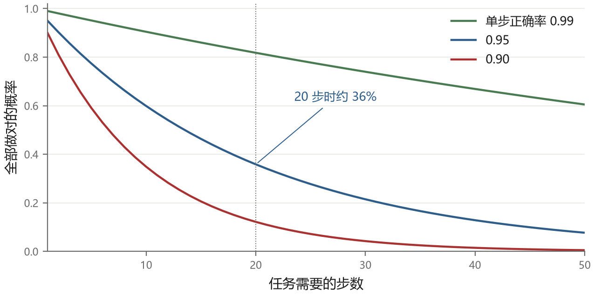
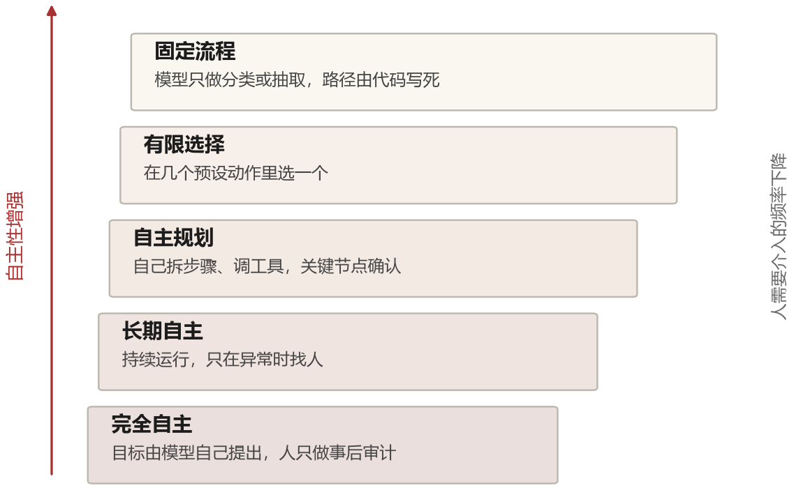
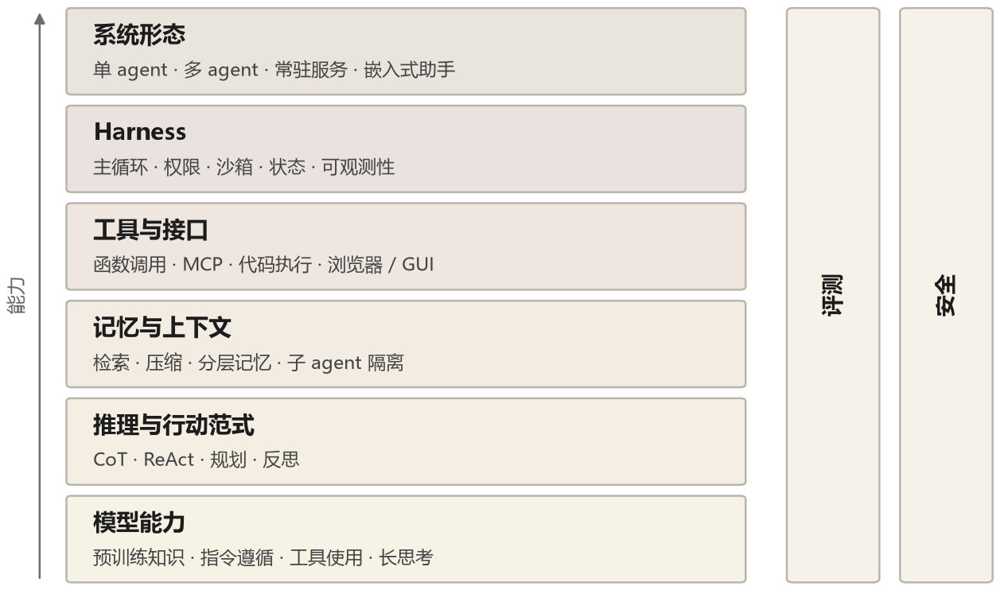

# 第 1 章 预测下一个词，然后呢

要理解 agent，最好的入口不是先看 agent 有多厉害，而是先看清楚它站在什么基础上。这个基础的起点小得惊人：给定一段文本，猜下一个词是什么。整座大厦都建在这个动作上，包括那些能连续工作几个小时、会自己写代码调试的智能体。

这一章要回答一个问题：从“猜下一个词”到“把一件事做完”，中间隔着什么。

## 1.1 一个几乎无害的目标

语言模型的训练目标可以写得很简单。给定一个由词（更准确说是 token）组成的序列 $x_1, x_2, \ldots, x_T$，模型要学会的是这个序列出现的概率：

$$P(x_1, x_2, \ldots, x_T) = \prod_{t=1}^{T} P(x_t \mid x_1, \ldots, x_{t-1})$$

把它拆成连乘，是因为每一步都只看前文。模型读入前 $t-1$ 个 token，输出一个覆盖整个词表的概率分布，然后用真实的下一个 token 去校正它。训练的损失就是真实 token 在预测分布里的负对数似然。整个过程没有别的监督信号，没有人告诉它哪句话是真的、哪句话有用、哪句话能解决问题，只有“这个词后面跟着那个词”。

这里有个词要先说清楚：**参数**。模型内部是几百上千亿个数字（GPT-3 是 1750 亿个），它们按固定的方式连成一张网。输入一段文本，这些数字一层层做加权求和，最后输出“下一个词是各个候选的概率”。训练做的事，就是反复拿真实文本去对答案，把答错的那些连接上的数字往正确方向挪一点。挪了几万亿次之后，这张网就“记住”了语言里的规律。所谓“模型有多大”，说的就是这些数字有多少个；“训练一个模型”，说的就是把这堆数字从随机值调到有用值。

这个目标看起来和“做事”毫无关系。但它在规模足够大的时候，会逼出一些别的东西。要准确预测“1943 年库尔斯克会战的结果是____”后面的内容，模型必须在参数里存下一些历史知识；要预测一段 Python 代码里 `for` 循环之后该写什么，它必须理解缩进和语法；要预测一段侦探小说里凶手的名字，它需要跟踪前文的线索。2020 年 GPT-3 的论文把这个现象总结为“few-shot learning”：不用改参数，只在提示里给几个例子，模型就能照着做新的任务。

有一句被引用得很多的话：预测得越准，说明压缩得越好，而好的压缩意味着抓住了数据里的规律。这个说法有它的道理，但也很容易被过度引申。它解释的是模型为什么会有知识，不解释模型为什么会有意图。一个把全世界文本压缩得很好的模型，本质上是一个极其擅长“接着往下写”的系统。接着往下写和把事情做完，中间还有一段路。

## 1.2 三样本事，和它们各自的缺口

把模型能做的事拆开看，大概是三样东西。

第一样是**知识**。参数里存着训练数据里的世界。它知道巴黎在法国，知道 HTTP 404 是什么意思，知道大部分编程语言里数组下标从 0 开始。这种知识很宽，但有三个毛病：有截止日期，训练数据之后的事情它不知道；会记错，尤其是那些细节丰富但不常见的事实；而且它不知道自己不知道——模型对错误答案和正确答案给出的语气往往一模一样。

第二样是**推理**。这件事比想象的微妙。一个 Transformer 在做一次前向传播时，层数是固定的，计算深度也就固定了。它能做的事情有上限。但如果你让它把中间步骤写出来，相当于给了它更多次前向传播的机会，每一步都能用到前面写下的结果。这就是思维链能提升复杂推理能力的根本原因，第三章会详细讲。推理能力的缺口在于它不稳定：同一个问题问十遍，可能对七遍错三遍，而模型自己没法判断哪一遍是对的。

第三样是**行动**。这是最容易被忽略的一项。模型本身不能改变任何东西。它输出的是 token，不是文件、不是网页上的点击、不是数据库里的记录。你看到它说“我已经帮你订好了明天上午的机票”，实际上什么都没有发生。这句话只是一个概率很高的续写——因为在训练数据里，客服确认订单时就是这么说话的。

三样本事拼在一起，缺口就很清楚了：**模型有知识，但知识会过时且不可自动验证；模型能推理，但推理不稳定、缺少外部反馈；模型能说出行动的结果，但不能仅凭文本真的行动。** 随后几年的许多工作，几乎都能对应到补这三个缺口中的某一个。

## 1.3 多走一步，错一遍

先看一个最朴素的失败。早期模型直接回答“137 乘以 248 等于多少”时，答错并不罕见。不能简单归因于“它完全不知道乘法规则”：即使训练语料里有很多乘法，直接报出最终答案仍要求它在生成过程中可靠完成多步部分积、进位和相加，而中间结果没有外置草稿区。第三章会把这个机制拆开。

单步的失败还能忍受，多步的失败会放大。为了看清数量级，先做一个简化假设：每一步相互独立、正确率都是 95%，而且任务必须二十步全部正确才算成功。那么整体成功率是 $0.95^{20} \approx 0.36$。真实任务中的错误可能相关，也可能被后续检查纠正，所以这不是普遍预测公式，只是说明“没有纠错时，误差会累积”。

图 1-1 里有三条曲线，分别对应单步正确率 0.99、0.95、0.90。横轴是任务需要的步数。图上能看到，0.99 那条在 50 步时还有六成，0.90 那条到 20 步就只剩一成。真实的 agent 任务动辄几十步：打开网页、找到搜索框、输入关键词、翻页、点进详情、复制信息、回到原页面、填表、提交。每一步都可能出错，而且错误会带着往下走——搜索词打错了，后面看到的全是无关内容，模型却不知道自己在错误的轨道上。

这就是为什么“给模型更多步骤”这件事本身不解决问题。步数越多，误差累积越严重。真正需要的是让每一步都能被检验，让错误在发生时就被发现，而不是等到最后才暴露。

## 1.4 一次具体的失败

一个常见的教学实验是：只给模型航空公司的查询页面说明，让它“帮我订一张下周三北京到上海的机票”，却不提供查询、下单或支付工具。

模型仍可能给出非常像样的回答：先确认日期，列出三个航班选项，询问舱位偏好，最后说“已为您预订，订单号 CA1234”。问题在于，这个订单号只能是它编的。它没有访问订票系统，也没有提交表单，只是生成了“订票成功后客服会说的话”。

这个例子说明“幻觉”在 agent 语境下有一种特殊形态。在问答里，幻觉是一句错话；在行动场景里，幻觉可能是一个虚假的状态变更，并污染后续决策。如果模型相信自己已经订好票，就不会再去查证；如果它相信自己改好了代码，就可能不再跑测试。错误一旦被写进上下文，就会被当成事实反复引用。

从这个失败里能抽出三个具体的设计要求：

- **反馈**。模型需要知道自己的动作产生了什么后果，而不是自己想象出什么后果。
- **状态**。真实世界的状态必须存在模型之外，能被查询，而不是靠对话历史推断。
- **后果**。有些动作不可逆，需要有机制在动作发生前检查。

一个只会输出文本的模型，这三样都没有。它有的只是上下文里的一段文字，而这段文字是它自己写的。

## 1.5 “智能体”这个词

agent 这个词比大模型老得多。控制论里，它指能感知环境并对环境施加影响以达成目标的系统；强化学习里，它是那个在状态 $s_t$ 下选择动作 $a_t$、收到奖励 $r_t$、转移到新状态 $s_{t+1}$ 的学习者；经济学里，它是按自己的效用函数做决策的参与者。这些定义共享一个骨架：**感知、决策、行动、反馈**。

大模型加进这个骨架之后，定义需要一点调整。比较实用的说法是：以大语言模型为决策核心，能够感知环境、调用工具采取行动、并根据行动结果调整后续行为的系统。这个说法里有两个词值得强调。

一个是“决策核心”。模型不一定是唯一做决策的东西，harness、规则引擎、用户审批都可以参与决策，但主要的判断由模型做出。另一个是“根据结果调整”，这是 agent 和“一次性调用”的分界线。如果一段程序只是把用户的输入交给模型，把输出打印出来，那它是个更好的命令行工具，不是 agent。

和强化学习里的 agent 相比，大模型 agent 有三处明显不同。动作空间不限于预先枚举的摇杆方向，可以是结构化的工具调用或代码；策略主要来自预训练和后训练，而不是在每个环境里从零试错；在基于提示运行的系统里，反馈常常是“测试失败”这样的文字观察，模型据此调整下一步。要注意，文字观察不都等于强化学习里的数值奖励；第十四章真正训练模型时，仍要明确奖励怎样计算。

还有一个概念需要先摆出来：自主性不是开关，是一条连续的谱。

图 1-2 从下往上是五档。最下面是固定流程，模型只做分类或抽取，走哪条路由是代码写死的。往上是模型在几个预设动作里选一个，比如决定要不要检索。再往上是模型自己规划步骤、自己调工具，人只在关键节点确认。再往上是模型长时间运行、自己设定子目标，人只在异常时介入。最上面是完全自主，连目标都由模型自己提出——这一档目前还停留在研究和演示阶段。

绝大多数被称为 agent 的产品，落在中间两档。这个谱系很重要，因为后面每一章讨论的技术，服务的是不同档位的需求：中档需要好的工具接口和上下文管理，高档需要好的记忆、权限和评测。分不清自己在哪一档，就很容易用高档的复杂度去做低档的事。

### 脚本、工作流、agent 的分界

“agent”这个词被用得很松，几乎什么自动化都往上面套。用报销这件事能看出三种做法的真正区别。

**脚本**：金额小于 500 自动通过，否则转人工。规则是人写死的，模型完全不参与。遇到规则没覆盖的情况——比如发票是外币、或者一张单子里混了两种费用——它就卡住，只能等人。

**工作流**：把流程画成一张图：识别发票 → 校验抬头 → 查重 → 审批 → 打款。每一步要么调一个接口，要么调一次模型做单点判断（这张发票是不是餐饮类）。路径是人定的，模型只在格子里填内容。

**agent**：只给目标和一组工具（读邮件、查发票库、调审批接口、发消息），由模型决定先做什么、遇到异常怎么办、什么时候该问人。同样是外币发票，它会先去查汇率、再判断要不要走特批，这些步骤没有人预先写。

三者的主要分界不在“用不用模型”，而在**谁在多大程度上决定下一步**：脚本走固定规则，工作流走预先编排的路径，agent 把更多现场决策交给模型。真实产品常常是混合体，例如固定审批流程里嵌一个能自主查资料的子任务，不必硬贴唯一标签。

这个区别也解释了为什么高自主性 agent 更难测。规则和工作流的分支显式可见，较容易系统测试；agent 的路径在运行时生成，需要在大量真实任务上采样，观察它在哪些岔口走错。

## 1.6 为什么是这几年

回头看，agent 这个概念在 2020 年之前就有人提，为什么直到 2022 年底才真正跑起来。我认为是四个条件在同一时间凑齐了。

**模型愿意听指令了。** 原始的 GPT-3 是个续写器，你给它“翻译成英文：今天天气不错”，它可能接着写“明天天气也不错”。2022 年的 InstructGPT 把“续写”调整成了“回应请求”。

InstructGPT 的常见训练流程可以概括为三步。第一步是**监督微调**：让人写示范回答，模型学习“收到请求后应该怎样回应”。第二步是**训练奖励模型**：让人比较同一问题的多个回答，用这些偏好数据训练一个打分模型。第三步是**强化学习优化**：语言模型生成回答，奖励模型给分，再调整参数，使高分回答更可能出现。后两步通常是狭义 RLHF（基于人类反馈的强化学习）的核心，三步合起来属于更完整的指令对齐流程。

强化学习阶段不需要人为每道题写唯一标准答案，但需要比较、奖励和大量计算。这类训练显著提高了指令遵循和格式稳定性，却仍不能保证输出永远可解析。后来的工具调用能力还依赖专门的数据、训练与接口约束。

**上下文变长了。** 早期的模型只有 2048 个 token 的窗口，装不下几个工具的说明，更装不下多轮的工具返回结果。窗口从 4K 到 32K 到 128K 再到百万级，让系统能携带更多代码、文档和工具结果。但“装得下”不等于“用得好”，第八章仍会讨论长上下文的注意力和成本。

**代码能跑了。** 模型的输出可以变成真正执行的代码，代码又能返回真实的结果。这一步让“反馈”从一句人类评价变成了一个确定的、可编程的信号。第九章会讲这条路线走得多远。

**成本降下来了。** 一个需要几十次调用的任务，在 2020 年是奢侈品，在 2024 年是日常开销。价格下降把“让模型多试几次”从研究手段变成了工程手段。

这四个条件里，第一个最容易被低估。很多人以为 agent 的关键是让模型更聪明，其实早期的关键恰恰是让模型“守规矩”——输出可解析、格式稳定、该停的时候停。

## 1.7 一张地图

把这本书要讲的东西按层次摆开，大致是这样：

最底下是模型本身：预训练得到的知识与推理能力，以及后训练得到的指令遵循和工具调用能力。这一层决定了 agent 的能力上限，第十四章会讲怎么把 agent 行为训练进模型。

往上一层是**推理与行动范式**，也就是第三章到第六章的内容：怎么让模型把思考写出来，怎么把思考和工具调用交织在一起，怎么规划和反思。这是 2022 到 2023 年最热闹的部分，现在已经成为常识，但常识往往最值得重新想一遍。

再往上是**记忆与上下文**，第七、第八章。模型每一次调用都是无状态的，它能“记住”的东西只有上下文窗口里的 token。怎么在有限的窗口里放进最有用的信息，怎么把窗口外的信息找回来，这两件事决定了一个 agent 能不能做长任务。

再往上是**工具与接口**，第五、第九、第十章：文件系统、命令行、浏览器、图形界面、以及把工具暴露给模型的标准协议。

再往上是 **harness**，第十一章。这个词在 2025 年之后变得非常重要，它指的是模型之外的那一整套系统：主循环、工具执行、权限、沙箱、可观测性、错误恢复。同样的模型，harness 不同，任务成功率和成本可能产生显著差异，必须通过同一批任务的对照实验来量化。

最上面是**系统形态**：单个 agent、多 agent 协作、常驻的个人助手、嵌入到 IDE 或浏览器里的助手。第十二、十三章讲这些形态，以及它们各自带来的新问题。

地图的右侧贯穿始终的是两件横向的事情：**评测**和**安全**。它们不是某一层的一部分，而是每一层都要面对的约束。第十五、十六章会专门讲，但在前面的章节里也会不断出现。

现在可以进正题了。下一章我们把 agent 拆到最小，看看一个能跑起来的循环到底需要哪几个零件，然后亲手写一个六十行的版本——它很笨，但结构完整，后面所有的复杂性都是在这个结构上加东西。
