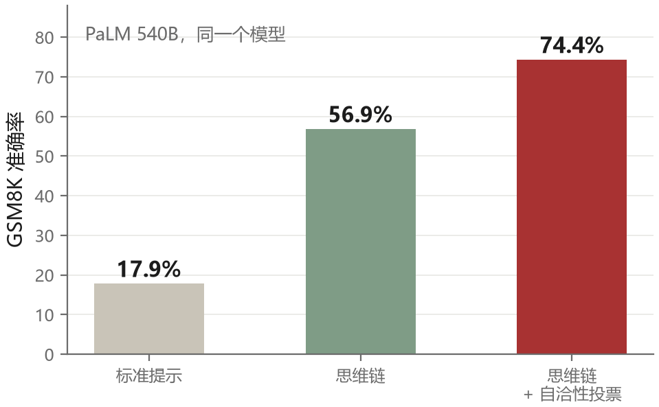
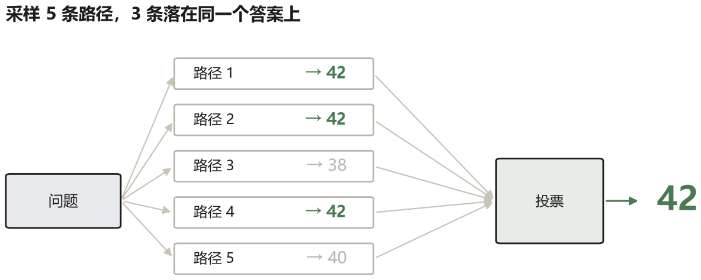
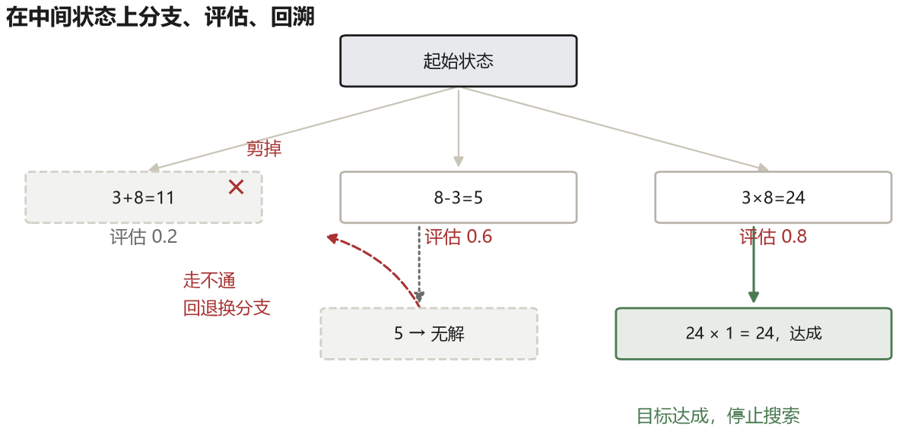

# 第 3 章 让它先想再说：思维链及其家族

前两章留下了一个问题：模型有能力，但能力不稳定，尤其在需要连续多步推理的任务上。这一章讲 2022 年之后出现的第一批系统性解法。它们都不改变模型参数，只在输入和输出的组织方式上做文章。听起来像是小打小闹，但其中一些技巧把某些基准的准确率从不到两成提到了七成以上，也正是这批工作让人们意识到：模型的能力没有被完全释放出来，释放它的方式可能藏在提示里。

## 3.1 一次前向传播能算多深

先把任务说清楚：我们要算 $137\times248$，答案是 $33976$。心算时，大多数人不会凭空看见这个结果，而会拆成几个部分积，再把它们相加。问题在于，语言模型接到题目后，默认是在逐 token 生成文本，并没有人替它准备一张自动保存中间结果的草稿纸。

先看它内部的一步计算。输入 token 变成向量后，会依次经过若干层 Transformer。每层都会更新一次这个向量；到最后一层，模型才据此计算下一个 token 的概率。整趟过程叫一次**前向传播**：信息从输入一路传到输出，不包括根据误差反过来修改参数的训练步骤。

假设某个模型有 96 层，那么预测**一个**输出 token 时，表示会经过 96 次层级更新。层数在生成期间是固定的，不会因为这道题更难，就临时变成 300 层。这里的“96 次”不是“整个答案总共只计算 96 次”：模型每继续生成一个 token，还会进行下一次前向传播。准确的说法是，**单个生成步骤的串行计算深度固定，连续生成多个 token 则提供更多串行步骤**。

这和乘法有什么关系？如果要求模型不展示任何过程、立刻开始报最终答案，第一个答案 token 必须在当前上下文里只有题目的情况下产生。模型可能在内部形成某些中间表示，但层数和单次计算量都有上限；它没有一个保证正确、可以无限续用的外部草稿区。实际的分词器还可能把多位数字拆成多个 token，后续 token 能利用前面已经生成的数字，但这仍不等于它显式完成了每个部分积和对位相加。

因此，“直接给答案”并不是逻辑上绝对算不出，而是把多步计算压进了很难保证可靠的生成过程里。数字位数增加、进位增多时，出错机会也随之增加。这正是本章要处理的问题：任务需要的中间状态，没有地方可靠地存放。

### 把草稿写出来，计算就变了

现在还是同一道题，但允许模型把中间结果写进上下文：

```text
137 × 248 = 137 × (200 + 40 + 8)

137 × 200 = 27400
137 × 40   = 5480
137 × 8    = 1096

27400 + 5480 = 32880
32880 + 1096 = 33976
```

第一行写完 `27400` 后，它就成了后续生成可以读取的文本。模型不必在内部一直保住这个数；计算 `32880 + 1096` 时，前面的结果仍在上下文里。每写一个中间步骤，都增加了新的前向传播，也把中间状态外置成了可见文本。

所以，思维链的关键不是“写得像人在想”，而是两件事：

1. **增加串行计算步数**：不用在一次生成步骤里完成所有工作。
2. **显式保存中间状态**：下一步能读取上一步已经写下的结果。

模型的层数并没有变，权重也没有变；改变的是任务被执行的方式。工程上常把这块文本工作区叫**草稿区**（scratchpad）。它不一定展示给最终用户，也不必然等于模型真实、完整的内部推理过程；这里只把它当作承载中间结果的文本区域。

### 这为什么还不是“保证正确”

草稿区解决的是计算空间，不解决所有错误。`137 × 40` 仍可能算错，前一行错了，后面也可能照着错；写出一篇流畅的“推理”更不等于推理有效。要进一步提高可靠性，可以换一种分解做检查，例如用 $137\times250-137\times2$ 复核，或者交给计算器验证。

代价也很直接：中间步骤越多，输出 token、延迟和费用越高。查一个已知事实、改一个标点，没有必要写长推理；多步计算、规划和排错才更可能受益。后来出现的推理模型，会把“在回答前生成较多中间计算”训练成默认行为；但第三章关注的不是某一种产品开关，而是这个更一般的机制。

一句话总结：**思维链不是把模型变深了，而是让它用更多轮计算，并把中间结果留在后续计算能读到的地方。**

## 3.2 思维链

2022 年 1 月，Wei 等人把这种想法做成了实验。做法非常朴素：在 few-shot 例子里，不只给问题和答案，还把解题的中间步骤写出来。模型看到几个这样的例子，就会模仿这个格式，在自己的回答里也写出步骤。

在 GSM8K 这个小学数学应用题数据集上，PaLM 540B 用标准提示（直接给答案）的准确率是 17.9%，加上思维链之后是 56.9%。同一个模型，同样的参数，三倍多的差距。



这个结果当时很震动，因为它说明：模型参数里存在一些未被“直接给答案”充分利用的能力，改变输出组织方式可以在特定任务上释放其中一部分。它不是“所有推理都早已会了”的证明；如果模型缺少知识或某类操作能力，光把格式改长也没有用。

同年晚些时候，Kojima 等人发现甚至不需要给例子。只要在问题后面加一句“Let's think step by step”，模型就会自己展开推理。这个技巧被称为 zero-shot CoT；论文在其模型和 MultiArith 实验设置中，报告准确率从 17.7% 提升到 78.7%。这个大幅数字依赖具体实验，不应当成任意模型的固定收益。

为什么一句话就有效，这件事至今没有完全统一的解释。一种说法是这句指令把模型的输出分布从“答案模式”切换到了“解题模式”，而后者在预训练语料里对应着更可靠的计算过程。另一种说法是它起到了“激活”作用，让模型进入某个在训练中出现过的、与逐步推理相关的子空间。无论哪种解释，实践上的结论是一样的：**输出格式会影响模型走哪条计算路径，而不同的路径可靠性差别很大。**

### 同一道题的三种问法

抽象地讲“写出中间步骤”不如看一遍。题目：小明有 5 盒铅笔，每盒 12 支，送出 8 支，还剩多少？

**直接问**：`问：小明有 5 盒铅笔，每盒 12 支，送出 8 支，还剩多少？答：` 模型接着写 `52`。答对了，你不知道它是乘对了还是碰巧；答成 `50` 时，你也不知道错在“5×12 算成了 58”还是“减错了”。

**思维链**：提示里给一个示例，把过程写出来：

```text
问：小明有 3 盒铅笔，每盒 10 支，送出 5 支，还剩多少？
答：3 盒共 3×10=30 支，送出 5 支，剩 30-5=25 支。答案是 25。

问：小明有 5 盒铅笔，每盒 12 支，送出 8 支，还剩多少？
答：
```

模型接着写 `5 盒共 5×12=60 支，送出 8 支，60-8=52 支。答案是 52。` 现在每一步都是可检查的：乘法对了、减法对了，答案才对。错的时候，你能定位到具体哪一步。

**加自检**：在思维链后面再追一句“把答案代回去验算”。模型可以接着写 `52+8=60，60÷12=5，与题意一致`。如果自检在同一次回答里继续生成，只增加输出长度；如果另开一轮、用独立输入复核，才增加一次完整调用。自检能发现部分抄写和计算错误，但也可能顺着原答案编出错误验算。

三种问法的直接成本依次增加：短输出、较长输出，以及可能额外的一轮复核。是否值得增加自检，取决于错误能否被检查、复核是否独立，以及错误代价有多高；不能只看“步骤越多越高级”。

## 3.3 有效的三个原因

思维链有效，大概有三个叠加的机制。

第一是**计算扩展**。生成更多中间 token，就增加更多串行前向计算；模型不必在一次生成步骤里完成全部工作。这里起作用的不是 token 数量本身，而是这些 token 是否承载了有用的中间状态。

第二是**分解与局部化**。把一个复杂问题拆成一串简单问题，每一步的输入都更短、更聚焦，模型在每一步上犯错的概率更低。这和人类做数学题时的策略一样：你不会一次性口算整个式子，你会一项一项来。

第三是**中间结果成为条件**。写下的中间结果会进入上下文，成为后续推理的条件。如果中间结果错了，后面的推理会基于错误的前提，但至少错误是可见的——这一点对调试非常重要。相比之下，直接给答案的模型如果错了，你完全不知道它错在哪一步。

第三个机制有个反面：中间结果一旦写错，错误会被“固化”。模型倾向于让自己后面的推理与前面写下的内容保持一致，哪怕前面明显算错了。这就是所谓的“自回归陷阱”：它更愿意解释自己已有的结论，而不是推翻它。

## 3.4 多问几遍，然后投票

如果一条推理链可能出错，那么采样多条，看哪条答案出现得最多，是不是就更可靠？这个想法就是自洽性（self-consistency）。

具体做法分三步。**采样**：同一个问题使用合适的非零温度，生成 $k$ 条推理路径；温度太低路径容易雷同，太高则可能跑题，具体值要随模型调整。论文的一组实验使用 $k=40$。**抽取**：从每条路径末尾提取最终答案，只比较答案，不比较过程。**投票**：按答案分组计数，取票数最多者；平票需要预先约定处理规则，也可以按实现需要保留路径概率等辅助信息。

投票的对象是最终答案，不是推理过程。这一点值得强调：如果按过程投票，几乎没有两条路径会完全一样，投票就没意义了。



在 GSM8K 的相应论文设置中，PaLM 540B 用 40 条采样路径投票，准确率从 56.9% 提高到 74.4%。代价是要生成并处理几十条路径，输入输出 token 和延迟都会增加；它不是免费提升，也不保证在别的任务上有同样幅度。

这个方法的隐含假设是：**错误的路径是分散的，正确的路径是收敛的。** 一道题如果有多种错法，每种错法各自出现的概率都不高；而正确解法通常只有一两种，会被反复采样到。假设在多数情况下成立，投票就有效。

它失效的情况也值得记住。如果题目本身有歧义，或者模型的错误是系统性的（比如它总是把“每个”理解成“总共”），那么错误答案会一致地出现，投票只会让你更自信地错。所以自洽性缓解的是“随机错误”，对“系统性错误”无能为力。这个区分在后面讲评测和反思时会反复出现：一个方法能不能解决问题，取决于它针对的是哪一类错误。

## 3.5 从链到树

思维链是一条路走到底。如果第一步就走错了，后面全废。而且模型没有回头的机会，它只能顺着已经写下的内容往下编。

2023 年 5 月，Yao 等人提出思维树（Tree of Thoughts，ToT），把这个过程改造成搜索。

### 四个部件

ToT 把“解一道题”变成在状态空间里搜索。要跑起来，得先定义四样东西。

**状态**是一步一步走到的中间结果。24 点游戏里，状态就是“还剩下哪几个数字”，比如初始是 `[4, 9, 10, 13]`，用 13 减 9 之后变成 `[4, 4, 10]`。

**思维生成器**负责从当前状态长出若干个子状态。ToT 给了两种策略：一种是“采样”，用较高的温度让模型独立生成 $k$ 个候选（适合有多种思路的开放问题）；另一种是“提议”，让模型一次性列出几个不重复的走法（适合 24 点这种走法可枚举的题）。24 点游戏里用的是后者，每个状态展开 5 个候选。

**评估器**给每个候选状态打分。论文里也有两种：让模型对状态做判断，输出 `sure / likely / impossible` 三档；或者让模型在多个状态之间投票，选出最有希望的一个。24 点游戏可以用规则直接判：剩下的数字能不能凑出 24。

**搜索策略**决定怎么在树上走。论文在 24 点上使用带宽度限制的逐层搜索：每层只保留分数最高的 $b$ 个状态，其余剪掉，这也叫束搜索（beam search）的思路。深度优先搜索（DFS）则沿一个分支深入，达到限制或失败后回到分叉点换路。论文的 24 点设置使用宽度 $b=5$、深度 3。



### 一次完整的搜索

把 24 点游戏跑一遍，过程大致是这样：

```text
状态 [4, 9, 10, 13]
  候选 1: 10 - 4 = 6    → [6, 9, 13]    评估：有希望
  候选 2: 13 - 10 = 3   → [3, 4, 9]     评估：有希望
  候选 3: 9 + 13 = 22   → [4, 10, 22]   评估：可能
  候选 4: 4 + 9 = 13    → [10, 13, 13]  评估：不行
  候选 5: 10 + 4 = 14   → [9, 13, 14]   评估：不行
保留得分最高的三个，其余剪掉

沿候选 3 展开：22 - 10 = 12 → [4, 12] → 12×4=48、12+4=16，都不通
               22 + 10 = 32 → [4, 32] → 也不通，这个分支判死，回退

沿候选 1 展开：13 - 9 = 4 → [4, 6] → 4 × 6 = 24，达成，停止
```

GPT-4 用标准思维链解这个游戏的正确率是 4%，用 ToT 是 74%。模型的知识没变，变的是它被允许“尝试—评估—放弃”的次数。

### 代价与边界

ToT 把推理从“生成”变成了“搜索”，代价是模型调用迅速增加：每一层既要生成候选，又要评估候选。若每个状态展开 $b$ 个分支且不剪枝，深度为 $d$ 时节点数会按 $b^d$ 增长；束搜索正是用固定保留宽度压住这个爆炸。二十四点只有三层，换成二十步任务就必须更谨慎地选择在哪里分支。

所以后来的系统很少原样使用 ToT，而是把它拆开用在关键节点上：计划阶段展开几个备选方案、调试阶段保留两条修复路线、写代码时同时生成两个实现再选一个。真正每一步都做树搜索的，只在少数离线任务里出现。

还有一个更根本的限制：评估器的质量决定了搜索的上限。如果评估函数经常把好状态判死、把坏状态判活，搜索越努力，错得越远。这就是为什么在有明确判据的领域（游戏、数学、代码测试）ToT 效果显著，而在开放式写作、商业判断这类没有快速验证的领域，它很难用起来。

## 3.6 图与程序

ToT 的搜索结构是树，每个节点只有一个父节点。但有些问题的中间结果会被多个分支复用，或者需要把几个子结果合并。2023 年 8 月的思维图（Graph of Thoughts，GoT）把结构推广成有向图，允许合并、聚合、复用。在排序任务上，他们报告用 GoT 得到的质量比 ToT 高 62%，同时成本降低。

另一条路是干脆不写自然语言，写程序。程序化思考（Program of Thoughts，PoT）让模型输出一段代码，由解释器执行得到结果。好处很直接：算术和符号操作交给 Python，模型主要负责把问题翻译成程序。翻译仍可能出错，代码逻辑也可能错，但解释器会确定地执行代码，不会像文本生成那样在每一位进位上重新采样。使用浮点数时还要考虑精度，不能笼统说“Python 不会算错”。

这条思路的影响比它本身的引用数更大。后来的代码行动（第九章）本质上就是把“输出程序”从推理技巧升级成了行动方式。

## 3.7 思维链不可信的那一面

到这里，思维链看起来是个免费午餐。但它有个问题，在 2023 年之后被反复讨论：**写出来的推理，未必是模型真正用的推理。**

有几个实验能说明这一点。把思维链里的关键步骤改掉，或者插入一段明显错误的推理，模型的最终答案经常不变。反过来，在提示里加入带有偏见的暗示（比如“我觉得答案是 A”），模型的答案会偏向 A，但它写出来的推理链依然看起来合情合理，只是悄悄地把论据调整成了支持 A 的样子。这被称为“不忠实推理”（unfaithful reasoning）。

这个发现对 agent 很重要。如果你用模型的思考文本来做监控、做审计、做错误归因，你监控到的可能只是一段事后编造的解释。它有用，但不等于内部状态。

还有一个实践中的反例：思维链不是越长越好。对一些简单任务，冗长推理反而增加了出错机会。模型可能丢失最初目标，或引入不必要的前提。推理训练可以让思考长度更适应任务难度，但不保证每次都恰到好处，也不意味着所有内部思考都适合原样展示。

## 3.8 从提示到训练

2024 年下半年开始，这个领域的重心发生了一次转移。

此前所有方法都建立在同一个假设上：模型本身没变，我们只是想办法把它的潜力挤出来。但这个假设有一个天花板——如果模型内部确实缺少某种能力，再怎么提示也挤不出来。于是有了另一条路：把“一步一步想”这件事直接训练进模型。

OpenAI 的 o1 系列、DeepSeek 的 R1、以及后来的多个推理模型，都是用强化学习训练模型生成长长的思考过程，然后用结果对不对来决定这次思考该不该被强化。它们在一些数学和编程竞赛基准上的表现远超此前的模型，而且思考长度会随着问题难度自动变化。

好的一面是，模型自身的规划和推理能力变强了，一些原本需要复杂提示和多次采样的任务，现在可以用更简单的外部流程完成。不那么好的一面是，推理模型可能在行动前生成很长的内部思考，而 agent 需要的是“想一点、做一点、看结果、再想”。在需要频繁与环境交互的任务上，过长思考可能又慢又贵。第十四章会讲怎么用强化学习训练这种“边做边想”的能力。

所以在今天的技术栈里，思维链这一族技术并没有消失，它分成了两半：一半被吸收进模型的训练过程，成了默认能力；另一半演化成了 agent 循环里的“思考”字段，也就是下一章要讲的 ReAct 里的那个 Thought。
