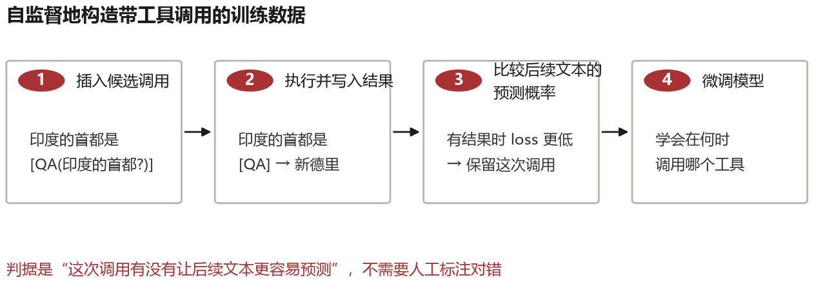
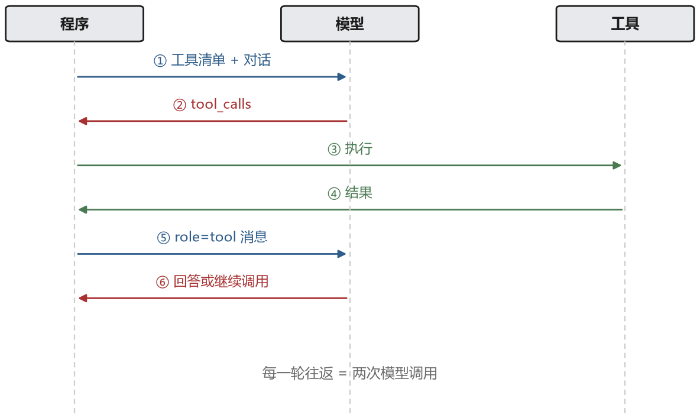
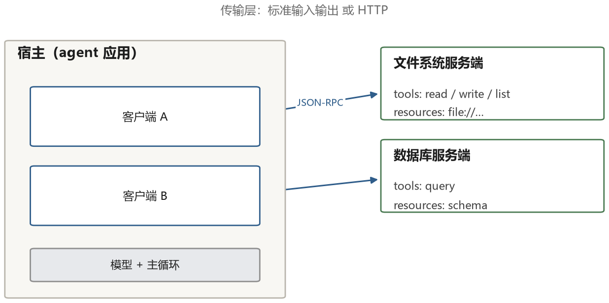

# 第 5 章 工具：从提示技巧到模型能力

ReAct 规定了“模型可以调用工具”这个游戏规则，但没有解决一个更基础的问题：模型怎么知道有哪些工具、怎么正确地把参数填对、怎么在几十个工具里挑出该用的那个。这些问题是工具层的核心，也是这一章要讲的。

如果把 2022 年到 2025 年的变化压缩成一句话，大概是：**工具调用从一种需要精心设计的提示技巧，变成了模型自带的一种能力，然后又变成了一个跨厂商的协议。** 这三步每一步都改变了工程实践的样子。

## 5.1 最早的做法：教模型“用”工具

早期通用模型并没有今天这样统一的原生工具调用接口。开发者只能在提示里写“你可以使用以下工具：搜索(关键词)、计算器(表达式)”，再用示例和解析器约束输出。

ReAct 是这种做法的代表，它用 few-shot 例子把格式教给模型。WebGPT 则专门训练模型操作一个浏览器界面，执行搜索、点击链接、引用网页段落等动作，再用人类偏好数据优化回答。论文在其问答评测中显示，浏览与引用能力可以纳入训练，而不仅是临时写在提示里。

MRKL 系统则从另一个角度提出方案：不要指望一个模型解决所有问题，而是把问题路由到不同的专家模块——计算器、数据库查询、知识库检索，模型只负责决定“这个问题该交给谁”。这个思路今天看很朴素，但它是“工具路由”这个概念的起点。

## 5.2 Toolformer：让模型自己学会何时调用

2023 年 2 月，Meta 的 Toolformer 提出了一个很聪明的训练方法：不为每个调用位置人工标注，而是让模型先提出候选，再用“能否降低后续文本预测损失”自动筛选。

### 调用怎么写进文本里

先要解决表示问题。模型只会生成文本，所以工具调用也必须写成文本。Toolformer 的做法是用一对特殊标记把调用包起来，紧跟着一个箭头，箭头后面是执行结果：

```text
印度的首都是 [QA(印度的首都是哪里?)] → 新德里 ，人口约三千万。
```

这里 `[QA(...)]` 是模型生成的调用请求，`→` 是一个特殊 token，`新德里` 是工具返回的真实结果。整段文字仍然是普通的语言建模序列，模型对它做下一 token 预测时，和预测别的词没有任何区别。这一点是整个方法的关键：**工具调用不是外挂的机制，而是被表示成文本的一部分**，于是“什么时候调用、调用什么”就变成了一个普通的语言建模问题，可以用训练解决。

### 训练数据从哪来

模型一开始并不知道该在哪里插入调用。Toolformer 用自监督的办法把这件事“试”出来，分四步。

**第一步：撒点。** 拿一批普通文本（他们用的是 CCNet 的一个子集），在每一段的每个位置，用 few-shot 提示让模型生成最多 5 个候选调用。提示里给出几个示例，比如“某地的人口是 [QA(某地的人口)] → 1234 万”，模型就照着这个格式，在当前位置写出它认为有用的调用和参数。

**第二步：真执行。** 每个候选调用都真的发给对应工具，拿回结果。这一步很贵，但只做一次，之后的数据可以反复用。

**第三步：用损失筛。** 这是整个方法最核心的判据。对每个位置 $i$，算两个损失：

- $L^-_i$：不加调用时，模型对后面那段文本的负对数似然；
- $L^+_i$：加了调用和结果之后，同一段文本的负对数似然。

如果 $L^-_i - L^+_i \ge \tau$，说明“知道这个结果”让后面的文本变得更容易预测，这次调用保留；否则丢弃。$\tau$ 是个阈值，论文里取 1.0（按 token 平均后的差值）。注意这个判据完全不问调用对不对、结果是不是真理，只问它有没有降低困惑度——所以不需要任何标注。

**第四步：微调。** 把保留下来的片段拼回原文，得到一批“带工具调用”的语料，在 GPT-J 6.7B 上做普通的监督微调。训完之后，模型在看到类似前缀时会自发地写出调用。



### 推理时怎么暂停

训练好的模型输出是一段文本，程序需要在正确的时刻介入。做法很简单：一边解码一边检查，一旦生成了 `→` 这个标记，就停下来，把前面 `[...]` 里的内容解析成工具名和参数，执行工具，把返回值接在箭头后面，再让模型继续往下写。

```text
模型生成：  … 人口密度约为 [Calculator(1.4e9 / 9.6e6)] →
程序介入：  解析出 Calculator(1.4e9 / 9.6e6) → 执行 → 145.8
模型续写：  145.8 人每平方公里，是 …
```

这个“生成—暂停—执行—插入—续写”的循环，和第四章 ReAct 的循环在形式上不同（ReAct 靠提示词和解析器，Toolformer 靠特殊 token 和解码器介入），但思想上是一回事：让模型在需要外部信息时停下来，等真实结果回来再继续。

### 它解决了什么，没解决什么

Toolformer 用 6.7B 的模型在若干任务上超过了 175B 的 GPT-3。差距不在知识量，而在于它学会了在正确的时机调用计算器、问答系统、翻译、日历这四五个工具，并且把结果整合进句子里。

局限也很清楚。第一，调用位置主要从训练语料的候选中筛选，模型学到的不等于通用的多步规划。第二，原始数据构造以插入单次调用为主，不是一个完整的“根据上一步结果自由规划下一步”的 Agent 框架。第三，筛选标准看重预测损失，而损失降低不等于事实正确：工具返回的错误结果也可能让文本变得更像训练语料。

所以它更像“工具增强的语言模型”，而不是 agent。真正把多步、动态决策做出来的，是后面几节要讲的函数调用和 ReAct 式循环。


## 5.3 函数调用：把格式固化进模型

2023 年 6 月，OpenAI 在 API 里加了 function calling。这个功能看起来只是把 ReAct 的文本格式换成了 JSON，但它的影响比这大得多。

变化在于：模型不再需要从提示里“学”格式，而是在后训练阶段就被训练成能输出结构化的调用请求。你传给它一份工具清单（JSON Schema），它返回一个 `tool_calls` 数组，里面是工具名和参数。程序执行完，把结果以 `tool` 角色的消息发回去。



这个改变解决了 ReAct 时代最头疼的几个问题。

**解析变可靠了。** 不再需要正则表达式去猜模型想干什么，返回的就是结构化数据。虽然偶尔还是会出错（参数类型不对、必填字段缺失），但错误是机器可检的，可以立刻返回一个明确的错误信息。

**可以并行调用。** 模型可以在一次回复里请求多个工具，程序并发执行，一次性把结果都给它。对于“同时查三个城市的天气”这种任务，省掉了两轮往返。

**工具描述有了标准位置。** 不需要在系统提示里用自然语言罗列工具，而是通过一个专门的字段传入。这让工具的定义可以被程序生成、被版本管理、被自动校验。

到了 2024 年，结构化输出（structured outputs）进一步把这件事推到极致：你可以给模型一个 JSON Schema，让它保证输出符合这个 schema。

常见的约束解码可以用有限状态机或语法约束来理解：状态表示“当前这段 JSON 写到哪里”，解码器屏蔽会让后续无法满足语法的候选 token。下面用简化状态机说明原理，不代表所有模型服务端的内部实现完全相同。

举个最小的例子。假设 schema 只要求 `city` 字符串和 `days` 整数两个必填字段，且不允许多余字段。模型写完 `{"city": "北京", "days": ` 后，数字和负号等可以开始整数的 token 才合法，字符串引号会被屏蔽。写完 `3` 后，忽略空白，合法的收尾主要是 `}`。这里展示的是简化规则；真实实现还要处理字符串转义、数组、可选字段和平台支持的 Schema 子集。

代价主要有三类：Schema 编译、校验和更复杂的生成会带来开销；复杂嵌套和关键字的支持因平台而异；约束只能保证结构满足规则，不保证内容真实。一个符合 schema 的 `{"city": "火星"}` 依然可能是错误答案。

## 5.4 结构化输出：让结果能被程序接住

函数调用解决的是“下一步要执行什么”。还有一大类任务并不执行动作，只要求模型把答案整理成程序能读取的形状。例如，从一句话里抽取报销记录：

> 2026 年 10 月 25 日在星河书店花 86.50 元买书，发票已收。

如果模型只回答“买了一本书，花了 86.5 元”，人能看懂，程序却很难稳定地保存。我们更希望得到固定的字段：商家、金额、币种、日期、类别、是否有发票。**结构化输出**就是围绕这个目标的一组方法：模型不只决定“说什么”，还要遵守“按什么形状说”。

### JSON：最常见的数据交换格式

这条报销记录可以写成 JSON：

```json
{
  "merchant": "星河书店",
  "amount": 86.5,
  "currency": "CNY",
  "date": "2026-10-25",
  "category": "办公",
  "receipt": true
}
```

JSON 的基本元素只有对象、数组、字符串、数字、布尔值和 `null`。对象用花括号装键值对，数组用方括号装一组值，二者可以嵌套。它容易解析，却不天然知道“金额必须是正数”或“日期不能写成下个月 32 日”。这些约束需要另一份规则来表达。

### JSON Schema：给字段写验收规则

**JSON Schema** 本身也是一份 JSON，用来描述另一份 JSON 应该长什么样。下面的规则要求六个字段全部存在，金额是正数，类别只能从四个值中选择，还不允许多出陌生字段：

```json
{
  "type": "object",
  "properties": {
    "merchant": {"type": "string", "minLength": 1},
    "amount": {"type": "number", "exclusiveMinimum": 0},
    "currency": {"type": "string", "enum": ["CNY", "USD"]},
    "date": {"type": "string", "format": "date"},
    "category": {
      "type": "string",
      "enum": ["办公", "餐饮", "交通", "其他"]
    },
    "receipt": {"type": "boolean"}
  },
  "required": [
    "merchant", "amount", "currency",
    "date", "category", "receipt"
  ],
  "additionalProperties": false
}
```

这里的 `type` 检查数据类型，`required` 列出必填字段，`enum` 限定可选值，`additionalProperties: false` 禁止额外字段。`format: date` 表示日期格式；具体校验器是否严格检查它，要看所用库和配置，业务层仍应再确认日期真实存在、金额没有超过报销上限。

Schema 有两个用途：一是随请求告诉模型“必须生成什么”，二是在程序收到结果后做验收。这两个用途不要混为一谈。

### 提示约束、JSON 模式与 Schema 约束不是一回事

从弱到强，常见做法有四层：

1. **只在提示里写要求**：“请输出 JSON，不要解释。”实现最简单，但模型仍可能多加一段开场白、漏字段或写错类型。
2. **使用 JSON 模式**：如果模型 API 提供这个选项，它通常只保证输出在语法上是合法 JSON，不保证包含你需要的字段。
3. **使用 Schema 约束输出**：请求中同时提供 Schema，平台在生成时限制 token 的选择，让结果符合所支持的结构约束。一些平台把这项能力称为 **Structured Outputs**。不同平台支持的 Schema 子集不同，不能把某一家的文档当成通用标准。
4. **接收后再校验**：程序用 JSON Schema 和业务规则检查。失败时，把具体错误交给模型修正，或转人工处理；超过重试上限就失败，不要无限重试。

一个最小校验流程可以写成：

```python
import json
from datetime import date
from jsonschema import validate


def accept_expense(text, schema):
    data = json.loads(text)          # 先检查是不是合法 JSON
    validate(data, schema)           # 再检查字段、类型和枚举
    date.fromisoformat(data["date"]) # 检查日期是否真实存在
    if data["amount"] > 10000:
        raise ValueError("超过单笔报销上限，需要人工审批")
    return data
```

即使平台承诺 Schema 约束，最后一层的业务检查仍然有意义：**结构合法不等于事实正确，更不等于操作被授权。** 模型完全可能生成一份格式完美、商家却根本不存在的记录。

### 工具调用是一种带行动语义的结构化输出

假设系统已经提供 `create_expense` 工具，模型可能生成这样的请求：

```json
{
  "name": "create_expense",
  "arguments": {
    "merchant": "星河书店",
    "amount": 86.5,
    "currency": "CNY",
    "date": "2026-10-25",
    "category": "办公",
    "receipt": true
  }
}
```

普通 JSON 只是在表达“这是一条数据”；工具调用则表达“请用这些参数执行这个动作”。它通常还要带调用编号，以便执行结果和请求对应。不同 API 的线上字段略有差别，有些会把 `arguments` 编码成 JSON 字符串，但概念不变。

最重要的边界是：**模型只生成调用请求，宿主程序才执行工具。** 程序要检查工具名是否在白名单里、参数是否合法、当前用户是否有权限，再决定是否执行。工具返回结果后，结果作为新的观察写回上下文；并不是模型输出 `name` 的那一刻，报销记录就真的创建了。

### 除了 JSON，还有哪些常见形状

- **XML 或自定义标签**：例如 `<answer>…</answer>`、`<tool_call>…</tool_call>`。边界清楚，适合在流式输出中识别“哪一段结束了”；但必须正确处理转义和嵌套，不能用随手写的正则代替完整解析。
- **固定 Markdown 模板**：例如“## 结论”“## 证据”“## 风险”三个小节。它对人友好，适合报告；严格说更接近半结构化文本，程序解析标题时仍可能遇到格式漂移。
- **代码、SQL 和命令**：它们遵循各自语法，也是结构化输出，而且可以直接执行。第九、十四章会用到这条路线；正因为可执行，沙箱、权限和超时一个都不能少。
- **CSV 等表格文本**：适合批量记录，但逗号、换行和引号的转义很容易出错。字段关系复杂时，JSON 通常更稳妥。

怎么选？人要直接阅读的报告，优先 Markdown；服务之间交换数据，优先 JSON 加 Schema；要宿主执行一个明确动作，使用工具调用；要组合循环、条件和大量计算，考虑代码。格式没有“越先进越好”，只有是否适合下游接收者。

## 5.5 工具本身该怎么设计

有了协议之后，新的问题浮现出来：工具写得好不好，直接影响 agent 能否正确使用。同样一个能力，接口设计不同，成功率和调用成本可能明显不同，需要用任务评测来量化。

这件事在 2024 年之后被反复讨论，Anthropic 甚至专门写了一篇关于“如何为 agent 写工具”的工程博客。把各家的经验合起来，大致有这么几条。

**名字要说明用途，不要说明实现。** `search_documents` 比 `es_query_v2` 好，因为模型只知道名字和描述，不知道你的 Elasticsearch 集群叫什么。

**粒度要匹配任务，而不是匹配 API。** 如果你的后端有五个接口分别取用户信息、订单、地址、优惠券、物流，不要把它们原样暴露给模型。模型会在五个接口之间来回跳，容易漏掉一个。更好的做法是提供一个 `get_order_context(order_id)`，一次返回决策所需的全部信息。

**返回值要紧凑，且信息密度高。** 工具返回的内容会全部进入上下文，占的是模型的注意力预算。一个返回 5000 行 JSON 的接口，会让模型在关键信息里迷路。理想情况下，工具应该返回“模型需要知道的那部分”，并且用自然语言或结构化但精简的形式。

**错误信息要能指导下一步。** `Error: 400` 是无用的。`错误：日期格式必须是 YYYY-MM-DD，你传入的是 2024/1/5` 才能让模型一次改对。这条规则的效果非常明显，很多 agent 的失败可以追溯到模糊的错误信息。

**写操作要有幂等性和确认机制。** 一个“发送邮件”的工具，如果模型重试就会发出两封。要么在接口层做幂等（用 request_id 去重），要么在调用前要求确认。

**工具的数量要控制。** 工具越多，Schema 占用的上下文和相似选项之间的区分成本通常越高；具体从多少个开始下降，要用自己的任务测量。下一节讲分组、检索和折叠三种办法。

### 同一件事，两种写法

抽象讲“工具要写好”没有说服力，直接看两份定义。任务是查订单：给定订单号，返回金额、状态、收件人。

**坏的定义**：

```json
{
  "name": "es_query_v2",
  "description": "Query the ES cluster",
  "parameters": {
    "type": "object",
    "properties": {
      "index": {"type": "string"},
      "dsl":   {"type": "object"},
      "size":  {"type": "integer"}
    }
  }
}
```

问题一眼能看出：名字说的是实现（ES 集群）而不是用途；`dsl` 是自由对象，模型不知道该往里填什么；`index` 要模型知道索引名，而它根本不知道；返回什么也没说。

**好的定义**：

```json
{
  "name": "get_order",
  "description": "按订单号查询订单，返回金额、状态、收件人和下单时间。订单号形如 ORD-2024-000123。",
  "parameters": {
    "type": "object",
    "properties": {
      "order_id": {"type": "string", "description": "订单号，例如 ORD-2024-000123"}
    },
    "required": ["order_id"]
  }
}
```

差别在四处。第一，名字描述用途，模型一看就知道什么时候用。第二，只有一个参数，且给了示例格式，模型不会填错类型。第三，描述里写清了返回什么，模型才能判断“这个结果够不够回答问题”。第四，实现细节（ES、索引名）全藏起来——那些是程序的事，不该让模型操心。

一个检验办法：把工具定义单独拿给不了解你系统的人看，如果他能在三十秒内说出“什么时候该用它、要传什么”，这个定义就合格了。模型面对的处境和他一样：只看得到这段文字。

## 5.6 工具太多怎么办

真实系统里，工具数量很快会增长。一个企业内部助手可能要查文档、工单、监控、日历和物流，还要发消息、建任务。把一百份完整 Schema 全塞进请求，既消耗 token，也让模型在相似工具之间犹豫。

第一种办法是**分组加两段式选择**：先给高层目录，例如“订单、物流、通知”，选定类别后再加载该组工具。这把一次从 100 选 1 变成两次较小的选择，适合分类稳定、职责清楚的系统。代价是多一次决策，而且类别分错时，正确工具根本不会出现在第二轮。

第二种办法是**工具检索**。它和文档检索类似：为每份工具的名称、用途说明和参数摘要建立向量索引；收到任务后，用任务文本查询，取最相关的若干工具，再交给模型选择。

```text
完整工具库：100 个
用户任务：“订单 A1023 一直没收到，查物流并通知我”
        ↓ 用任务文本检索，先取 top_k = 8
候选：get_order、get_shipment、list_shipments、
      send_message、search_order、refund_order……
        ↓ 白名单与权限过滤，保留当前用户可用的工具
本次模型请求只携带这些 Schema
```

`top_k` 是每次召回多少候选。可以从 8 或 10 做实验，而不是当成通用答案：太小容易漏掉正确工具，太大又会带回选择负担。还应始终保留少数核心工具，例如 `ask_user` 和 `finish`，防止检索把它们排掉。

这个例子还暴露了一个典型失败：查询里的“查物流”可能让物流工具排在前面，却漏掉“通知我”所需的消息工具。缓解办法是按**所需能力**分步检索，而不是只对整个长任务检索一次；第一步拿到物流结果后，再根据“向用户发送结果”补充通知工具。若模型发现候选里没有能完成当前步骤的工具，也应允许它请求重新检索，而不是硬选一个相似工具。

评估工具检索不能只看最后的任务成功率。至少还要记录：

- **召回率**：真正需要的工具是否出现在前 k 个候选里；
- **误调用率**：检索没有召回时，系统是否错误地用了别的工具；
- **上下文成本**：候选 Schema 一共占多少 token；
- **端到端成功率**：检索加上模型选择之后，任务是否真的完成。

第三种办法是**折叠成通用动作空间**：不暴露很多细工具，而给一个受控命令行或代码解释器，让模型组合文件、搜索和数据处理能力。这能减少工具定义，却没有消除权限问题；`bash` 把一百个具体风险合并成了一个更大的风险，需要沙箱、命令限制和资源预算。第九章会详细展开。

三种办法可以混用：核心只读工具常驻，领域工具按组检索，批量处理交给代码环境。选择依据不是“哪种最先进”，而是工具数量、任务稳定性、可接受的延迟，以及每一层失败后能否发现。

## 5.7 MCP：工具层的插头标准

到这里，工具调用的技术问题基本解决了，但生态问题冒出来了。每个 agent 框架都要自己实现一遍 GitHub 集成、自己实现一遍数据库查询、自己实现一遍文件系统访问。你在框架 A 里写的工具，换到框架 B 就要重写。

2024 年 11 月，Anthropic 提出了模型上下文协议（Model Context Protocol，MCP），想做的事情就是把这一层标准化。它的结构可以参考任何一个熟悉的协议：客户端和服务端。



先说清三个角色。**宿主**（host）是那个 agent 应用本身，比如一个 IDE 或者一个桌面助手。**客户端**（client）是宿主里负责和某个服务端说话的那一小块代码，一个宿主可以同时有好几个客户端。**服务端**（server）是一个独立的进程，负责真正干活——读文件、查数据库、调 API。三者是嵌套关系：宿主里有客户端，客户端连着服务端。

### 两个进程怎么说话

它们用的是 JSON-RPC。这是一种极简的约定：每条消息是一个 JSON，请求里带三样东西——方法名、参数、以及一个自己编的编号；响应里带同样的编号，好让请求方知道这是对哪一条的回复。

```text
请求：
{
  "jsonrpc": "2.0",
  "id": 7,
  "method": "tools/list",
  "params": {}
}

响应（节选）：
{
  "jsonrpc": "2.0",
  "id": 7,
  "result": {
    "tools": [
      {
        "name": "read_file",
        "description": "读一个文本文件",
        "inputSchema": {
          "type": "object",
          "properties": {"path": {"type": "string"}},
          "required": ["path"]
        }
      }
    ]
  }
}
```

这就是“列一下你有哪些工具”。调用某个工具则长这样：

```text
请求：
{
  "jsonrpc": "2.0",
  "id": 8,
  "method": "tools/call",
  "params": {
    "name": "read_file",
    "arguments": {"path": "notes.md"}
  }
}

响应：
{
  "jsonrpc": "2.0",
  "id": 8,
  "result": {
    "content": [{"type": "text", "text": "# 会议记录..."}]
  }
}
```

`id` 的作用值得停一下：两个进程之间可能同时有好几条消息在路上，靠编号才能把“回复”和“请求”配对。没有它，程序就不知道这个结果是哪个调用的。

传输方式要按本机和远程场景区分。**标准输入输出**（stdio）适合本机：宿主把服务端作为子进程启动，通过 stdin/stdout 交换消息，不需要开放网络端口。**远程 HTTP 传输**（例如 Streamable HTTP）适合团队共享服务，可以跨机器访问，但必须处理认证、授权和网络安全。具体支持的传输与版本，以所用 MCP 规范和 SDK 为准。

MCP 定义了三种原语。**tools** 是模型可以调用的函数，这个最好理解。**resources** 是模型可以读取的数据，比如文件内容、数据库表结构，通常由用户或宿主决定要不要提供给模型。**prompts** 是预置的提示模板，让服务端可以把“怎么用我这个服务”的知识一起打包提供。

为什么要区分 tools 和 resources？关键是由谁控制、用来做什么。工具通常由模型选择并发起动作；资源多由用户或宿主选择后提供给模型；提示模板则通常由用户主动选用。这个区分影响产品交互和权限设计，但不能据此假定“读资源永远低风险、只授权一次就够”。

MCP 发布后，多家模型和开发工具厂商陆续宣布支持。它的意义不在于 JSON-RPC 有多新，而在于把工具和数据能力从某个框架的私有格式，变成可复用的接口。一个服务端可以被多个兼容宿主使用，但传输、认证、能力和权限仍要逐项适配，不能理解为“写完就能在所有产品里无差别运行”。

代价也随之而来。安装来源不明的 MCP 服务端，相当于把陌生人的代码和数据通道接进 agent：它可能读取文件、发起网络请求，或在工具描述里放入诱导指令。第十六章会展开这类供应链与提示注入风险。

## 5.8 工具层的现状

把这几年的变化摆在一起看，能看出一个清晰的走向。

2022 年，工具是提示的一部分，靠 few-shot 教。2023 年，工具是 API 的一个字段，靠后训练教。2024 年，工具是协议的一部分，可以跨应用复用。2025 年之后，“工具”这个概念开始和“环境”融合——不只是给模型几个函数，而是给它一台机器、一个浏览器、一套文件系统，让它自己在里面找路。

这个走向背后有一个判断：**限制 agent 能力的，往往不是模型不知道怎么做，而是接口不够自然。** 让模型填一个五层嵌套的 JSON 参数，不如让它写一行 shell 命令；让它在一个自定义的网页动作 DSL 里点按钮，不如让它像人一样看屏幕、移动鼠标。后面第九章和第十章会分别讲这两条路走出来的结果。
