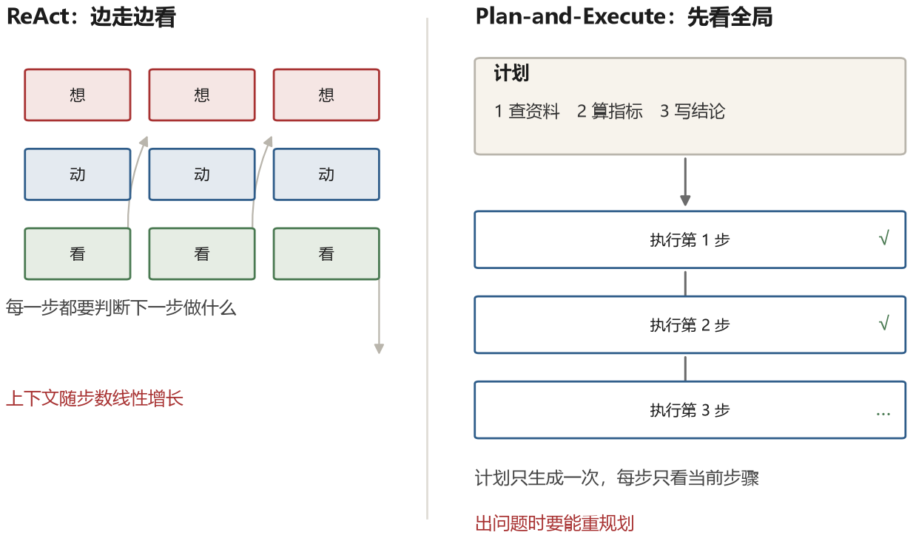
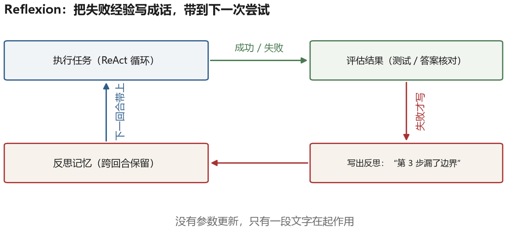
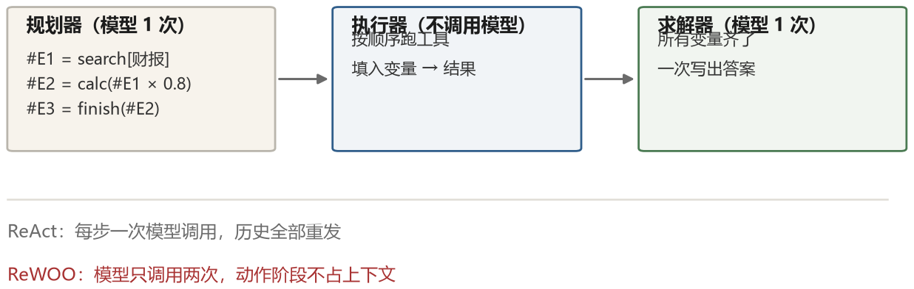

# 第 6 章 规划、反思与自我修正

ReAct 的循环有个隐含的短视：每一轮只决定下一步做什么。对于十几步就能完成的任务，这没问题。但当一个任务需要五十步、涉及多个子目标、有些步骤失败后必须改道时，“走一步看一步”就开始出问题——模型会忘记大目标，会在无关的支线上耗光预算，会在同一个坑里反复跌倒。

这一章讲两类互补的技术：**在动手之前先想清楚整体怎么做**（规划），以及**在动手之后回头看哪里做错了**（反思）。它们分别对应人类做事时的两种习惯，也分别有各自的失效方式。

## 6.1 分解

最早也最自然的想法是：把大问题拆成小问题，逐个解决。

**由易到难提示**（Least-to-Most Prompting）的做法是两阶段提示。第一阶段把问题拆成由易到难的子问题；第二阶段依次求解，并把已有答案作为已知条件带进下一个子问题。本节后面会用“去年营收 800 万元”的完整例题走一遍。

**分解式提示**（Decomposed Prompting）把分解做得更彻底：不只拆问题，还为每类子问题指定专门的处理器——有些交给模型，有些交给检索，有些交给专门的小程序。这实际上是在用提示组织一个子任务调用图。

**计划并求解**（Plan-and-Solve）是在思维链的基础上加入“先制定计划，再按计划执行”的提示。它让模型在计算前先组织全局步骤；具体收益仍取决于模型和任务。

这些方法的共同假设是：**分解出来的子问题比原问题容易**。这在数学应用题上基本成立，在真实任务上不一定。一个“帮我分析这份财报”的任务，分解成“读文件、算比率、写结论”看起来合理，但真正难的部分往往在于“发现该算哪个比率”，而这个判断没法在分解阶段完成，因为它依赖于读到数据之后的发现。

### 一次 Least-to-Most 的完整拆解

分解听起来理所当然，做起来的关键是“拆成什么形状”。看一个具体例子。

题目：某公司去年营收 800 万元，今年增长了 25%，成本一直占营收的 60%。今年的利润比去年多了多少？

**第一阶段，让模型只做拆解，不做计算**：

```text
要回答“利润多了多少”，需要先知道：
  Q1 今年的营收是多少？      依赖：原题的增长率
  Q2 去年的利润是多少？      依赖：原题的营收和成本比例
  Q3 今年的利润是多少？      依赖：Q1 和成本比例
  Q4 今年的利润比去年多多少？ 依赖：Q2 和 Q3
```

**第二阶段，按顺序逐个求解，每个子问题的答案都带进下一个**：

```text
Q1: 800 × (1 + 25%) = 1000 万元
Q2: 800 × (1 - 60%)  = 320 万元
Q3: 1000 × (1 - 60%) = 400 万元
Q4: 400 - 320 = 80 万元
```

这里有两个容易忽略的点。第一，拆解阶段**只输出子问题和依赖关系**，不输出数字——一旦它在拆解时顺手算，算错的部分会被后面全盘继承，而且你看不出是哪一步错的。第二，每个子问题的提示里要显式带上“已知：Q1=1000 万”，否则模型会重新从原题推一遍，等于没拆。

这套做法在这道数学题上结构清楚，因为子问题之间有明确依赖。换成“帮我分析这份财报”就不够：真正的难点是“该算哪个比率”，而这个判断依赖读到数据后的发现，没法在第一次拆解时完全确定。这时需要“先粗后细”的滚动计划，也就是下一节讲的先规划再执行。

## 6.2 先规划，再执行

把规划从提示技巧升级成一种架构，是 2023 年的事。Plan-and-Execute 模式的做法很直接：先用一次模型调用生成一份完整的步骤清单，然后逐步执行，每步可以调用工具，执行完再进入下一步。



和 ReAct 相比，这个结构的优点和缺点都很明显。

最明显的好处是**全局一致性更容易维持**。计划把目标和步骤显式写出来，后续执行可以不断对照，减少被无关信息带偏的机会。上下文也可能更省：执行每一步时，只带当前步骤、必要约束和相关工具结果，而不是所有历史。

代价是**计划可能一开始就错**。模型在没看到任何实际数据的情况下制定的计划，往往建立在对任务的想象上。真到执行时发现第一步就走不通，后面的步骤全部作废。

所以实践中很少用纯粹的 Plan-and-Execute，常见的是混合式：先出一个粗粒度的计划，执行中允许重规划（replan）。触发重规划的条件通常是某一步失败、或者执行结果与预期差距太大。重规划本身也是一次模型调用，把“原计划、已完成的部分、遇到的问题”一起给它，让它给出新的计划。

LLMCompiler 把这个思路推得更远。它让模型把任务编译成一个**有向无环图**（DAG）：节点是任务，箭头表示数据依赖，并且依赖关系不能绕一圈回到自己。调度器据此并发执行：没有依赖的任务同时跑，有依赖的等前置任务完成。论文在部分任务设置中报告了显著的端到端加速；实际收益取决于可并行比例和工具延迟。

DAG 的好处是把“哪些事可以同时做”这件事显式化了。人做复杂任务时也是这样：等编译的时候顺便去改文档，而不是干等。但 DAG 要求模型能正确识别依赖关系，一旦漏掉一条边，就会有两个任务用到过期的数据。

## 6.3 反思

规划解决的是“往哪走”，反思解决的是“走错了怎么办”。

### Self-Refine：三步循环

Self-Refine 的结构可以写成三行伪代码：

```text
y0 = 模型(任务提示, 输入)
for t in 1..T:
    fb = 模型(批评提示, 输入, y_{t-1})       # 哪里不好，怎么改
    y_t = 模型(修改提示, 输入, y_{t-1}, fb)   # 按意见改一版
    如果 fb 里写着“无需修改”，提前停
```

三个提示是分开的：生成提示只要求完成任务；批评提示要求“找出具体问题，不要泛泛而谈”；修改提示要求“只改被指出的地方，不要重写”。$T$ 可设为少数几轮，并根据收益调整；论文在多种任务上报告了平均提升，但它不是所有任务都有效的固定参数。

这个结果当时让很多人兴奋，因为它暗示模型可以在不改参数的情况下改进输出。但后续研究也指出：**同一个模型评估自己的输出，可能重复自己的盲区。** 尤其是知识缺失造成的错误——它不知道自己不知道，也就很难指出哪里错了。

一个更有效的变体是引入外部信号。代码任务里，编译器报错和测试失败提供了可执行反馈；数学任务里，把结果代回原式验证，或交给计算器检查，通常比单看模型自评更可靠。外部信号也会不完整——测试可能漏掉边界——但它至少提供了独立于生成者的检查。

### Reflexion：把反思存起来

Reflexion 换了个思路：不在同一轮里反复改，而是把失败的经验**存下来，带到下一次尝试**。

它有三个角色。**执行者**跑任务，可以是 ReAct 循环，也可以是一次代码生成。**评估者**给出成败判定，代码任务里就是跑测试，问答任务里就是比对答案。**反思者**在失败之后读一遍轨迹，写一到三句话，说明“为什么会失败、下次要注意什么”。

```text
第 1 次尝试：
  执行者 → 代码 v1 → 测试失败：第 12 行索引越界
  反思者 → “空数组没有处理，要先用 if not arr: 返回”
  存进记忆：[任务类型=数组处理] 空输入要先判断

第 2 次尝试：
  提示 = 原任务 + 上次的反思
  执行者 → 代码 v2 → 测试通过
```

论文里管这个叫“语言化强化学习”（verbal reinforcement learning）：没有梯度，没有参数更新，只有一段文字在起作用。这段文字相当于把“这次失败了，因为 X”变成了下一轮的先验。



在 HumanEval 的相应论文设置中，Reflexion 把 GPT-4 的通过率从约八成提高到九成以上。这个数字依赖当时的模型、提示和评测方式；它说明外部测试加上失败反思有潜力，不代表任何代码任务都能获得同样提升。

Reflexion 的局限也很清楚：它依赖一个可靠的评估信号（测试是否通过），而且反思的质量取决于模型对自己失败的归因能力。如果它把失败归因成“这个题目太难”，写下的反思就没有任何用处。

## 6.4 把搜索和反思合起来

LATS（Language Agent Tree Search）把**蒙特卡洛树搜索**（MCTS，一种通过反复模拟来评估分支的搜索方法）搬到了语言 agent 上。它的每一轮包含四个阶段：

**选择**。从根节点往下走，每次挑“上置信界”最高的子节点。常用的公式是
$$\mathrm{UCT}(s,a) = Q(s,a) + c\sqrt{\frac{\ln N(s)}{N(s,a)}}$$
其中 $Q$ 是这个动作的平均得分，$N$ 是访问次数，$c$ 控制探索与利用的平衡（越大越愿意试冷门分支）。前半项偏向已经证明有效的路，后半项偏向还没怎么试过的路。

**扩展**。走到一个没展开过的节点，让模型生成若干个候选动作（通常是 3 到 5 个），每个动作连同它的执行结果成为一个新节点。

**模拟**。从新节点继续往下走几步，或者直接让模型判断“这条路能不能成”，得到一个估值。LATS 用的是模型自评：给它当前状态，让它输出一个 0 到 10 的分数，或者“成功/失败/继续”。

**回传**。把这个估值沿着路径往回累加，更新沿途每个节点的 $Q$ 和 $N$。失败的路径还会触发一次反思，把“这条路为什么不通”写进记忆，下一轮展开时作为提示的一部分。

外层的终止条件有两个：走到环境的成功状态（测试通过、答案正确），或者搜索预算用完。最终输出是得分最高的那条完整轨迹。

这个工作的意义不在于它的绝对成绩，而在于它展示了三种能力的融合：规划（搜索）、行动（工具调用）、反思（价值评估与记忆）。在网页导航和编程任务上，它比纯 ReAct 有稳定提升。

代价是成本。一次搜索要跑几十次模型调用，是 ReAct 的几倍到十几倍。所以在实际产品里，这种“重搜索”的做法通常只用在关键决策点上，而不是每一步。

## 6.5 省 token 的规划：ReWOO

ReWOO 观察到一个浪费：ReAct 每一轮都要把全部历史重新发一遍，而其中大部分内容在下一轮用不上。

它把过程拆成三个角色，用变量把“推理”和“观察”解耦。

**规划器**一次性写出完整计划，每一步的结果用一个变量占位：

```text
Plan:
  #E1 = Search[某公司 2024 年营收]
  #E2 = Search[该公司 2023 年营收]
  #E3 = Calculate[#E1 / #E2 - 1]        # 同比增长率
  #E4 = Search[行业平均增长率]
  #E5 = Compare[#E3, #E4]               # 高于还是低于
```

**执行器**按依赖关系调用工具，把返回值填进变量；互不依赖的步骤也可以并行。这一步不必让模型逐次决定，只需解析计划、执行和记录：

```text
#E1 = 128.4 亿元
#E2 = 112.0 亿元
#E3 = 14.6%
#E4 = 9.2%
#E5 = 高于行业平均
```

**求解器**拿到全部变量和原问题，一次性写出答案。它看到的是干净的证据列表，而不是几十轮夹杂着失败尝试的对话。



这个结构在 token 效率上有明显优势：本例中规划器调用一次，工具执行不单独调用模型，求解器再调用一次；原本需要多轮的串行流程被压成两次主要模型调用。论文在相应任务上报告了显著的 token 节省。若某个“工具”内部也调用模型，或者失败后需要重规划，总调用数还会增加。

它的代价是灵活性。计划是死的，如果某一步的结果和预期不符，整个计划可能失效。ReWOO 的做法是在计划里预留条件分支（“如果 #E4 查不到，则改用行业报告”），但这又回到了需要模型动态决策的老路上。

## 6.6 计划该长什么样

工程上，“计划”的表示形式会直接影响执行和检查。常见有三种表示。

**待办清单**。最简单，一个数组，每项有描述和状态。模型每次可以标记完成、添加新项、调整顺序。模型很容易读写，人也很容易看懂；不足的地方在于表达不了依赖和并行。

**有向无环图**。节点是任务，边是依赖。可以并行，可以做关键路径分析。麻烦在于模型生成 DAG 时经常漏边或成环，需要一个校验层。

**状态机**。定义若干个状态和允许的转移，模型只能在合法转移里选。这是最可靠的一种，因为它把“不能做什么”写死了，代价是灵活性最差，适用于流程明确的任务，比如客服工单处理。

这三种表示可以混用：外层用状态机框住大阶段，每个阶段内部用清单或 DAG。真实系统里这种混合结构很常见，因为计划越自由，长任务中越需要额外的状态校验和恢复机制。

## 6.7 反思的三个陷阱

反思听起来是万灵药，但它在实践中经常不起作用，原因大致有三种。

**自我评估的偏差。** 前面提过，模型给自己的输出打分偏高。一个缓解办法是换一个模型来评估（用 A 模型生成，B 模型批评），或者用一组固定的评分标准逼它逐条对照。更彻底的办法是不用模型评估，用能执行的东西评估。

**反思变成空话。** 模型写下的反思经常是“我应该更仔细地检查边界条件”这种正确但无用的话。有效的反思必须具体到“第 3 步用了 `len(arr)` 但数组可能为空，应该先判断”。这个差别决定了反思记忆有没有价值。有些系统会要求反思必须引用具体的步骤编号和具体的错误信息。

**过度反思。** 有的 agent 在每一步之后都反思一遍，结果是一半的 token 花在自我批评上，而且经常把本来正确的做法改错。反思应该由信号触发：测试失败、工具报错、用户不满意、置信度低。没有信号的时候，改来改去只是在噪音里打转。

## 6.8 规划能力正在被训练进模型

和思维链一样，规划和反思也在经历从“提示技巧”到“模型能力”的迁移。

2024 年之后的许多推理模型，会在回答前生成较长的中间过程，其中可能包含任务分解、可行性判断和自我检查。于是，并不是每个任务都要再写一句“请先制定计划”。一些专门针对 agent 任务训练的模型，还会学习在执行中途检查进展、决定是否调整方向。

这对工程实践的影响是：那些靠提示堆出来的规划模板，价值在下降；而**计划的外部表示、执行状态的持久化、失败后的恢复机制**，价值在上升。因为模型内部的思考是不可见、不可干预的，而写在文件里的计划、存在数据库里的状态，是你能检查、能修改、能在崩溃后恢复的。

这也是第十一章要讲的核心观点：模型越强，harness 里那些“帮模型想”的部分越不重要，而“帮模型记住、帮模型验证、帮模型恢复”的部分越重要。
