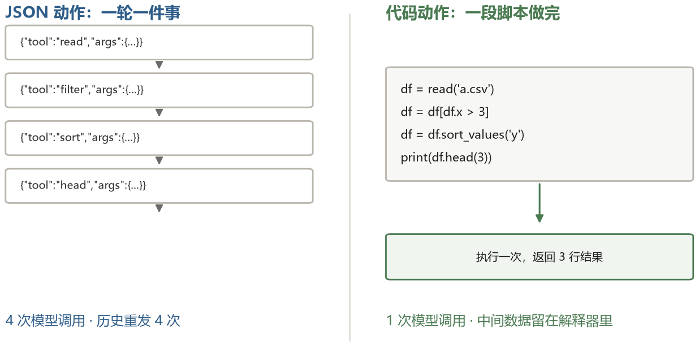
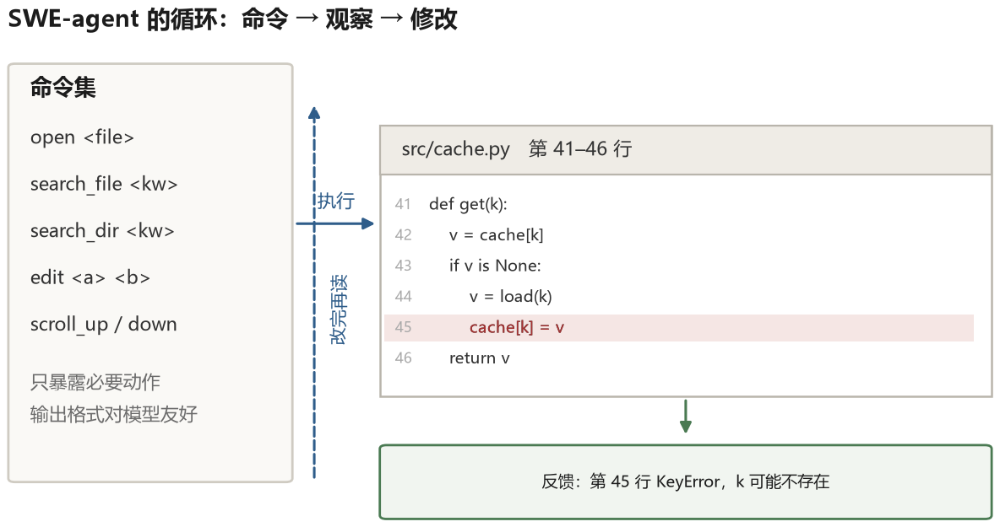

# 第 9 章 用代码行动

前面几章的工具都是“一个动作一个接口”：搜索是搜索，计算是计算，读文件是读文件。这种设计直观，但有一个天花板——模型只能在别人预先想好的动作里选择。真实任务里总有预料之外的步骤，一旦需要的动作没被实现，agent 就卡住了。

打破这个天花板的办法是：不再给模型一堆接口，给它一个能运行代码的环境。这一章讲这条路线是怎么走出来的，以及为什么它成了 2024 年之后 agent 的主流形态。

## 9.1 为什么代码是一种好的动作表示

代码有几个别的动作表示没有的性质。

**可组合**。给模型 30 个工具，它能组合出的行为是这些工具的排列组合，但每个组合都需要一次单独的模型调用。给模型一个 Python 解释器，它能在一段代码里做完循环、条件、字符串处理、数据转换。原本需要十轮交互的事情，一段二十行的脚本就完成了。

**精确**。自然语言里的“把结果里所有日期格式统一成 ISO 格式”是有歧义的，代码里的 `datetime.strftime("%Y-%m-%d")` 没有歧义。

**可复用**。一段跑通的代码可以保存下来，下次直接调用。这比“让模型记住上次怎么做的”可靠得多。

**可验证**。代码能被执行，执行有结果，结果可以断言。这是最重要的一条：它给了 agent 一个不依赖模型自我判断的反馈信号。

代码的麻烦也很明显：写代码本身会出错，运行代码有安全风险，读代码需要上下文空间。这三条分别对应这一章后面的三节。

## 9.2 CodeAct：把动作写成代码

2024 年 2 月的 CodeAct 做了一个很干净的对比实验。同样是“用工具完成任务”，一种方式是用 JSON 表示动作（`{"tool": "search", "args": {...}}`），另一种方式是直接写 Python 代码，工具就是 Python 函数，执行结果通过标准输出返回。

论文在其评测设置中报告，代码动作相对 JSON 或文本动作取得了更高的任务成功率，并在部分对比中减少交互轮数；最高幅度约为 20% 和 30%。这些是不同任务与模型下的实验结果，不是所有系统都能获得的固定加成。



这个思路后来成为一类重要的 Agent 形态：模型写代码，程序在受限环境中运行，再把结果写回。文件操作、数据处理和 API 调用都可以通过代码完成，但并不是所有主流产品都只采用这一种方式；结构化工具调用在权限清晰、动作固定的场景仍然很有价值。

代码执行还有一个隐性好处：它能把中间结果留在解释器里，而不是全部塞进上下文。DataFrame 是内存里的表格数据对象，可以近似理解成程序中的一张 Excel 表；CSV 则是一种用文本保存表格的文件格式。一个 DataFrame 有一万行，模型不需要逐行读完，只要写 `df.groupby("city").size()`，查看几行聚合结果。这是第八章“隔离”的一种形式，隔离媒介是程序运行时。

### 一次会话里发生了什么

“让模型写代码”听起来简单，实际运行时是多轮共用同一个解释器。看一次真实的会话（任务是整理一份 CSV）：

```text
第 1 轮 模型写：
  import pandas as pd
  df = pd.read_csv("sales.csv")
  print(df.shape)
解释器返回：
  (12043, 7)

第 2 轮 模型写：
  print(df.columns.tolist())
  print(df["amount"].isna().sum())
解释器返回：
  ['date', 'region', 'sku', 'qty', 'amount', 'channel', 'note']
  318

第 3 轮 模型写：
  clean = df.dropna(subset=["amount"])
  by_region = clean.groupby("region")["amount"].sum().sort_values(ascending=False)
  print(by_region.head())
解释器返回：
  region
  华东    4 812 300.0
  华南    3 190 450.0
  ...
```

三个细节决定了这套东西能不能用。

**变量要跨轮存活。** 第 3 轮直接用第 1 轮建的 `df`，说明解释器是常驻的，不是每轮新开一个。简化实现可以维护一个长期存活的 Python 进程，在共享命名空间里执行代码片段；生产系统还要处理进程隔离、依赖冲突、资源清理和会话回收，不能只在全局字典里裸用 `exec`。

**输出要限长。** `print(df)` 会刷出上千行，直接进上下文会瞬间吃掉预算。所以执行器会截断，并在末尾加一句“输出已截断，共 12043 行，用 head() 或聚合后再看”。模型看到这句提示，下一轮就会写更精确的查询。

**中间结果留在解释器里。** 一万行的表不需要读进上下文，模型只要写 `df.groupby(...).sum()` 看五行结果。这比“把数据塞进提示让模型算”省了几个数量级，也是第九章开头说“代码是一种好的动作表示”的实际含义——它把上下文压力转移给了程序运行时。

## 9.3 一个能用的代码环境

给模型一个 Python 解释器听起来简单，做起来有一堆细节。

**状态要明确保持和清理。** 多轮之间，变量和导入的模块通常需要保留；打开的文件、数据库事务和临时资源则要有明确的关闭与回收策略。不能每次重启解释器丢掉变量，也不能永远不清理导致资源泄漏。

**输出要截断和整形**。`print(df)` 在终端里可能刷出几千行。需要限制输出长度，并且在超长时提示模型“输出被截断，请用更精确的查询”。

**错误要可读**。原始 traceback 对模型是有用的，它包含行号和错误类型。但要避免把几十层调用栈全部塞进去，通常只保留最后几层和出错的那一行代码。

**超时要能中断**。一段死循环会挂住整个会话。需要在执行层设超时，超时后杀掉进程并返回“执行超时”。

**文件系统和进程要隔离。** 模型写的代码可能删文件、改配置或启动子进程。仅靠“限定工作目录”不够，还需要容器或操作系统权限、挂载控制和资源限制。

这五条做齐了，才算是一个能用的代码环境。只做文件隔离而不管输出、超时和资源，agent 仍可能因为一次长输出或死循环而卡住。

## 9.4 SWE-agent：接口设计决定成败

如果只能选一篇讲“agent 与计算机接口”的论文，我会选 SWE-agent。

它的任务是修 GitHub 上的真实 issue：给一个代码仓库和一个 bug 描述，让 agent 找到问题、改代码、让测试通过。难点在于仓库可能有几十万行代码，agent 不可能全读，也不能靠 `cat` 一个个翻。

SWE-agent 的核心贡献之一是 agent-计算机接口（ACI）。论文在其当时的模型和 SWE-bench 设置中报告，专用接口显著高于简单 shell 基线；这些数字反映特定版本，不能直接当成今天任意系统的预期成绩。

### 命令集

它没有给模型一个通用的 shell，而是设计了一套专用命令，每条命令的输出格式都是为“被模型阅读”而设计的：

- `open <path> [line]`：打开文件，从指定行开始显示 100 行，每行带行号
- `goto <line>`：跳到文件的某一行
- `scroll_up` / `scroll_down`：在当前文件里上下翻 100 行
- `search_file <kw>`：在当前文件里搜关键词，返回匹配行和行号
- `search_dir <kw>`：在整个目录里搜，返回文件名、行号和内容
- `edit <start> <end>`：把 start 到 end 这几行替换成新内容，随后回显改动后的片段
- `create <path>`：新建文件
- `submit`：提交修改，结束

这套设计里每个细节都有理由。100 行的窗口，是因为一次显示整个文件会淹没上下文——一个两千行的文件塞进去，模型基本找不到重点；带行号的显示，是因为 `edit` 要用行号定位，没有行号模型只能靠“第几行大概在哪”猜；专门的 `search_file` 而不是 `grep`，是因为 `grep` 的输出常常一行几百字符、路径重复、没有上下文，模型读起来很费劲；`edit` 之后自动回显改动片段，是让模型确认“改的确实是这里”。

### 两个反馈回路

SWE-agent 里有两个不同时间尺度的反馈。

**短回路：编辑后立刻检查。** 每次 `edit` 执行完，程序会对改过的文件跑一次语法检查（Python 用 `ast.parse`，其他语言用对应的 linter）。如果不通过，不等到跑测试，直接把错误信息作为观察返回：“第 43 行缩进错误”。模型于是马上再改一次。这把“写完一大段再跑测试发现全错”的长反馈，切成了每次编辑都有回应。

**长回路：跑测试。** 改到一定程度，模型调用 `python -m pytest tests/test_x.py`，看通过还是失败，失败就把 traceback 的关键几行读进来，继续改。



### 护栏

除了命令，ACI 里还有一组“不许做”的限制，这些限制在论文里叫 guardrails：

- 一次 `edit` 不能改超过若干行，避免模型“重写整个文件”；
- 不允许 `rm`、`mv` 这类破坏性命令；
- 搜索结果的条数有上限，避免一次返回几千行；
- 连续多次相同的动作会被打断，提示换思路。

这些限制看起来是在削弱 agent，实际是在提高成功率：它们把模型从“自由但容易迷路”的状态，推到“受限但每步都有效”的状态。

结果是在 SWE-bench 的论文设置中，SWE-agent 明显优于直接使用 shell 的基线。这个结果的意义超出了代码任务本身：**接口设计本身就是一种系统能力**。同样的模型，换一套更适合它阅读和行动的接口，表现可能显著变化。这个观察后来成了 harness 工程的核心命题（第十一章）。

## 9.5 Voyager：会积累技能的 agent

Voyager 是 Minecraft 里的 agent。它的任务没有终点：在一个开放世界里尽可能探索、获取物品、完成成就。

它有三个部件，每个部件解决一个具体问题。

**自动课程**解决“学什么”。系统把当前状态（背包里有什么、附近有什么、已完成哪些成就）交给模型，让它提出下一个难度合适的目标：“你还没有木头，先去砍树”“有了木镐，可以往下挖石头”。目标太难会导致反复失败，太简单则学不到东西，所以提示里明确要求“比当前能力稍微难一点”。

**技能库**解决“学过的东西怎么复用”。每当一个行为被验证成功，就把实现它的那段代码存进库，函数名和注释作为检索键。下面用教学化伪代码表示技能条目，省略了准备木棍等游戏细节：

```python
def craftStoneShovel(bot):
    """挖三个圆石，合成石铲。前提：有木镐。"""
    mine(bot, "stone", count=3)
    craft(bot, "stone_shovel")
    assert has_item(bot, "stone_shovel")   # 自验证
```

下次遇到相关任务，系统用任务的描述去技能库里检索，把最相近的几个函数签名和说明放进提示，模型直接调用，不用重新摸索。

**迭代提示**解决“写错了怎么办”。一次执行失败时，把三样东西一起交给模型：执行报错（哪一行、什么异常）、当前环境状态（背包、坐标、附近方块）、以及相关的 API 文档片段。模型据此改代码，再跑一次。这个循环最多重试四轮。

成果是：在同样的游戏时间里，Voyager 获得的独特物品数量是基线的 3.3 倍，探索距离是 2.3 倍，而且学到的技能可以迁移到新的世界。

这个工作的启发在于技能库。它把“程序记忆”具体化了：技能可以是一段可执行代码，带前置条件、验证和检索说明。第 8.6 节讲的 Agent Skill 更强调“说明文档加可选资源”的通用包装；两者相关，但 Voyager 的技能库不等同于后来所有产品的 `SKILL.md` 格式。

## 9.6 OpenHands 与平台化

SWE-agent 之后，一批开源项目开始把这类系统平台化。OpenHands（前身 OpenDevin）是其中比较有代表性的：它把 agent 的运行时（一个容器里的浏览器、终端、文件系统）、事件流（所有的动作和观察都是一条事件）、以及多个 agent 的协作都做成了可扩展的架构。

平台化的价值在于，它把前面所有章节讲的东西变成了基础设施：上下文管理、工具执行、沙箱、状态持久化、可观测性。你在它的基础上做实验，不需要每次从零搭循环。

## 9.7 沙箱：不能省的那一层

代码执行的能力越强，出错和作恶的后果越严重。一个能跑 `rm -rf /` 的 agent，需要一个容器把它关起来。

沙箱要考虑的不只是文件系统。**网络**要不要放开？放开的话，agent 可以把读到的数据发到任意地址。**资源**要不要限制？不限的话，一段内存泄漏的代码能让整台机器卡死。**凭据**怎么给？给了 API key，agent 的代码就能用它做任何事。

常见的做法是分层：默认在无网络或网络受限的容器里跑，需要联网时通过代理，设置域名白名单并记录请求。凭据可以按需提供，但要限定权限范围（scope）、缩短有效期并可撤销。高风险代码还可能需要更强的虚拟机隔离，不能把“用了 Docker”当成安全证明。

还有一个常被忽略的问题：**不可逆操作**。删除文件、发邮件、提交 PR、调用付费 API，这些操作一旦执行就没法撤销。可靠的做法是把它们放在沙箱之外，由 harness 拦截，要求确认或者做预演（dry run）。

## 9.8 测试是 agent 最好的朋友

代码任务有一个别的领域羡慕的东西：**自动化的正确性判据**。

一段代码对不对，跑测试就知道。这个信号比任何模型自评都可靠，而且成本极低。所以好的代码 agent 都会围绕测试来组织工作：先跑一遍现有测试看基线，改完再跑，失败就读错误信息，再改。有些系统更进一步，要求 agent 先写一个能复现 bug 的测试，然后再修——这样“修好了”这件事就有了确定的标准。

这个模式可以推广到代码之外的领域，只要能构造“可执行的检查”：数据处理检查行数、空值和汇总结果；文档生成检查链接和格式；部署检查健康接口是否返回预期状态。检查也可能不完整，所以要覆盖关键风险，而不是只追求“有测试”。

## 9.9 命令行 agent 的形态

2024 年底之后，出现了一类新的产品形态：直接跑在终端里的 agent。你给它一个工作目录，它像一个人一样在里面工作——列文件、读代码、改代码、跑命令、看输出、修 bug。

这类工具的技术栈其实很朴素：一个循环，加上四五个工具（读写文件、执行命令、搜索），加上一套上下文管理策略（把长文件截断、把长输出摘要、把待办写成清单），再加上权限控制（哪些命令需要确认）。

它能工作的原因，不是工具多，而是**接口足够自然**。命令行是成熟的人机接口，大量开发工具都为它设计过文本输出。模型在训练时见过许多终端会话，通常知道 `ls -la` 的输出长什么样、pytest 失败时该看哪一行。这种先验有时能降低接入成本，但不意味着通用命令行永远优于专用 API：固定动作、严格权限和结构化校验场景里，专用工具往往更安全。

这也解释了为什么“给 agent 一台机器”比“给 agent 一堆接口”更有效。前者复用了整个软件生态，后者要求你为每个能力重新设计一次接口。

代价是风险。给它一台机器，意味着它可能做到代理进程账号权限内的许多操作。所以这类产品都把权限控制做得很重：默认只读、写操作按需授权、危险命令拦截、所有动作留日志。这些是第十一章的主题。
