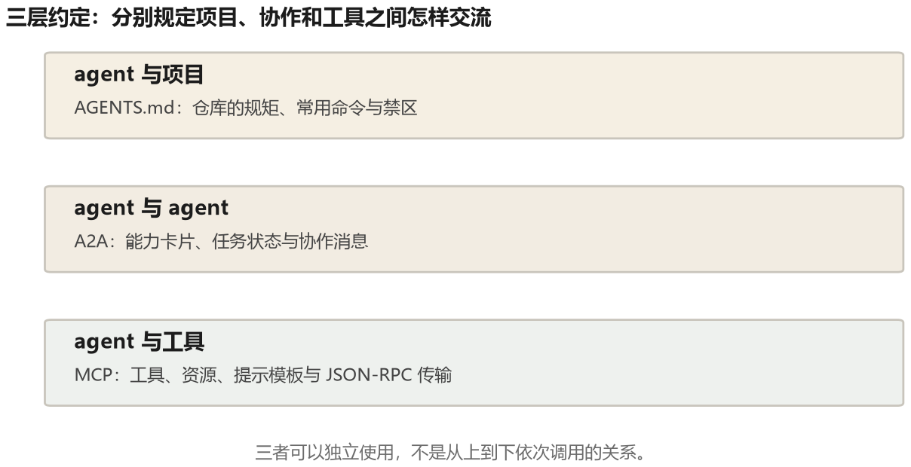
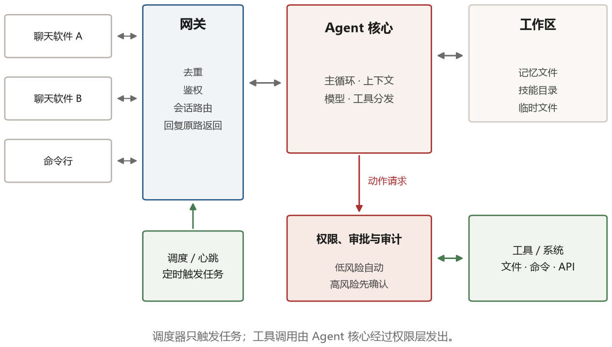

# 第 12 章 协议、平台与常驻 Agent

技术讲到这里，单个 agent 的内部结构已经清楚了。但一个 agent 不是活在真空里：它要用别人写的工具，要和别的 agent 打交道，要嵌进某个产品，要遵守某个项目的规矩。这一章讲的就是这些“之间”的问题。

有一条线索可以串起这一章：**每当 agent 的能力增长一步，它和外部世界的接触面就扩大一圈，于是就需要一层新的约定来管理这个接触面。** 工具多了，有了 MCP；agent 之间要协作了，有了 A2A；项目里的规矩多了，有了 AGENTS.md 这类文件；agent 变成常驻服务了，就有了网关式的架构。

## 12.1 三份约定



最下面一层是 **agent 与工具**之间的约定，代表是 MCP。第五章讲过它的结构：宿主里有客户端，客户端连服务端，服务端提供工具、资源、提示。它解决的问题是“工具能不能一次实现、到处使用”。

中间一层是 **agent 与 agent** 之间的约定，代表是 A2A（Agent2Agent）。它要解决的问题是：两个由不同团队、不同厂商做的 agent，怎么互相发现、怎么描述自己的能力、怎么把一个任务委派过去、怎么拿回结果。A2A 的核心概念是“agent card”——一份描述文件，说明这个 agent 叫什么、能做什么、接受什么输入、有哪些技能、认证方式是什么。任务以“task”为单位流转，有状态（提交、进行中、需要输入、完成、失败），支持流式更新。

最上面一层是 **agent 与项目**之间的约定。这一层没有统一的正式协议，常见做法是在仓库根目录放 AGENTS.md、CLAUDE.md 或宿主支持的其他说明文件，写清“在这个项目里工作要遵守什么”：测试命令、代码风格、禁止修改的目录和提交约定。具体读取哪个文件，要看所用工具。

这份文件看起来太简单了，不像个“协议”。但它解决了一个真实的痛点：agent 进入一个新项目时，对项目的了解是零，只能靠探索。而项目里有很多隐性知识，探索不出来——比如“这个仓库的 `legacy/` 目录是历史遗留，不要改”。把这些写进一个固定位置的文件，agent 每次启动时读一遍，就省掉了大量试错。

这三层约定的共同点是：它们都不改变 agent 的能力，而是降低协作的成本。MCP 降低工具复用的成本，A2A 降低跨组织协作的成本，AGENTS.md 降低 agent 理解项目的成本。

### 一份 agent card 长什么样

下面是一份**教学用简化卡片**，用来看字段表达什么，不用于直接通过某个版本的协议校验；实际必填字段、认证写法和地址以所采用的 A2A 规范版本为准。

```json
{
  "name": "invoice-auditor",
  "description": "审核发票：核对抬头、金额、税率，标记异常项",
  "url": "https://agents.example.com/invoice",
  "version": "1.2.0",
  "capabilities": {"streaming": true, "pushNotifications": false},
  "skills": [
    {"id": "audit", "name": "发票审核",
     "inputModes": ["application/pdf", "image/png"],
     "outputModes": ["application/json"]}
  ],
  "authentication": {"schemes": ["bearer"]}
}
```

调用方读完这份卡片就知道三件事：这个 agent 能接什么（PDF 或图片）、会返回什么（JSON）、怎么认证（Bearer token）。不用读文档，不用问人，机器之间自己就能对接——这就是“协议”相对“约定”的价值。

任务状态可以用下面的简化状态机理解（完整规范还可能有认证等待等状态）：

```text
submitted → working → (input-required) → completed
                    ↘ failed / canceled
```

`input-required` 是个有意思的状态：agent 干到一半发现缺信息，可以暂停并向上游要（“这张发票的税额和金额对不上，请确认是否为免税”），而不是硬着头皮给个错结果。这个状态在多 agent 协作里很关键，它把“人机确认”变成了协议的一部分。

## 12.2 四种产品形态

协议是“之间”的问题，形态是“在哪里”的问题。目前能看到的形态大致有四种。

**嵌入型**。agent 活在一个已有的应用里：IDE 侧边栏、浏览器插件、聊天窗口、办公套件的助手。用户不需要打开一个新东西，agent 就在他工作的地方。这类形态的优点是场景明确、上下文现成（IDE 知道你在改哪个文件）；缺点是能力受限于宿主应用，很难做长任务和跨系统操作。

**命令行型**。agent 跑在终端里，以工作目录为活动范围。第九章讲过这类产品。它的好处是能力最完整（一台机器上的一切都能碰），对非技术用户则不太友好。

**任务型**。你给它一个任务，它自己去跑，跑完给你结果。比如“调研这五家公司的定价策略，做成表格”。这类形态通常有独立的界面，能长时间运行，有中间进度和产物。优点是适合长任务，缺点是交互性弱，一旦方向错了要等它跑完才发现。

**常驻型**。agent 一直在运行，你通过聊天软件随时找它，它也可能主动找你。这是 2025 年底之后出现的一类新形态，也是这一章下半部分的重点。

## 12.3 常驻 Agent 的解剖

2025—2026 年，常驻式个人 agent 受到更多关注。这类系统把 agent 长期运行在自己的电脑或服务器上，可以通过聊天软件接收任务，也能在调度器触发时处理后台工作。你在手机上发一句话，机器上的 agent 开始干活，完成后按原通道回复。

这里不再按某一个产品的宣传页面复述功能，而是分析这类系统的共同结构。它把前面许多问题集中到一起：长期运行需要记忆和恢复，真实权限需要沙箱和审批，无人值守需要预算与错误处理，外部消息则必须视为不可信输入。

它的架构大致可以分成几块。在看图之前，先解释一个词：**网关**（gateway）。

网关是一个一直跑着的小程序，专门负责“对外接客、对内派活”。它自己不做业务，只做四件事：维持和各种聊天软件的连接、把收到的消息整理成统一格式、判断这条消息该交给哪个会话、把 agent 的回复按原路发回去。把它单独拆出来，是因为这些工作的节奏不同：聊天连接可能随时断开并重连，agent 任务可能运行几分钟。若全塞进一个进程，一处阻塞就容易拖住其他工作。



读这张图时要注意三条边界。第一，网关负责统一消息和路由，不应因为消息来自聊天软件就自动获得全部权限。第二，调度器只负责到点触发任务，不直接绕过 Agent 核心调用工具。第三，无论是用户消息还是定时任务，真正的工具动作都要经过权限与审批层；工作区、外部工具和其他 agent 的返回再写回执行上下文。

**通道适配层**。每个聊天软件一个适配器，负责收发消息、处理附件、维护会话标识。这一层的麻烦在于各家的 API 差异极大：有的支持编辑消息，有的支持按钮，有的有速率限制，有的会丢消息。适配层要做的归一化工作非常多。

**会话路由**。一条消息进来，要决定交给哪个“会话”处理。是按聊天窗口分，还是按话题分，还是全局一个？不同选择对应不同的上下文管理策略。全局一个最简单，但上下文很快被塞满；按话题分更合理，但需要一个分类器来判断“这条消息属于哪个话题”。

**工作区**。agent 的文件系统，通常是一个目录，里面可以放记忆文件、技能目录、临时产物和日志。小型个人 agent 常用 Markdown 保存可审计的说明与偏好，因为人和 agent 都能直接读；数据量大、并发高或需要复杂查询时，数据库更合适，不能把 Markdown 当成唯一正确答案。

**技能系统**。这是常驻 agent 扩展能力的主要方式。一个技能就是一段说明书加上若干脚本：说明书告诉 agent 什么时候用它、怎么用；脚本负责实际执行。agent 启动时只看到技能的标题和一句话描述（渐进式披露，第八章），需要时才读详情。这让一个 agent 可以挂几十上百个技能，而上下文不被占满。

**调度与心跳**。常驻意味着它要在没有用户输入的时候也做事：定时检查邮件、每天早上汇总日程、每隔一段时间看看某个网页有没有变化。这需要一套调度机制，以及一个“心跳”——定期唤醒 agent，让它看看有没有待办。MemGPT 里提到的心跳机制，在这里变成了产品功能。

**执行与审批**。这是最关键的部分。常驻 agent 有真实权限：它能读你的文件、发你的邮件、操作你的账号。所以它必须有分级审批：低风险动作直接做，高风险动作发一条消息问你要不要做。审批的交互设计很难——既要让用户看懂要做什么，又不能每次都打断。

## 12.4 常驻带来的新问题

把 agent 从“用完就关”变成“一直开着”，会冒出一些在单次会话里不存在的问题。

**身份与边界**。这个 agent 代表谁？它用谁的账号发消息？如果同时服务家庭和工作，怎么隔离？常见选择是为不同主体或用途拆分身份、凭据和工作区，但粒度没有统一答案；多用户共享一台机器时，还要防止记忆和文件串号。

**成本**。常驻不等于每次心跳都必须调用模型。更省钱的方式是先由普通程序检查“有没有新邮件、网页是否变化、是否到预算”，只有确有工作时才唤醒模型。即使如此，后台索引、定时任务和长任务仍会产生费用，所以需要单次、每日和每月预算，超限后降级或暂停。

**记忆的膨胀与污染**。跑三个月的 agent，记忆库会变得很大，检索质量下降，而且很容易积累错误的记忆（一次误解被写进去，之后反复被引用）。需要定期整理：合并重复、删除过期、校验事实。

**人格的一致性**。常驻 agent 会被用户当成“一个东西”，它今天和明天说话的风格最好一致。这在技术上表现为系统提示的稳定性，以及记忆里对“用户偏好”的持续维护。频繁换模型或换提示，会让用户觉得“它变了个人”。

**攻击面**。这是最严重的。一个常驻 agent 收发的每一条消息都是潜在的攻击入口：一封邮件里藏一段指令，一个网页里藏一段注入，一个群聊里有人 @ 它让它做某事。它还有长期记忆，一次成功的注入可以潜伏很久。第十六章会详细讲这些攻击和防御，这里只强调一点：**常驻 agent 的安全模型和普通软件完全不同，它的输入是不可信的，而它的权限是真实的。**

<div class="pagebreak"></div>

## 12.5 LangChain 是什么，框架还是自建

先从一个具体任务出发：用户问“订单 A1023 到哪里了”，系统要调用 `get_order(order_id)`，再把查询结果写成回答。第二章已经说明，最小实现只需要消息列表、工具说明、一个循环和真正的 Python 函数，不必先安装任何 Agent 框架。

```text
消息和工具说明 → 调用模型
                    ├─ 没有工具请求：返回回答
                    └─ 有工具请求：校验参数和权限 → 执行函数
                         → 把结果写回消息 → 再调用模型
```

那框架为什么存在？因为真实项目很快会多出模型切换、工具统一封装、状态保存、失败恢复、人工审批和运行监控。框架把这些常见部分做成可复用实现，你不必每个项目都重写一遍。

### 先分清 SDK、框架和 Harness

**SDK**（软件开发工具包）通常封装某个服务的请求和响应。例如模型 SDK 让你用 Python 函数调用模型，而不必每次手工拼 HTTP 请求。基础模型 SDK 不一定包含 Agent 循环；名字里带 Agent 的 SDK 则可能提供更高层能力，要分别看文档。

**框架**提供的是一套运行骨架和扩展方式。你写业务函数，框架按约定组织模型、工具和状态。它可以少写重复代码，但也会带来自己的概念、依赖和调试方式。

**Harness**是本书所说的模型外围系统，包括循环、工具执行、上下文、权限、沙箱、日志和恢复。框架可以帮助实现其中一部分，却不等于整个 Harness，更不会自动替你做好权限和评测。

### LangChain：把常见连接和 Agent 循环组装起来

按 2026 年 10 月的[官方文档](https://docs.langchain.com/oss/python/langchain/overview)，LangChain 是一个较高层的 Agent 框架：提供模型、工具等标准接口和集成，并提供由模型、工具、提示和中间件组成的 Agent 运行结构。

用订单任务来理解：你自己写 `get_order`，LangChain 可以帮你把模型接口、工具定义和循环接起来。下面只用伪代码表示分工，不绑定某个版本的函数名：

```text
你负责：get_order 的真实查询、权限、参数校验和业务规则
框架负责：把工具说明交给模型、接收调用请求、驱动循环、整理状态
模型负责：决定何时请求 get_order，以及如何根据结果回答
```

LangChain 不是模型，也不是一个会自动完成业务的现成 Agent。模型 API 密钥、数据库访问、错误处理和安全边界仍然属于你的应用。它的价值是减少连接代码、提供较统一的抽象；代价是你要学习这些抽象，升级版本时也要跟着核对行为变化。

### LangGraph：显式编排状态和步骤

[LangGraph](https://docs.langchain.com/oss/python/langgraph/overview) 是更低层的编排框架和运行时。可以把它理解为一张可执行的流程图：

- **节点**是普通函数、模型调用或工具步骤；
- **边**决定下一步去哪里，可以由固定规则决定，也可以根据模型输出动态选择；
- **状态**记录当前任务、中间结果和错误，在各节点之间显式流动。

它并不只适合固定流程，也不排斥“模型自己决定下一步”。区别在于：LangChain 给你较现成的 Agent 结构，LangGraph 让你更细地控制这个结构以及分支、持久化、恢复和人工介入。当前 LangChain 的 Agent 抽象构建在 LangGraph 之上，但 LangGraph 可以独立使用；只用 LangChain 时不必先学会 LangGraph。

例如报销系统可以先做“抽取发票”，再由程序判断金额：低于 100 元走自动校验，高于 100 元进入人工审批，审批失败还能从检查点恢复。这种确定性代码、模型判断和人工节点混合的流程，就是图编排更有价值的场景。

### LlamaIndex：从数据接入走到检索和 Agent

[LlamaIndex](https://developers.llamaindex.ai/python/framework/) 的重要组成是数据连接、索引、查询和检索，也提供 Agent 能力。若你的核心问题是“把几千份制度文档整理好，让 Agent 能查到正确条款”，它值得重点了解。

第七章讲的 RAG 可以先作为 Agent 的一个检索工具；不必把所有文档问题都变成自由循环。LlamaIndex 也不只是一个 RAG 库，LangChain 与它更不是固定的前后两道工序，二者在 Agent 能力上存在重叠。

### 这些概念不要互相顶替

- **ReAct** 是第四章讲的“推理轨迹与动作交替”的方法，不是 LangChain 的别名，也与前端开发里的 React 无关。普通工具调用循环可以借鉴它，但不必都严格称为原始 ReAct。
- **MCP** 负责把外部工具、资源等接入应用，不规定应用怎样调用模型、管理上下文或编排任务，所以它不是 Agent 框架。
- **Agent Skill** 提供可复用的流程说明和资源，不是独立运行时；它可以被某个框架或宿主加载，但不替代框架。
- **AutoGen** 等多 Agent 框架关注可对话实体及其协作。是否采用要先读第十三章，不能把“角色更多”当成默认收益。

### 怎么选，先学什么

| 当前需求 | 更合适的起点 |
|---|---|
| 单次模型调用、固定顺序的小流程 | 模型 SDK 加普通代码 |
| 想理解 Agent 原理，只有一个或几个工具 | 先写第二章的最小循环 |
| 需要较多模型／工具集成和较现成的 Agent 结构 | 评估 LangChain |
| 有复杂分支、持久状态、故障恢复或人工审批 | 评估 LangGraph |
| 数据连接、索引和检索是核心难点 | 评估 LlamaIndex |
| 强依赖某家模型的专有功能 | 先评估该厂商 SDK |

选择框架不等于选择质量。它不会自动提高模型正确率，也不会自动生成好的评测集。引入前最好用一个真实任务做对照：统计代码量、失败定位时间、升级成本和运行开销，而不只看演示是否少了几行。

对零基础读者，本地跑示例不需要先学完整前端或后端。先掌握 Python 的函数、列表和字典、异常处理，再理解 JSON、环境变量和基本 HTTP 请求即可。只有做网页界面时才需要前端，只有部署成多人服务时才需要补服务端认证、日志和密钥管理。无论用哪个框架，都不要把自己的模型 API 密钥直接交给浏览器。

## 12.6 一个判断

写到这里，可以给这一章一个总结性的判断。

agent 的形态在过去三年里变了三次：从“一个提示模板”到“一个能调工具的循环”，再到“一个常驻的服务”。每次变化都不是因为技术更炫，而是因为约束变了：单次会话的约束是上下文长度，循环的约束是工具可靠性，常驻的约束是安全和成本。

所以看一个新产品的架构，可以先问三个问题：它的上下文怎么管、它的权限怎么控、它失败之后怎么办。这三个问题的答案，基本决定了它能走多远。
