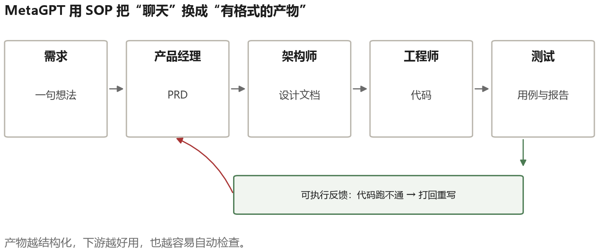
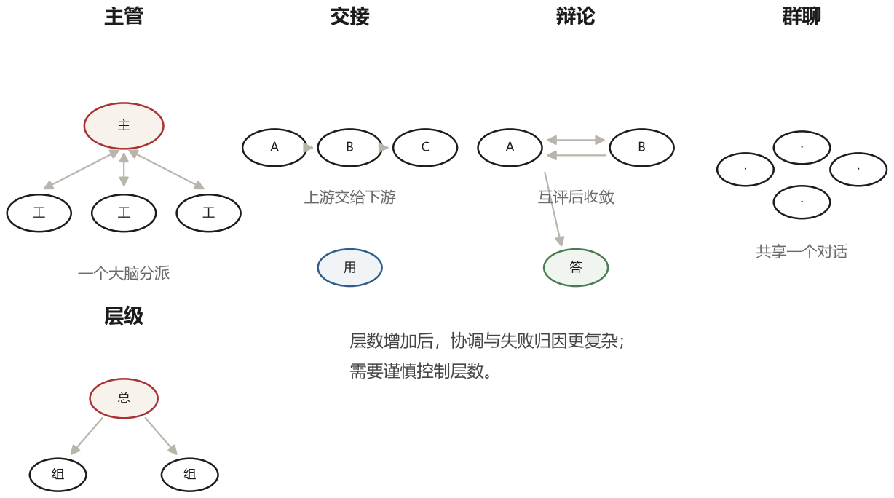
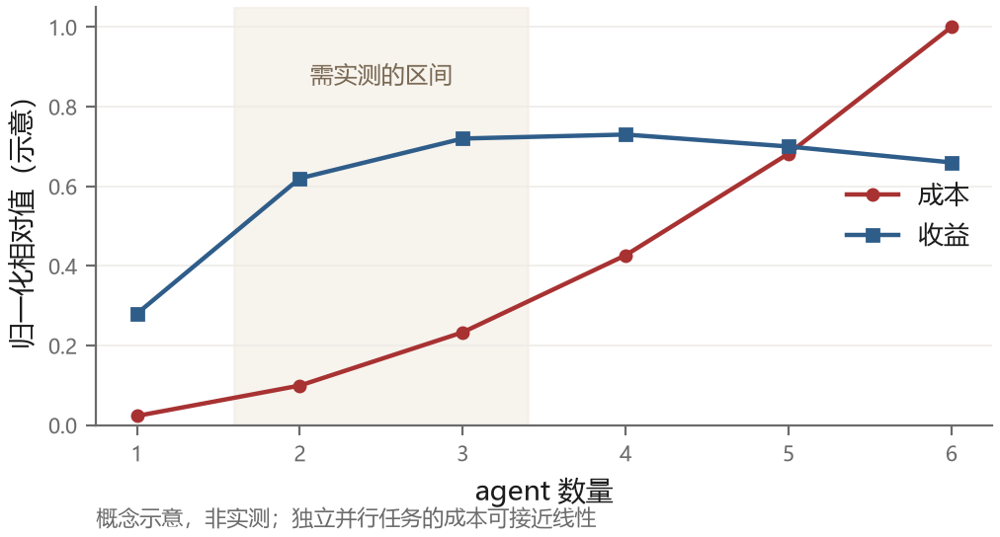

# 第 13 章 多 Agent：协作的收益与代价

一个人做不完的事，多找几个人。这个直觉很自然，所以当单 agent 遇到瓶颈时，第一反应往往是“多来几个 agent”。

2023 年出现了一大批多 agent 工作：给不同 agent 分配产品经理、程序员、测试等角色，让它们交换消息，最后产出结果。演示很有吸引力，但生产使用必须同时核算成功率、成本和延迟；角色变多并不自动带来更好结果。

这一章讲多 agent 的几种典型设计，然后花不小的篇幅讲它为什么经常失败。知道收益在哪里、代价在哪里，才能判断什么时候该用。

## 13.1 拆分能带来什么

先讲清楚多 agent 的理论收益，这四点是真实的。

**上下文隔离**。一个 agent 处理一个子问题，每个 agent 的窗口里只有自己那部分信息。这解决了第八章讲的污染问题：主 agent 不需要读一千行代码的细节，只需要“这个模块用了什么接口”这个结论。

**专精**。不同的 agent 可以有不同的系统提示、不同的工具集、甚至不同的模型。写代码的用擅长代码的模型，写文案的用擅长文字的模型，做审查的用更严格、更便宜的模型。

**并行**。几个独立的子任务可以同时跑。忽略协调开销时，调研五家公司由五个 agent 并行，理想墙钟时间接近较慢的一个任务，而不是五个任务简单相加；总 token 消耗并不会因为并行而自动减少。

**对抗**。一个 agent 生成，另一个 agent 挑错。如果两者视角不同（不同提示、模型或信息），并且评审有独立验证手段，就更有可能发现生成者自己的盲区；如果只是同一模型礼貌互评，收益可能很小。

这四点里，前两点是“省”，后两点是“增”。省的是上下文和成本，增的是质量和速度。多 agent 只有在至少一项上明显占优时，才值得付出协调成本。

## 13.2 三种经典设计

### 角色扮演：CAMEL

CAMEL 是最早把“两个 agent 对话”做成系统性实验的工作之一。它让两个 agent 分别扮演“任务提出者”（user）和“任务执行者”（assistant），给一个初始想法，然后让它们多轮对话，一个不断提要求，一个不断给方案。

跑起来分三步。**第一步是任务具体化**：用户只给一句“开发一个股票交易策略”，一个单独的模型调用把它改写成带约束的具体任务（“用 Python 写一个基于双均线的回测脚本，输入是 CSV，输出年化收益和最大回撤”）。不具体化，对话会飘。**第二步是角色分配**：把两个角色分别写进两份系统提示，附上各自的职责、输出要求、以及一条结束标记（比如 `<CAMEL_TASK_DONE>`）。**第三步是对话循环**：把 user 的消息发给 assistant，把 assistant 的回复再发给 user，如此往复，直到某条消息里出现结束标记或达到轮数上限。

关键是系统提示里那几条“元规则”，也就是 inception prompting：

```text
你是 assistant，负责完成 user 提出的任务。
你也是 AI，另一个角色同样是 AI，你们都不必扮演人类。
永远不要替对方说话，也不要自己切换角色。
任务完成时，输出 <CAMEL_TASK_DONE>。
```

没有这几条，模型会开始“帮对方写台词”，一个人把整段对话演完，实验就失去意义了。

CAMEL 用这个框架生成了五万多条对话数据。它观察到的问题很典型：角色会翻转（执行者开始提要求），对话会陷入重复（两个人互相说“好的，请继续”），或者过早终止（一个人说“任务完成”，其实什么都没做）。这三个问题后来在多 agent 系统里反复出现，本章第四节会再讲。

### 群聊：AutoGen

AutoGen 把 agent 抽象成“可对话的实体”。一个实体有三个可配置的部分：它由谁驱动（大模型、人、还是固定脚本）、它有哪些工具（包括代码执行器）、它在什么条件下发言。多个实体放进一个 `GroupChat`，由一个 `GroupChatManager` 决定下一个该谁说话。

manager 可以用规则，也可以用模型选择下一位发言者。使用模型选择时，系统把参与者职责和最近对话交给它，让它输出下一个发言者。这允许“写代码—执行—审查”按进展动态排序，但也多了一次可能出错的决策和一份上下文成本。

AutoGen 的另一个设计是**代码执行器**。agent 生成的代码直接送进一个受限的容器里跑，stdout 和报错回到对话里，下一个 agent 就能看到真实结果。这让“讨论”能落到“验证”上：审查者不是说“我觉得这段有问题”，而是看到 `KeyError` 之后说“第 12 行要判空”。

群聊的风险也很清楚：manager 的选择可能出错，导致两个 agent 互相吹捧半天；对话没有硬性的终止条件，容易越聊越长；所有内容都在一个共享上下文里，几十轮之后谁说过什么都糊了。

### 流程编排：MetaGPT

MetaGPT 走的是另一条路：不让 agent 自由聊天，而是给它们一套标准作业流程（SOP）。

它模拟一家软件公司的分工：产品经理把一句话需求写成 PRD，架构师根据 PRD 出系统设计和 API 定义，项目经理拆任务，工程师按任务写代码，测试写用例并跑。每个角色的输出是**结构化产物**——带固定小节的文档、带函数签名的接口定义、真实文件——而不是聊天记录。



支撑这件事的机制有两个。一个是**共享消息池**：所有产物发到一个池子里，每个角色订阅自己关心的类型（工程师只订阅“任务”和“接口定义”，不订阅 PRD 全文），这样上下文不会被无关内容塞满。另一个是**可执行反馈**：代码写完真的去跑，报错就把错误和对应文件打回给工程师重写，而不是让另一个 agent 评价“这段代码看起来不错”。

MetaGPT 的核心启发是：用标准作业流程约束角色，用结构化产物约束交接，而不是让多个模型只进行自由聊天。流程是否有效，仍要看产物是否完整、验证是否真实，以及错误能否被打回修正。

ChatDev 的思路类似，用一条“聊天链”把需求分析、技术选型、编码、测试和文档串起来。它有两个值得学的细节：**交流式去幻觉**（communicative dehallucination）——写代码前先提问澄清需求，确认后再动手；以及**评审关卡**——产物经过另一个角色检查才进入下一阶段，不通过就打回。

## 13.3 五种编排模式

把上面的设计抽象一下，多 agent 的拓扑大概有五种。



**主管模式（supervisor）**：一个主 agent 负责拆解和分派，若干工人 agent 负责执行，结果汇总回主 agent。这是最常见也最容易控制的模式。主 agent 掌握全局状态，工人只看到自己的子任务。风险是主 agent 成为瓶颈和单点故障。

**交接模式（handoff）**：不是主从，而是接力。一个 agent 做完自己那段，把控制权连同上下文交给下一个。客服系统里常见：售前 agent 判断这是技术问题，转给技术 agent，技术 agent 判断要退款，转给财务 agent。优点是每段都可以很专精；缺点是上下文在传递中会丢，而且没人对整体负责。

**辩论模式（debate）**：多个 agent 对同一问题给出答案并互相批评，若干轮后收敛。不同路径有时能暴露彼此错误，但同源模型也可能共享偏差，不能把“多数人一致”当成事实保证。代价是多份生成和讨论成本。

**群聊模式（swarm/group chat）**：所有 agent 在一个共享的对话里，谁都可以发言，由一个调度者决定顺序。灵活，但很容易失控：话题漂移、重复发言、无人收敛。

**层级模式（hierarchical）**：主管下面再设主管，形成树。适合边界清晰的大型任务，但层级越深，任务分解、信息传递和责任定位的成本通常越高，实践中需要谨慎控制层数。

选哪种，取决于任务的形状。任务是“可分解成独立子任务”的，用主管模式；任务是“分阶段流水”的，用交接；任务是“需要提高答案可靠性”的，用辩论；任务是“开放式探索”的，才考虑群聊。

## 13.4 为什么多 agent 经常更差

下面这几点，是我认为最该先说清楚的。

**成本可能超过线性增长。** 独立子任务各跑一次，成本通常接近随 agent 数量线性增长；如果多个 agent 反复对话，而且每轮都携带共享历史，输入 token 会更快增加。必须分别统计模型调用次数、重复上下文和协调消息的消耗。



图 13-3 是概念示意图，用来表达一种常见权衡：增加 agent 会增加成本，收益却可能逐渐饱和。它不是某篇论文的实测曲线，也不能据此推导“最佳数量”是固定值；交叉点要由自己的任务评测决定。

**幻觉会传染。** 一个 agent 编了一个事实，另一个 agent 引用它，第三个 agent 基于它做推理，最后整个系统在一个虚构的基础上达成了一致。这比单 agent 的幻觉更危险，因为多了一个“交叉验证”的假象——看起来经过了多方确认，实际上源头只有一个。

**评审容易失效。** 同一模型、同样信息的评审可能只会复述“看起来不错”。更有效的评审通常需要至少一种独立条件：不同模型或提示、明确评分规则、外部文档，或测试等可执行反馈。关键不是角色名称叫“审查者”，而是它有没有发现错误的新证据。

**责任扩散。** 出了问题，没人知道该改哪里。单 agent 的失败可以定位到某一步的某个决策；多 agent 的失败往往是一连串小偏差的累积，每个 agent 都做了“合理”的事。

**通信开销吃掉了上下文预算。** agent 之间的消息也是 token。一个 agent 把结论写给另一个 agent，为了让对方理解，必须写得比较完整，这就占掉了对方的预算。真正有效的信息传递需要精心设计的接口（结构化的、精简的），而这又退回到了“写一个好的函数签名”这件老事上。

### 一次幻觉是怎么传开的

说“幻觉会传染”太抽象，看一遍具体过程。任务是核实一家公司的营收，三个 agent：调研、核算、写作。

```text
调研 → 核算：这家公司 2024 年营收约 12 亿元，来源是某篇行业分析。
核算 → 调研：12 亿这个数字，是营收还是 GMV？
调研 → 核算：应该是营收，那篇文章里写的是 revenue。
核算 → 写作：2024 年营收 12 亿元，已核实。
写作 → 输出：该公司 2024 年营收 12 亿元。
```

问题出在第三句。“应该是营收”是一个猜测，但它以肯定的语气说出来了；核算 agent 拿到这句话，把它当成“已核实”，于是在给写作 agent 的交接里加上了“已核实”三个字。到写作环节，这个数字已经带了两层背书，谁都不会再去查原文。

整个链条里没有一个 agent 说谎，每个人都做了“合理”的事：调研找到了一个来源，核算问了一个澄清问题，写作引用了上游结论。错误是在**信息逐层简化和断言化**的过程中产生的——这是多 agent 系统最典型的失败，比单个模型胡编更难发现，因为表面上有“多方确认”的样子。

防这种问题，靠加一个“审查 agent”没用（它看到的也是二手信息）。有效的做法有两个：一是要求**关键数字必须带可验证的出处**（URL 或文件行号），审查时点开看，而不是看上游的结论；二是让**核算环节自己去查一次原文**，而不是问调研“这是营收还是 GMV”。前者靠格式约束，后者靠流程设计——都不靠“再多一个 agent”。

## 13.5 什么时候值得用

基于上面的分析，我的判断是：多 agent 值得用的场景，比想象中窄。

**可并行的独立子任务**。五个公司分别调研，五个 agent 并行，这是明确的收益。子任务之间不需要通信，只需要最后汇总。

**需要不同上下文的子任务**。一个 agent 读了一百个文件，另一个 agent 完全不需要这些细节，只需要结论。用子 agent 做隔离，主 agent 的上下文保持干净。

**对抗性审查**。让一个 agent 专门挑错，它的提示是“你的任务是找出这个方案的问题，不要客气”，并且给它独立的验证工具。这种信息不对称的审查是有效的。

**角色差异带来真实的能力差异**。例如视觉 agent 看截图，文本 agent 读代码，它们掌握的信息和擅长处理的内容不同，组合才可能产生超出简单拆分的价值。

反过来，下面这些场景不适合多 agent：任务本身是线性的（一个阶段接一个阶段，没有并行空间）；子任务之间需要频繁交换中间状态；总预算很紧；对可解释性要求高（出了事要能说清楚是谁的判断）。

## 13.6 如果要做，注意这几件事

**限制 agent 数量。** 可以从一个主 agent 加少量子 agent 开始，通过评测逐个增加；两到三个只是便于验证的起点，不是通用最佳值。每次增加都要证明它带来了独立收益。

**主 agent 要保持控制权。** 不要让子 agent 直接对用户说话，也不要让它们互相无限对话。子 agent 的产出回到主 agent，由主 agent 决定下一步。

**接口要窄。** 子 agent 的输入是一个明确的任务描述，输出是一个明确格式的结果。不要让它们返回大段自由文本。

**共享状态要显式。** 需要共享的信息放在一个所有 agent 都能读的地方（文件、黑板、共享内存），而不是靠对话传递。对话传递会失真，而且不可追溯。

**给每个 agent 一个明确的终止条件。** “做完就停”不够，要具体到“产出了符合 schema 的 JSON 就停”或者“连续两轮没有新信息就停”。

## 13.7 一个正在发生的变化

最后提一个趋势。2024 年之后，模型自己的能力变强了，很多原本需要多 agent 才能做的事，单 agent 加一个好的 harness 就能做：长任务靠上下文管理，并行靠代码里的并发，审查靠外部验证信号。

同时，“多 agent”这个词的含义也在变。它越来越少指“几个模型互相聊天”，越来越多指“一个主 agent 派生几个子 agent 去做隔离的探索”。后者其实不是协作，是**任务分解加上下文管理**，只是借用了多 agent 的形态。

这个变化说明了一件事：多 agent 的价值不在于“多”，而在于“分”。分的是上下文、是权限、是失败的影响范围。至于要不要让它们互相说话，那是次要的。
