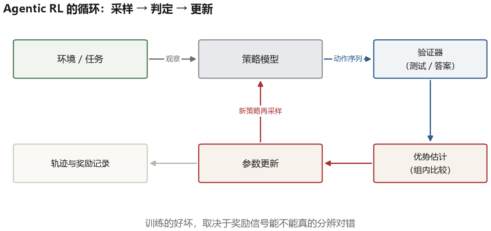
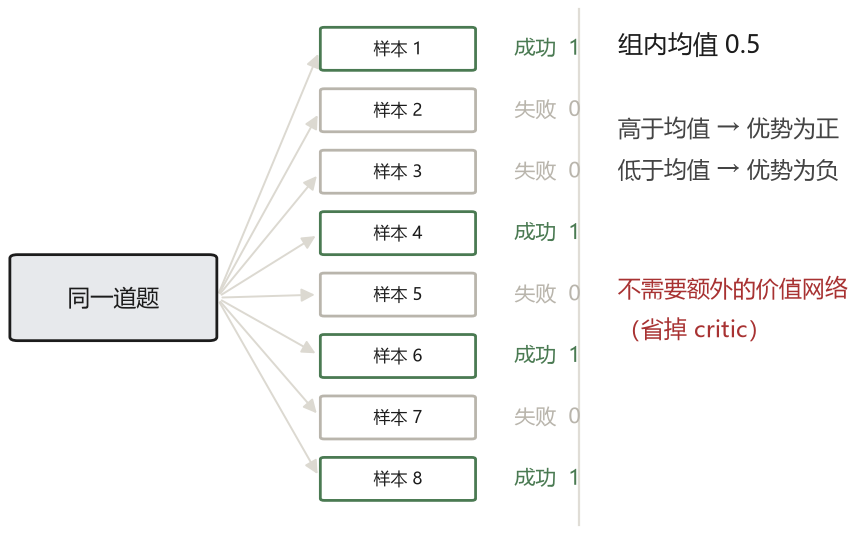
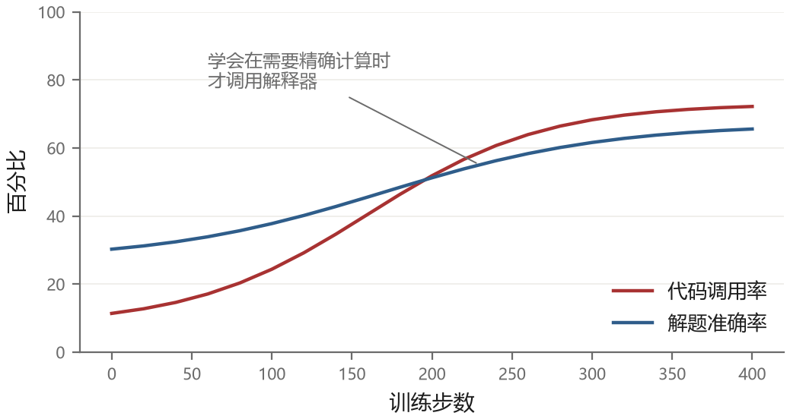

# 第 14 章 把 Agent 能力训练进模型

前面十三章讲的基本都是“模型不变，改外面的东西”。提示、工具、记忆、harness，都是在同一个模型上做文章。这条路有天花板：如果模型本身不会用工具、不会规划、不会在长任务里保持目标，外面怎么搭都补不上。

所以还有另一条路：改模型。这一章讲怎么用训练的方式，把 agent 需要的那些行为能力教给模型。它比前面的内容更偏机器学习，但我不打算讲太多数学，重点放在“训练什么、用什么信号、为什么难”这三件事上。

## 14.1 提示不够用的三个原因

**分布偏移**。你在提示里教模型“遇到这种情况就调这个工具”，它在训练时见过类似的模式，所以能照做。但 agent 运行起来会遇到训练数据里从未出现的状态：某个工具返回了一个奇怪的错误、网页加载了一半、用户中途改了需求。这时候提示里的规则覆盖不到，模型只能自由发挥。

**长程信用分配**。一个任务跑了三十步才失败，到底是哪一步错了？运行时提示当然可以把“第七步错了”临时告诉模型，但它只影响当前上下文，不会自动更新参数；换一个会话，同样错误可能再犯。训练希望用反馈把这类修正变成更稳定的行为。

**格式与习惯**。有些行为很难用提示描述清楚，比如“什么时候该停下来问用户”、“工具返回的内容里哪些值得引用”。这些是判断力层面的东西，靠几句话说不明白，靠大量例子才能学会。

训练解决的就是这三个问题：用大量真实轨迹让模型见过各种状态，用结果信号告诉它哪些决策是好的，用数据把模糊的判断变成默认行为。

## 14.2 第一步：模仿

最直接的做法是监督微调（SFT）：收集一批“好的轨迹”，让模型学着生成它们。一条轨迹就是一段完整的交互记录：观察、思考、动作、结果、再思考，直到任务完成。

轨迹从哪来？三种来源。

**人工标注**。质量最高，成本也最高。适合那些“人做得很好但很难自动验证”的任务。

**强模型蒸馏**。用较强的模型跑任务，把成功且经过验证的轨迹留下来训练小模型。成本通常低于全人工标注，但强模型也会犯错、绕路或编造解释，所以“由强模型生成”不等于高质量，仍需筛选和抽检。

**拒绝采样**。让模型自己跑很多次，只保留成功的那些。这就是 STaR 的思路：模型生成解题过程，如果最后答案对了，就把这个过程当作训练样本；如果答案错了，但给出正确答案作为提示后能改对，也保留（叫 rationalization）。反复迭代，模型的能力会逐步提升。

STaR 有个明显的问题：它只保留成功的样本，而成功的样本可能有偶然性。模型可能用了一个错误的推理得到了正确的答案，这条轨迹被保留下来，错误就被强化了。这个问题在 agent 任务里更严重，因为“结果对”和“过程对”的差距更大。

### 一条训练样本长什么样

“用轨迹做 SFT”听起来抽象，一条样本其实就是一段结构化的记录：

```text
样例 log-0042    reward = 1（单元测试验证通过）

 system    : 你可以调用工具，需要时输出 <tool_call>…</tool_call>
 user      : 看下 logs/app.log 里有没有 500 错误，有就统计次数
 assistant : <tool_call>
             {"name":"read_file","args":{"path":"logs/app.log"}}
             </tool_call>
 tool      : 2026-03-01 10:12 GET /api 500 …（共 340 行）
 assistant : <tool_call>
             {"name":"count_http_status","args":{"path":"logs/app.log","status":500}}
             </tool_call>
 tool      : 17
 assistant : 日志里有 17 条状态码为 500 的记录
 meta      : source=strong-model rollout   verified_by=unit_test
```

这里不能用“整行包含字符串 500”代替状态判断，因为端口号、字节数或时间也可能含 500。`count_http_status` 表示一个按结构化日志字段统计的工具。训练时只对 assistant 的片段计算损失，`tool` 和 `user` 内容会被 mask 掉——**掩码**（mask）在这里就是“这些 token 不作为本轮训练要预测的答案”。模型不需要学会预测工具返回什么，只需要学习看到结果后怎样行动。

`reward` 字段是筛选的依据：只有成功的轨迹（reward=1）才进 SFT 数据；失败的轨迹留作错误分析，或者作为“反例”用于偏好训练（让模型学会区分好坏）。`meta` 里的 `verified_by` 记录了这条轨迹是怎么判定成功的——人工确认、单元测试、还是下游系统反馈，这决定了它的可信度。

同一批数据里最容易被忽略的是**分布**。如果 80% 的轨迹都是“读文件、grep、总结”这一种模式，训出来的模型就只会这一种；长尾任务（需要多步推理、需要拒绝执行、需要向用户提问）在数据里必须占够比例，否则模型在这些场景下会表现得像没训过。

## 14.3 关键：奖励从哪来

强化学习需要奖励信号。agent 任务的奖励设计，是整个训练流程里最难的部分。

**结果奖励**最直接：任务成功给 1，失败给 0。若验证器可靠，它容易批量计算，麻烦在于信号稀疏——一个三十步任务只有一个最终信号，模型难以判断哪一步贡献了成功。它也不是天然无法作弊：如果测试不全或环境允许修改测试，模型可能钻评分器漏洞。

**过程奖励**给每一步打分，能缓解稀疏性。但过程奖励需要标注，而“这一步好不好”往往主观，标注成本高、一致性差。更麻烦的是，模型会学会讨好奖励模型，而不是真正解决问题（reward hacking）。

**可验证奖励**是这几年最重要的进展。它的想法是：不去判断过程，只用程序判断结果，但把判断做得非常严格。数学题对答案，代码跑测试，SQL 查数据库比对，网页操作检查最终状态。这类奖励客观、廉价、可扩展，而且随着任务变难，验证器可以跟着变严。

DeepSeek-R1 展示了这条路线的一种做法：用数学答案、代码测试等可验证奖励进行大规模强化学习。论文报告，模型在训练中出现了更长推理、自我检查和修正等行为。这里的“出现”是实验观察，不意味着任何任务只要加一个结果奖励，就自动涌现同样能力。



## 14.4 RL 的两个关键件

没学过强化学习也可以先抓住四个词。**策略**（policy，记作 $\pi_\theta$）就是模型在各状态下选择下一个 token 或动作的概率；**轨迹**是一次任务完整的观察与动作序列；**奖励**是环境或验证器给的分数；**优势**（advantage，记作 $A$）表示某个选择比同组或同状态的参照水平好多少。训练则沿“让好选择更可能、坏选择更不可能”的方向调整参数。

**策略梯度的直觉**。梯度可以理解为“参数往哪个方向改，目标会增加”的数值方向。强化学习的基本写法是

$$\nabla_\theta J = \mathbb{E}\big[\nabla_\theta \log \pi_\theta(a\mid s)\cdot A\big]$$

其中 $A$ 是优势函数，表示“这个动作比平均水平好多少”。$A>0$ 时提高它的概率，$A<0$ 时降低。所以训练效果几乎完全取决于 $A$ 估得准不准。

**优势怎么估**。PPO（Proximal Policy Optimization，近端策略优化）的一类实现会训练价值网络（critic），估计“在这个状态下平均能拿多少分”，再用实际回报减去这个基线。critic 本身也要训练，而且长轨迹上很难训准：三十步只有一个最终分数，信用怎样摊到每一步并不显然。

GRPO（Group Relative Policy Optimization，组相对策略优化）换了个思路：不用独立 critic，而用**同一道题的一组采样**当参照。对每个问题采样 $G$ 条回答（例如 8 条），第 $i$ 条的教学化优势可以写成：

$$\hat{A}_i = \frac{r_i - \operatorname{mean}(r_1,\ldots,r_G)}{\operatorname{std}(r_1,\ldots,r_G)}$$

也就是“比组内平均好多少，再除以组内波动”。例如 8 条回答里 4 条得 1 分、4 条得 0 分，均值是 0.5；成功样本的中心化分数是 $+0.5$，失败样本是 $-0.5$。如果 8 条全对或全错，组内没有差异，就无法靠这个相对比较判断哪条更好，这也是实际训练要处理的退化情况。

不同实现对标准差为零、长度归一化和 KL 位置的处理不同；下面的公式用来读结构，不应当成所有框架逐字相同的规范。

有了优势，目标函数是带裁剪的重要性采样比：

$$J_{\text{GRPO}}(\theta)=\mathbb{E}\Big[\frac{1}{G}\sum_{i=1}^{G}\frac{1}{|o_i|}\sum_{t}\min\big(\rho_{i,t}\hat{A}_i,\ \operatorname{clip}(\rho_{i,t},1-\epsilon,1+\epsilon)\hat{A}_i\big) - \beta\,D_{\mathrm{KL}}\big(\pi_\theta\,\|\,\pi_{\text{ref}}\big)\Big]$$

三个符号值得认一下。$\rho_{i,t}=\pi_\theta(o_{i,t}\mid\cdot)/\pi_{\text{old}}(o_{i,t}\mid\cdot)$ 是新旧策略在这个 token 上的概率比；`clip` 把比值限制在 $[1-\epsilon,1+\epsilon]$，减少一次更新把策略推得过远的风险；最后的 KL 散度衡量两个概率分布的差异，用来约束新模型不要离参考模型太远。公式中的 $o_i$ 是第 $i$ 条输出，$t$ 是其中的 token 位置，$\beta$ 控制约束强度。



这个改动看起来只是工程优化，但它省掉了 critic 的显存和调参，显著降低了 RL 训练的门槛，让很多团队能在自己的任务上做实验。2025 年之后大量开源的 agent RL 工作都基于 GRPO 或者它的变体。

## 14.5 三个具体的例子

三个工作都在做同一件事：把“调用外部工具”放进 RL 的采样轨迹（rollout）里，再用结果奖励训练。差别在于动作长什么样、奖励怎么设计。

**Search-R1** 训练模型“什么时候该搜、搜什么”。它给模型规定了两个特殊标记：`<search>查询</search>` 表示发起检索，`<information>结果</information>` 表示检索结果。生成时，一旦模型写完 `</search>`，训练框架就暂停解码，去搜索引擎取回前几条结果，包进 `<information>` 拼到序列后面，再让模型继续写。

一条 rollout 大致是这样：

```text
<reasoning>问题是 2023 年诺贝尔文学奖得主是谁，我不确定。</reasoning>
<search>2023 诺贝尔文学奖</search>
<information>… 获奖者是约恩·福瑟 …</information>
<reasoning>资料显示是约恩·福瑟，可以直接回答。</reasoning>
<answer>约恩·福瑟</answer>
```

训练上有个关键细节：**检索回来的那些 token 不参与损失计算**。梯度只在模型自己生成的 token 上算，`<information>` 里的内容被 mask 掉。否则模型会学着去“预测搜索结果”，而这既学不到东西，还会把语料里的噪声当真理。奖励就是最终答案与标准答案是否完全一致，外加一个格式奖励（有没有按规定的标记写）。

结果很有意思：模型自己学会了在推理中途插入检索，学会了根据检索结果调整后续查询，甚至学会了“这个问题我不确定，先搜一下”这种行为。

**ReTool** 训练模型用代码解释器。动作形式是 `<code>…</code>`，执行结果以 `<interpreter>…</interpreter>` 返回：

```text
<code>
import math
print(sum(i*i for i in range(1, 101)))
</code>
<interpreter>338350</interpreter>
```

和 Search-R1 一样，解释器返回的 token 不参与损失。不同之处在于它先做了一轮**冷启动**：用几千条“会用代码”的示例做 SFT，让模型先学会基本格式，再上 RL，否则一开始根本生成不出合法的代码块，奖励全是零，学不动。RL 阶段只跑了几百步，模型就自发形成了“先想、再算、根据结果继续想”的模式，在需要精确计算的地方调用解释器，不需要的地方不调用。



图 14-3 是一条典型的训练曲线：随着训练推进，代码调用率上升，准确率跟着上升，两者高度相关。这条曲线本身就是一个论证：模型不是靠“想得更久”变强的，而是靠“学会在正确的地方借助外部计算”。

**ToolRL** 关注的是奖励怎么设计。它的出发点是：如果只奖励最终答案，模型很快会发现“少调工具、多猜”更划算——猜对了同样有奖励，而调工具还要承担参数写错、返回为空的风险。训练到后面，工具调用率掉到接近零，准确率也上不去。

所以它把奖励拆成几块：

```text
格式分： 有没有用规定的标记包裹调用、能不能解析
参数分： 工具名存在、必填参数齐全、类型正确
结果分： 最终答案对不对
```

每块单独给分，再按权重组合。论文比较了多种组合，说明格式和参数奖励能在“最终答案还不对”的早期提供更频繁的反馈。这里应叫更密集的**奖励信号**，不等于每一步都自动获得精确梯度；奖励权重不合理时，也可能诱导模型只追求格式而忽视任务。

## 14.6 环境才是瓶颈

做 agent 训练做久了会发现，卡住进度的往往不是算法，而是环境。

训练需要成千上万次 rollout，每次 rollout 都要在真实环境里执行几十步。这要求环境满足几个条件：**可重置**（跑完能回到初始状态）、**可并行**（同时跑几百个）、**可验证**（结果能自动判定）、**防作弊**（模型不能通过读测试文件或者改测试来通过）。

真实的软件系统很难满足这些。所以训练环境大多是仿真的：一个假的浏览器、一个假的数据库、一个简化的操作系统、一套预置的 bug 仓库。仿真环境和真实环境的差距，就是训练出来的模型在真实场景里表现打折的原因。

这也是为什么 SWE-bench 这类基准重要：它提供真实、可验证、可重复的任务。但若把评测题直接拿去训练，就会产生数据污染，失去比较意义；训练、开发和最终测试任务必须严格分离，换代码库的泛化也要单独评测。

## 14.7 小模型加好 harness

有一个和实践密切相关的判断值得单独讲。

假设你的任务是“从一堆发票 PDF 里抽出金额、日期、供应商，填进表格”。你可以用一个很大的通用模型，配一个粗糙的循环；也可以用一个小模型，专门在这个任务上微调过，配一个精心设计的循环（固定的抽取流程、严格的 schema 校验、失败重试）。

后者有可能大幅降低成本，并在窄分布任务上达到甚至超过前者的准确率，但这不是预设结论。原因是任务分布窄时，小模型可能足够，而严格校验和固定流程能减少不确定性；是否更好必须放在同一评测集上比较。

这个结论可以推广：**任务越窄、越重复、越有明确的验证标准，越值得用小模型加 harness；任务越开放、越需要通用推理，越依赖大模型。**

很多团队一开始就用最大的模型做所有事，成本高、延迟大，而且并没有更好。先想清楚任务的可变性有多大，再决定在模型上花多少钱。

## 14.8 数据飞轮

最后一个工程问题：训练数据从哪来，怎么持续变好。

一个可行的闭环是这样的。线上跑 agent，记录所有轨迹。用自动验证（测试通过、用户确认、下游任务成功）给轨迹打上成功/失败标签。把成功的轨迹拿去微调，把失败的轨迹拿去做错误分析，找出系统性的问题，要么改 harness，要么补进训练数据（作为负例，或者作为“应该怎么做”的正例）。定期重跑评测，确认没有退化。

这个闭环里最容易出问题的是标签质量。用户说“谢谢”不等于任务成功，用户没说话也不等于满意。所以标签最好来自客观信号：代码合并了、工单关闭了、数据核对一致了。

还有一个隐患：飞轮会放大偏差。如果线上流量集中在某几类任务，训练数据也会集中在那里，模型在长尾任务上会越来越差。所以要有意识地补充长尾样本，或者保留一个通用模型作为兜底。

## 14.9 训练与工程的分界

这一章讲的是训练，但我想在最后强调一个判断：**大多数团队不需要训练模型。**

训练的成本不只是 GPU，还有数据管道、评测体系、环境建设、以及持续维护。一个十来人的团队，把这些精力投在 harness 和评测上，收益通常更大。

需要训练的情况大致有三种：任务非常垂直且重复，通用模型的表现有明显天花板；对延迟和成本极其敏感，必须用小模型；有大量独有数据，且这些数据能构成竞争壁垒。

除此之外，先把 harness 做好，把评测做扎实，再看模型是不是真的不够用。这个顺序反了，很容易花半年训出一个不如提示工程的模型。
