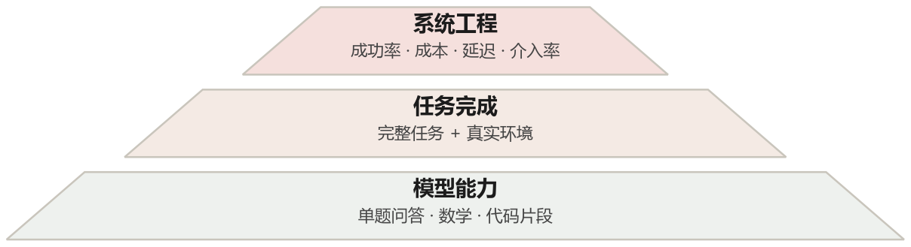
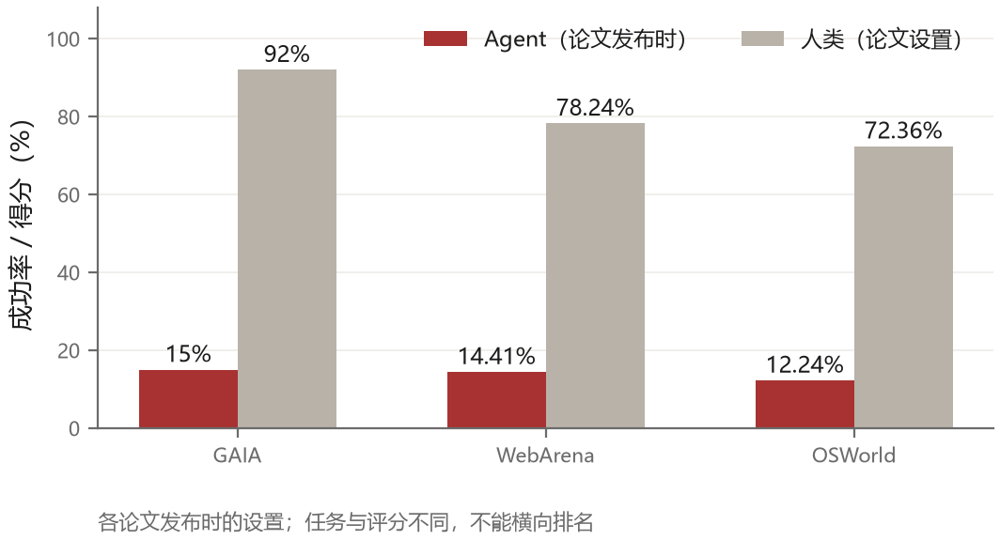
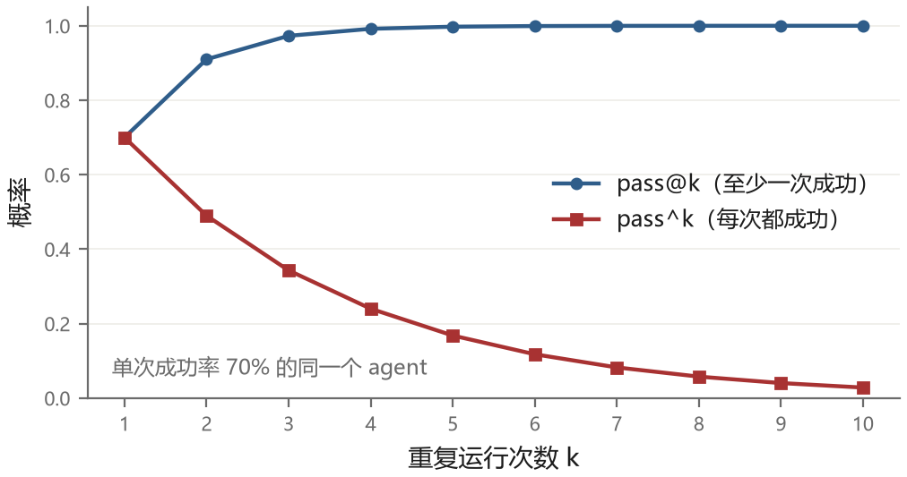

# 第 15 章 怎么知道它行不行

一个 agent 做出来了，怎么判断它好不好用？最直接的回答是“看它能不能把活干完”。但这个回答没法指导改进：你不知道它为什么不行，也不知道改了一版之后是不是真的更好了。

评测要解决的就是这件事。它是工程里不显眼、容易糊弄、又最能决定迭代质量的部分。没有评测，每次改动只能靠几个例子和感觉判断，失败很容易在别的任务上被忽略。

这一章讲三个层次：测什么、怎么测、测出来的数字为什么经常骗人。

## 15.1 三个层次



最底层是**模型能力**。给模型一道题，看它答不答对。这一层测的是“这个模型会不会”，和 agent 系统无关。常见的数学、代码、知识基准都在这一层。

中间层是**任务完成**。给 agent 一个完整任务和一个环境，看它能不能做到。这一层测的是“模型加上工具加上循环”的整体表现。SWE-bench、WebArena、OSWorld 属于这一层。

最上层是**系统工程**。测的是真实使用中的表现：任务成功率、平均耗时、单任务成本、需要人工介入的比例、失败后的恢复能力。这一层没有标准基准，每个产品都要自己建。

三层的用途完全不同。底层用来选模型，中层用来选方案，上层用来判断产品能不能上线。很多团队只做底层和中层，然后发现实验室指标很好，一上线就崩——因为上层的问题（延迟、成本、长尾任务、异常输入）在中层基准里根本不出现。

## 15.2 几个重要的基准

**AgentBench** 是最早系统性地把 agent 放进多种环境里评测的工作之一。它包含八个小环境：操作系统、数据库、知识图谱、卡牌游戏、家务模拟、网页购物、网页浏览、代码。同一个模型在不同环境里的排名差别很大，这个发现本身就有价值：**agent 能力不是一维的，一个在代码上很强的模型可能在网页上很弱。**

**GAIA** 换了个角度：不造仿真环境，直接出题，题目的答案唯一且可验证，但需要多步推理加上网查证。它的设计目标是“对人容易、对 AI 难”——人类用搜索引擎能答出 92%，而发布时带插件的 GPT-4 只有 15%。这个反差很能说明当时 agent 的水平：它不是不会查资料，而是不会规划查什么、怎么整合。

**SWE-bench** 用真实的 GitHub issue 做任务：给仓库和一个 issue，要求生成能通过测试的 patch。发布时最好的模型（Claude 2）解决率是 1.96%。后来模型和 harness 都显著进步，不同子集和评测设置下出现了更高成绩。SWE-bench Verified 是经过人工质量验证的子集，主要解决任务描述和评测可靠性问题，**不等于已经排除了预训练污染**；不同子集的成绩也不能直接混比。

**τ-bench** 引入了一个之前被忽略的维度：**用户**。任务是客服场景，agent 要通过工具操作数据库，同时和一个模拟用户对话，用户会改主意、会给错信息、会不耐烦。它提出的指标 pass^k 是另一个维度的东西，值得单独说（下面细讲）。

**Terminal-Bench** 把任务放在终端里：配置一个服务、修一个构建脚本、从日志里找出问题。这类任务的特点是“没有标准答案，只有能跑通和跑不通”，非常接近真实工作。

**TheAgentCompany** 更进一步，造了一个完整的虚拟公司：有代码库、有内部文档、有聊天工具、有其他“同事”。任务是“帮我把这个季度的报表整理好并发给财务”，需要跨多个系统操作。它测的是长链条、多系统的综合能力。



把这张图放在一起看，可以看到这些论文发布时的共同差距：人类在相应设置中明显领先，早期 agent 只有一两成左右。它们是历史快照，不表示今天的最佳系统；三个基准的任务和评分也不同，不能据此说 GAIA 比 WebArena 更难。真正值得注意的是，越接近真实工作，异常处理和隐性知识越难被静态基准覆盖。

## 15.3 指标：不止是成功率

只看成功率会漏掉很多东西。

**pass@k 与 pass^k**。pass@k 是“跑 k 次，至少成功一次”的概率，衡量的是能力上限。pass^k 是“跑 k 次，每次都成功”的概率，衡量的是稳定性。这两个指标的差距，反映了 agent 的一致性。

严格说，评测里算的不是“概率”，而是从 $n$ 次采样里估出来的值。常用的无偏估计是

$$\mathrm{pass@}k = 1 - \frac{\binom{n-c}{k}}{\binom{n}{k}}$$

其中 $n$ 是每题采样的次数，$c$ 是其中成功的次数。直观理解：从 $n$ 次里随机抽 $k$ 次，一次都没抽到成功的组合占比，反过来就是“至少抽到一个成功”的比例。$n$ 一般取 20 到 200，$k$ 取 1、5、10。

如果单次成功概率是 $p$，并假设 $k$ 次尝试独立且分布相同，那么 $k$ 次全部成功就是 $p^k$。实际评测当然也要从有限运行中估计：常见做法是先算每道题在 $n$ 次运行里的成功比例 $\hat p$，再按基准定义计算 $\hat p^k$ 并对任务取平均。它不是“不用估计的真值”，不同任务的单次成功率也不能先混成一个总比例再随便乘方。

举例：在独立重复尝试的简化模型里，单次成功率 70%，跑 5 次至少成功一次是 $1-0.3^5 \approx 99.8\%$，5 次都成功只有 $0.7^5 \approx 16.8\%$。客服任务如果要求每次都可靠，pass^5 比“多试几次总能成功一次”更贴近需求。

这两个数字放在一起看，还能推出一个诊断：如果 pass@5 很高但 pass^5 很低，说明 agent 有能力完成任务，但稳定性差，问题多半出在随机性上（温度太高、工具返回不稳定、上下文顺序敏感）；如果两个都低，那是能力问题，得换模型或换方案。



**成本**。同一个任务，用 3 步完成和用 30 步完成，成功率可能一样，成本差十倍。评测报告里应该带平均 token 消耗和平均步数，否则无法比较方案的性价比。

**延迟**。用户能忍受的等待是有限的。一个需要五分钟的 agent，即使成功率很高，在很多场景里也不可用。

**人工介入率**。有多少任务需要人接管？介入的方式是什么（回答一个问题、批准一个动作、还是完全接手）？这个指标在产品化阶段比成功率更重要。

**方差**。跑三次评测，成绩分别是 62%、71%、58%，说明系统不稳定。不稳定的系统比稍弱但稳定的系统更难用，因为你无法预期它的表现。

## 15.4 数字为什么会骗人

接下来这部分比前面的方法更值得花时间。agent 评测里的坑特别多，因为整个链条（模型、提示、工具、环境、评分器）都可以被无意或有意地调优。

**数据污染**。训练数据如果包含测试题或答案，成绩就可能失真。代码和数学基准尤其需要关注公开仓库、题解和相似变体。人工筛选高质量任务、推出新子集、使用隐藏测试或按时间切分，可以缓解不同问题，但没有任何一个子集名称能自动证明“无污染”。

**harness 过拟合**。同一个模型，针对某个基准反复调提示、调工具、调重试策略，成绩会上升，但上升的是“在这个基准上的成绩”，不是“能力”。有些团队会针对基准的评分脚本做特殊处理（比如让 agent 学会读测试文件），这已经接近作弊。

**评分器的漏洞**。自动评分器总是有漏洞。代码任务里，agent 可以改测试让它通过；网页任务里，agent 可以直接访问最终状态的 API 而不走界面；问答任务里，答案的匹配规则可能过宽（“北京”匹配到“北京市朝阳区”）。这些漏洞在基准设计时很难全部堵住，评测时必须抽查轨迹。

**单次运行的偶然性**。温度不为零、工具环境变化或网络不稳定时，同一任务多次运行结果会不同。用一次运行做比较，噪声可能比真实改动还大。可以先用少量运行排查，再按波动程度增加样本，报告均值、波动范围和置信区间，而不是机械地把“三次”当成充分证据。

**任务分布的代表性**。基准里的任务往往是“精心挑选的、有明确答案的、可以自动验证的”。真实任务里有一半是模糊的、答案不唯一的、需要人判断的。在基准上 80 分，在真实场景可能只有 40 分。

**环境的简化**。仿真环境里没有网络延迟、没有弹窗、没有登录过期、没有同事临时改需求。这些在真实环境里是常态。

## 15.5 给自己造评测集

公开基准解决不了你的问题，因为你的任务是特定的。你需要自己的评测集。

造法有几种，按可靠性排序。

**从真实失败出发**。把线上出过的错收集起来，每一个错做成一个测试用例。这类用例的价值最高，因为它们代表了真实的分布，而且每修一个，指标就真的变好一点。这条路的缺点是覆盖率增长慢。

**从真实任务采样**。从用户的实际请求里抽样，脱敏之后做成用例。关键是样本要覆盖长尾：不能只挑简单的，也不能只挑难的，要按真实分布来。

**人工构造**。针对你预见的场景手写用例。适合覆盖那些线上还没出现但一定会出现的情况（比如权限不足、数据格式异常）。这类用例容易写得过于理想化，要注意让它们“脏”一点。

**对抗生成**。让一个模型专门想“怎么让这个 agent 失败”，生成一批刁钻的用例。这能发现很多设计者想不到的盲区，但生成的用例需要人工筛一遍，去掉不合理的。

一个好的评测集应该满足几个条件：**可重复**（同样的输入得到可比的输出）、**可自动评分**（或者至少有明确的评分标准）、**有分层**（核心场景、边缘场景、对抗场景分开统计）、**会更新**（每季度加一批新的失败案例，删掉已经饱和的）。

### 一条评测用例长什么样

评测集不是一个文件夹里的 txt，而是一批可执行的用例。一条用例大概是这个形状：

```text
id        : refund-0031
task      : 客户反馈订单 ORD-2024-000123 重复扣款，请核实并退款
setup     : 数据库导入 seed/refund-0031.sql（该订单有两条扣款记录）
tools     : get_order / list_payments / refund
success   : refunds 表里该订单的退款状态为 completed
            refunds 表里该订单的退款合计等于 199.00
forbidden : 退款金额不得超过实付金额
budget    : 最多 25 步，最多 0.40 美元
```

这是把字段摊开写的样子，真实文件可以使用 JSON。上面的 `success` 为排版写成了两句话；交给下面的评分器时，每条规则要展开成包含 `sql` 和 `expect` 的对象，`forbidden` 也要有可执行的检查定义。

三个字段值得单独说。`setup` 决定了环境的初始状态：同一个任务，数据库里“扣了两次”和“只扣了一次”是完全不同的题，不写清楚就没法复现。`success` 是判分依据，最好落在**外部状态**上（数据库里的记录、文件内容、接口调用记录），而不是看模型说了什么——模型说“已退款”不算数，退款表里有记录才算。`forbidden` 是负向断言：不许退超过实付金额、不许改用户地址，这类检查能抓住“为了完成任务而不择手段”的行为，比成功率更能反映系统的可靠性。

评分器就是把 `success` 和 `forbidden` 跑一遍：

```python
def score(case, env, trace):
    for rule in case["success"]:
        if env.query(rule["sql"]) != rule["expect"]:
            return 0.0, f"未达成：{rule['sql']}"
    for rule in case["forbidden"]:
        if violated(rule, trace):
            return 0.0, f"违反约束：{rule}"
    return 1.0, "通过"
```

有了这个形状，加用例就是补结构化规则和初始环境，跑评测就是遍历目录，回归就是对比两次通过列表。它把每次改动从“人肉试几个例子”变成可重复检查。不过，评分器本身也要测试：如果 SQL 写错、环境没重置或 `violated` 判断漏掉副作用，绿色结果同样不可信。

代码里的 `env` 封装数据库查询和重置，`check` 由评测框架提供，用来检查轨迹中的副作用；示例省略了它们的实现，不能把这段摘录直接当成完整可运行程序。

## 15.6 评测报告该长什么样

一份能用来做决策的评测报告，大概包含这些内容：

- 任务集描述：多少个任务、来自哪里、难度分布
- 运行配置：模型、提示版本、harness 版本、温度、最大步数
- 总体指标：成功率、pass^k、平均步数、平均成本、平均延迟
- 分层指标：按任务类型、按难度、按输入长度分组
- 失败分类：模型错误、工具错误、环境问题、超时、预算耗尽，各占多少
- 典型失败案例：三到五个，带完整轨迹
- 与上一版的对比：哪些变好了，哪些变差了

最后一项经常被忽略。单看一个版本的绝对数字没意义，看两版差异才知道改动是有益还是有害。改 A 可能让某类任务变好，同时让另一类变差，这种**取舍**（trade-off）只有对比才看得出来。

## 15.7 评测驱动开发

把评测放到开发流程里，会改变团队的工作方式。

改动之前先跑一遍基线，改动之后跑一遍，看差异。新发现的失败案例立刻加成回归用例。每个季度清理一次用例集，删掉太简单的、补上新的。

这套流程听起来很重，但它带来的收益是复利式的：用例集越来越像真实分布，回归越来越快，改动的信心越来越足。而没有这套流程的团队，会在“感觉变好了”和“好像又变差了”之间反复摇摆。

一个具体建议：把评测跑进 CI（持续集成）。每次提交自动跑一个小规模**冒烟集**——用少量任务快速检查主流程是否还能运行，例如二三十个任务；每天晚上再跑完整集。时间和任务数按项目预算调整。冒烟集失败就阻止合并，完整集结果进入趋势图。
