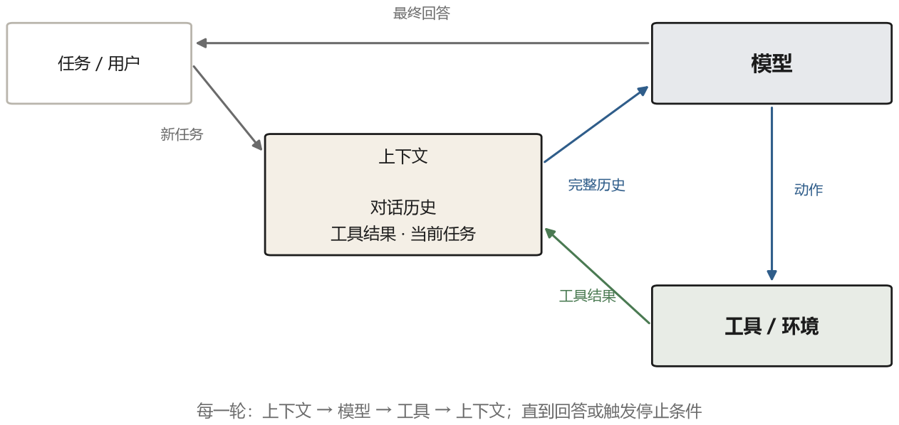
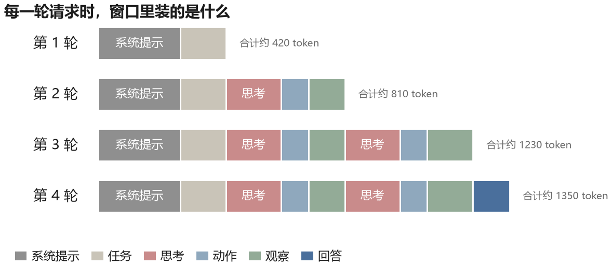

# 第 2 章 一个 Agent 的最小骨架

如果剥掉所有框架和库，一个 agent 剩下的东西少得让人意外：一个循环，一个工具表，一段不断变长的文本，加一个停下来的条件。这一章把这四样东西拆开看清楚，然后写出一个六十行就能跑完的版本。它解决不了什么实际问题，但它的结构和今天所有复杂系统是同一个结构。

## 2.1 循环

普通程序调用模型是这样的：读入用户的问题，拼一段提示，请求模型，把返回的文字显示出来，结束。模型在里面只被调用一次。

agent 把这个过程包进一个循环。模型输出之后，程序不是把结果给用户，而是先看这段输出里有没有“要调用某个工具”的意思。如果有，就执行那个工具，把执行结果追加到对话里，再请求一次模型。模型看到新的结果，决定下一步。如此往复，直到它说“我做完了”，或者步数用完。



图 2-1 里有个容易被忽略的细节：在这个手写示例的每一圈里，模型看到的都是**当时已经积累的完整消息历史**，包括之前的动作和结果。模型本身没有跨请求记忆，它对上一轮的了解来自这次重新传入的上下文。真实 API 可能另有工具消息、服务端状态或推理字段，但“应用必须管理任务状态”这一点不变。

## 2.2 四个零件

**模型**。负责在每一步决定做什么。这里的“决定”其实是一次采样：给一段文本，生成下一段文本。所谓的决策能力，来自提示里对输出格式的约束，以及模型在预训练中见过的类似模式。

**工具表**。一份清单，说明有哪些工具、每个工具做什么、参数长什么样。模型看不到函数的实现，只看到描述。所以工具描述写得好不好，直接决定模型会不会用、用得对不对。第五章会专门讲这件事，那里面的坑比想象的多。

**上下文**。一个不断增长的结构化消息列表，每条消息带角色和内容。系统提示、任务描述、历史动作、工具返回结果，都要按约定放进其中。它是模型的工作台，也是会被窗口上限和预算约束的资源。

**终止条件**。可以是模型自己宣布完成，可以是步数上限，可以是预算上限，也可以是外部检查（比如测试通过）。缺少终止条件的 agent 会在两个状态之间来回跳，烧掉一整天的 API 额度。

## 2.3 最小的实现

下面这段是完整可跑的教学版本，去掉注释不到八十行。它用假模型函数按顺序返回预先写好的句子，因此你不用 API key 就能观察循环；这不代表真实模型会稳定照同样格式回答。接入真实模型时，除了把 `mock_llm` 换成 API 调用，还要处理超时、限流、结构化输出和更严格的解析。

```python
# ===== 一个能跑的最小 agent =====
# 整段代码只做四件事：定义工具、写系统提示、解析模型输出、跑循环。
import json   # 把 Action 里的 JSON 文本解析成 Python 字典
import re     # 用正则从模型输出里把 {...} 那段抠出来


# ---------- 1. 工具：一个会算数的函数 ----------
def calc(expr: str) -> str:
    """输入一个算术表达式，返回结果。
    返回值一律是字符串：它要被原样拼进上下文，作为模型
    下一步能读到的“观察结果”，而不是交给程序去用。
    """
    # eval() 可以执行任意 Python 代码，所以先用白名单把输入
    # 锁死：只允许数字、四则运算符、括号和空格。
    if not re.fullmatch(r"[0-9+\-*/(). ]+", expr):
        return "错误：表达式包含非法字符"
    try:
        # 第二个参数把内置函数全部清空，即使输入里混进函数名
        # 也调不到任何东西；第三个参数是空的局部变量表。
        return str(eval(expr, {"__builtins__": {}}, {}))
    except Exception as e:
        # 除零、括号不配对等：把原因原样返回，模型下一轮
        # 看到这段文字，就知道该怎么改。
        return f"错误：{e}"


# 工具表。键是模型在 Action 里写的名字，值里两样东西：
#   fn   —— 真正被执行的函数
#   desc —— 给模型看的说明书（模型看不到代码，只能靠它猜用法）
TOOLS = {
    "calc": {
        "fn": calc,
        "desc": "计算一个算术表达式，例如 calc(expr='(12+8)*3')",
    },
}


# ---------- 2. 系统提示：规定输出格式 ----------
# 循环能不能转起来，全看这里定的格式。要点只有三条：
# 只允许两种输出；动作必须是合法 JSON；告诉它有哪些工具。
SYSTEM = """你是一个会用工具的助手。每一步只输出以下两种格式之一：

Thought: <你的推理>
Action: {"tool": "<工具名>", "args": {...}}

或者：

Thought: <你的推理>
Final Answer: <给用户的答复>

可用工具：
{tools}
"""
# 结尾的 {tools} 是占位符，请求前用字符串替换填进去（不能用
# format：提示词里本来就有 JSON 的花括号，会被当成占位符）


# ---------- 3. 解析：把一段文字变成“要做什么” ----------
def parse(text: str):
    """返回 (类型, 内容) 两元组：
       ("final", 答案文本)
       ("action", {"tool": ..., "args": {...}})
       ("error", 错误原因)
    """
    # 先看有没有最终答案。动作和答案同时出现时拒绝执行，
    # 避免把一段自相矛盾的输出当成完成。
    if "Final Answer:" in text:
        if "Action:" in text:
            return "error", "Action 和 Final Answer 不能同时出现"
        return "final", text.split("Final Answer:", 1)[1].strip()

    # 用正则找 Action: 后面的那段 {...}。
    # re.S 让点号也能匹配换行，因为 JSON 可能写成多行。
    m = re.search(r"Action:\s*(\{.*\})", text, re.S)
    if m:
        try:
            return "action", json.loads(m.group(1))
        except json.JSONDecodeError:
            # 括号找到了，但里面不是合法 JSON：
            # 少逗号、引号没转义、多写了字，都会走到这里。
            return "error", "动作不是合法 JSON"

    # 两样都没找到，说明模型跑题了。
    return "error", "输出里既没有 Action 也没有 Final Answer"


# ---------- 4. 主循环：问 → 解析 → 执行 → 写回 ----------
def run(task: str, llm, max_steps: int = 6):
    # 把工具表摊平成几行文字，准备塞进系统提示的 {tools} 处
    tools_desc = "\n".join(
        f"- {k}: {v['desc']}" for k, v in TOOLS.items()
    )

    # 上下文从这里开始：一条系统提示、一条用户任务。
    # 之后每一轮都往这个列表里追加，模型看到的就是它全部。
    system_prompt = SYSTEM.replace("{tools}", tools_desc)
    messages = [
        {"role": "system", "content": system_prompt},
        {"role": "user", "content": task},
    ]

    # 步数上限是保险丝：模型陷入死循环时，别让它无限烧钱
    for step in range(1, max_steps + 1):
        # ① 把整段上下文发给模型，拿到这一步的输出
        reply = llm(messages)

        # 模型说过的话也要进上下文，否则它下一轮不记得自己想过什么
        messages.append({"role": "assistant", "content": reply})

        # ② 看它想干什么
        kind, payload = parse(reply)

        # ③-1 它说做完了：把答案和历史一起返回
        if kind == "final":
            return payload, messages

        # ③-2 格式错了：把错误当成一条观察喂回去，让它自己改。
        # 注意 continue：格式错的时候不执行任何动作。
        if kind == "error":
            messages.append(
                {"role": "user", "content": f"格式错误：{payload}"}
            )
            continue

        # ③-3 要调工具：先按名字到表里查函数
        name = payload.get("tool")
        fn = TOOLS.get(name, {}).get("fn")

        if fn is None:
            # 名字对不上：不抛异常，而是把“没有这个工具”告诉模型，
            # 它会自己换一个。
            obs = f"错误：没有名为 {name} 的工具"
        else:
            try:
                # 把 {"expr": "18*7"} 展开成 calc(expr="18*7")
                obs = fn(**payload.get("args", {}))
            except TypeError as e:
                # 参数名写错、缺了必填项，同样作为观察返回
                obs = f"错误：参数不对（{e}）"

        # 本手写示例把工具结果包成 user 消息。真实工具调用 API
        # 通常有专门的 tool 角色或对应字段，应按平台文档写回。
        messages.append(
            {"role": "user", "content": f"Observation: {obs}"}
        )

    # 循环正常走完，说明步数用光了
    return "达到步数上限，未完成", messages
```

跑一次，任务设成“一箱苹果 24 个，每箱 18 元，买 7 箱要多少钱，另外算一下平均每个多少钱”：

```python
# ---------- 5. 用一个假模型跑一遍 ----------
# 真实场景里 llm(messages) 是一次 API 请求；这里用一个
# 按顺序吐出台词的函数代替，方便离线观察循环怎么走。
script = [
    'Thought: 先算总价，再算单价。\n'
    'Action: {"tool": "calc", "args": {"expr": "18*7"}}',

    'Thought: 总价 126 元，现在算单价。\n'
    'Action: {"tool": "calc", "args": {"expr": "126/24"}}',

    'Thought: 单价 5.25 元，两问都有答案了。\n'
    'Final Answer: 7 箱共 126 元，平均每个 5.25 元。',
]

def mock_llm(messages):
    # 数一数上下文里有几条 assistant 消息，就知道当前是第几轮：
    # 第 1 轮返回 script[0]，第 2 轮返回 script[1]，依此类推。
    turn = len([m for m in messages if m["role"] == "assistant"])
    return script[turn]

# 跑起来：answer 是最终答案，history 是完整历史
answer, history = run("一箱苹果 24 个，每箱 18 元，买 7 箱要多少钱？"
                      "平均每个多少钱？", mock_llm)
print(answer)
```

输出是“7 箱共 126 元，平均每个 5.25 元”。结果是对的，但更值得看的是 `history` 里发生了什么。这个离线例子只证明循环和工具数据流跑通了；`calc` 里的白名单加 `eval` 也只是为了缩短代码，不应直接暴露给不可信输入。真实系统应使用专门的算术解析器，并限制表达式长度和计算资源。

## 2.4 一次运行里到底有几段文本

把 `history` 打印出来，会看到七条消息：系统提示、任务、第一段思考加动作、`Observation: 126`、第二段思考加动作、`Observation: 5.25`、最后一段回答。模型的“记忆”就是这七段文字。



图 2-2 把每一轮请求时上下文里的内容画成了堆积条。第一次请求只有系统提示和任务；第三次请求时，前面所有的思考、动作、结果都还在里面。这就是 agent 的成本结构：每一轮都要把之前所有内容重新发一遍。一个跑了三十步的任务，最后一轮请求的输入可能是第一轮的二十倍。

这种“重发全部历史”的做法看似浪费，却是无状态模型 API 中常见的实现方式。部分平台提供服务端状态、前缀缓存等优化，但应用仍要决定逻辑上哪些历史该保留。后面会讲到压缩旧内容、只保留摘要、把中间结果写进文件、把子任务交给另一个 agent。所有这些优化，本质上都在回答同一个问题：哪些信息值得留在窗口里。

### 打印出来的历史长这样

上面那句“七条消息”很抽象，把关键字段摊开看就具体了。跑完那个例子，`history` 里是这七条：

```text
role=system     content="你是会用工具的助手…（后面是工具说明）"
role=user       content="一箱苹果 24 个，每箱 18 元，买 7 箱多少钱？"
role=assistant  content="Thought: 先算总价…  Action: {calc, 18*7}"
role=user       content="Observation: 126"
role=assistant  content="Thought: 再算单价…  Action: {calc, 126/24}"
role=user       content="Observation: 5.25"
role=assistant  content="Thought: 两问都有答案…  Final Answer: 126 元，5.25 元"
```

为了看清结构，这里把 `Action` 里的 JSON 写成了简写；真实内容是上一章代码里那种完整 JSON。

注意三件事。第一，本示例把工具结果包成 `user` 消息，并加 `Observation:` 前缀；这不等于所有模型 API 都只有三种角色。许多工具调用 API 有专门的 `tool` 角色或工具结果字段，第五章会按真实结构讲。第二，每次请求重发的是**当时已有**的历史，七条是运行结束后的总条数，不是第一轮就有七条。第三，`assistant` 消息里混着思考、动作和答案，程序靠前缀区分，所以格式漂移会直接影响控制流。

想亲眼看到这些数字，把第二章那段代码里的 `history` 打印出来即可：`print(json.dumps(history, ensure_ascii=False, indent=1))`。

## 2.5 最脆弱的地方是解析器

上面那段代码里，真正容易出问题的不是模型，是 `parse` 函数。模型输出的东西千奇百怪：JSON 前面多一句“好的，我来帮你”，`Action:` 写成 `action:`，引号用了中文全角，参数里嵌套了没转义的换行。任何一处都会让解析失败。

早期的 agent 框架在这上面吃了很多苦，于是演化出两种应对。一种是把格式约束写得更死，比如要求输出 XML 标签，或者干脆让模型输出一段代码然后由程序提取函数调用。另一种是不再依赖文本解析，而是让模型服务端直接返回结构化的工具调用字段——这件事在 2023 年被做进了模型 API，第五章会讲。

这个细节值得单独说一句，因为它揭示了一个通用规律：**agent 的可靠性往往不取决于模型有多聪明，而取决于接口有多确定。** 一个只能输出 95% 合法 JSON 的模型，在需要二十步的任务里已经会频繁遇到格式失败：若各步独立，至少出一次错的简化概率是 $1-0.95^{20}\approx64\%$。把格式错误作为可恢复的观察喂回去，能给模型一次修正机会；更稳妥的做法则是使用 API 的结构化工具调用和 Schema 约束，从生成阶段减少错误。

## 2.6 什么时候停

循环要有出口。上面的代码实际有两个直接出口：模型返回最终答案，或者步数用完；格式错误会消耗步数，不会单独触发另一种上限。真实系统还应加预算上限、时间上限、连续重复检测和外部完成条件。

“连续重复”这一条在实践中非常必要。模型有时候会陷入一种很典型的循环：调用搜索工具，得到空结果，然后换个说法再搜一次，还是空结果，再换一个说法。它每次都觉得自己在尝试新方法，实际上是在原地打转。简单的检测方式是看最近三次的动作是否高度相似，如果是，就强制插入一条提示：“你已经连续三次得到相同结果，请换一个思路，或者告诉用户你做不到。”

还有一种更隐蔽的失败：模型宣布完成，但事情没做完。它可能只做了一半就说“任务已完成”，也可能把一个失败的操作描述成成功。这就是第一章提到的虚假状态变更。对付它只有一个办法：不要相信模型的自述，去检查外部世界的真实状态。文件是否存在、测试是否通过、数据库里的记录是否真的写进去了。这个原则在后面会反复出现，第十一章讲 harness 时会展开。

## 2.7 骨架的三个空洞

到这里，最小 agent 已经能跑了。它的结构是完整的：感知（读上下文）、决策（模型采样）、行动（调工具）、反馈（把结果写回上下文）。但它有三个明显的空洞，后面每一部分的技术都在填这三个洞。

**第一个洞：它不会想。** 上面的例子之所以能一步算对，是因为任务简单，而 `mock_llm` 是预先写好的。真实模型遇到需要多步推理的任务时，容易在第一步就选错方向，然后一路错下去。第三章到第六章讲的就是怎么让它想得更清楚：把推理写出来、多采样几次投票、把问题拆开、做完回头检查。

**第二个洞：它记不住。** 上下文一满，早期的信息就被挤掉；换个会话，一切归零。第七章讲记忆，第八章讲怎么在有限窗口里安排信息。

**第三个洞：它的手脚很笨。** 一个 `calc` 工具什么都做不了。要让它读文件、跑命令、点网页，需要一整套接口设计，以及一个能安全执行这些动作的环境。这是第五章和第九章、第十章、第十一章的内容。

在填这些洞之前，还有一件事值得先做：看看在没有工具、只有文字的年代，人们是怎么让模型“想得更好”的。那段历史里的很多技巧，今天仍然在用，只是被藏进了模型的训练过程里。
