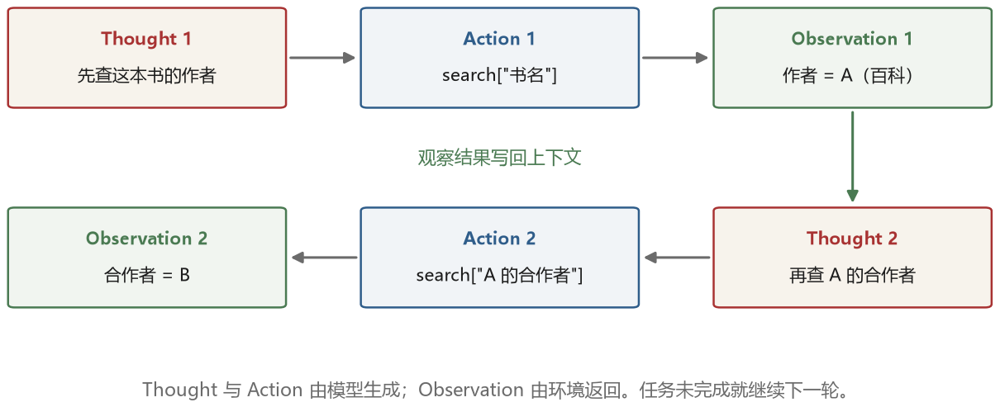
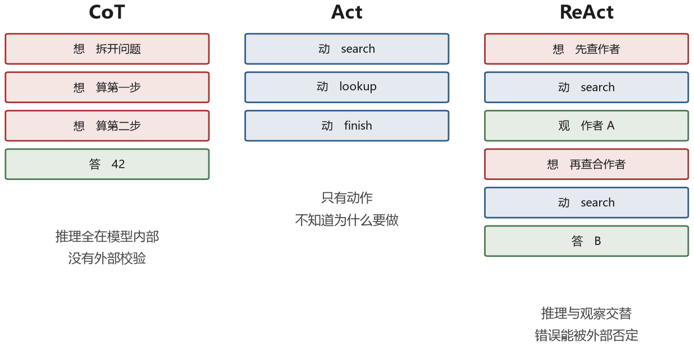

# 第 4 章 ReAct：把推理和行动缠在一起

2022 年 10 月，普林斯顿和 Google 的一组研究者挂出一篇论文，标题是 *ReAct: Synergizing Reasoning and Acting in Language Models*。这篇论文的方法简单到可以用一页纸讲完，后来成为许多 agent 系统的重要原型。今天不少 agent 框架里的“思考—调用工具—读结果”循环，都能看到它的影响。

这一章把 ReAct 拆开看：它为什么出现，它是怎么写的，它在哪些任务上赢，以及它在什么地方会翻车。

## 4.1 两条路，各自的病

在 ReAct 之前，让模型处理复杂任务有两条主流路线，各自都有明显的毛病。

第一条是思维链。上一章讲过，它让模型把推理过程写出来，在数学题上效果很好。但它有一个根本问题：**推理过程没有主动与外部世界核对的通道。** 模型可以写出“北京的人口是 2100 万，上海的人口是 2400 万，所以上海更大”，形式上看每一步都连贯，但如果起始数字记错了，整条链就建立在错误前提上。

第二条是纯行动。模型直接输出动作，比如“搜索[某某]”、“点击[按钮]”，执行完看结果，再出下一个动作。这条路线能接触到真实信息，但模型没有“想”的余地。它不知道为什么要搜这个词，搜到了也不知道该关注哪一句。在多跳问答这种需要“搜一次、看看结果、再决定搜什么”的任务上，纯行动的模型经常在第一跳就选了错误的查询词，然后一路在无关信息里打转。

两条路各有各的短板，而短板恰好是对方的长处。思维链擅长把问题拆开、维持一个连贯的目标；行动擅长获取新信息、纠正错误的事实假设。ReAct 的想法就是：为什么不交替着来？

## 4.2 交替的格式

ReAct 的做法是把输出格式规定成三段循环：

```text
Thought: 先查《海风与代码》的作者是谁。
Action: search[《海风与代码》作者]
Observation: 作者是林之遥。

Thought: 已经得到作者姓名，还需要查合作者，并确认对方的海军上将身份。
Action: search[林之遥 海军上将 合作]
Observation: ...

Thought: 信息足够了。
Action: finish[答案]
```

`Thought` 是模型自己的推理，不产生任何外部效果。`Action` 是调用一个工具，格式是“工具名[参数]”。`Observation` 不是模型写的，是环境返回的真实结果，由程序插入。

### 提示词怎么写

格式能稳定产出的前提，是提示里把规矩说清楚。论文的提示由三块拼成：几个完整的示例轨迹、可用工具及参数格式的说明、以及几条行为约束。

```text
你可以在需要时调用下面的工具：
  search[关键词]   在维基百科上检索
  lookup[词条]     查看某个词条的第一段
  finish[答案]     给出最终答案并结束

（以下是两个完整的示例，每个都是 Thought / Action / Observation 交替的轨迹）

请按同样的格式继续作答。注意：
- 每次只输出一段 Thought 和一个 Action，然后停下等待观察结果。
- 不要在 Thought 里自己编造 Observation。
- 信息足够时用 finish[答案] 结束；搜索无结果时换个说法重试。
- 最多进行 7 轮，超过则必须给出答案。
```

四类约束各有用处。第一条规定“一次一个动作”，否则模型会一口气写完十步，中间的结果全是编的。第二条堵住“假装执行”，这是 ReAct 最常见的失败模式。第三条处理空结果，避免它在原地打转。最后一条给了硬上限，让循环一定会结束。

完整示例轨迹和明确约束都很重要。模型会模仿示例里的字段顺序、动作格式和结束方式，但“等待观察”不能只靠模型自觉：程序要在 Action 后停止解码，执行工具，再把真实 Observation 写回。示例也要覆盖预期任务类型，例如单跳查证、多跳搜索和需要计算的情况。

这三段交替出现，构成一条轨迹。Observation 的来源尤其重要：它应由程序从工具结果填入，而不是让模型凭空续写。工具结果也可能过时或错误，所以“来自外部”不等于“必然为真”，但它至少提供了可检查、可纠正的新信息。



图 4-1 画出了这个循环的信息流。有一点值得强调：Thought 的内容会影响 Action 的选择，而 Observation 会回头修改下一个 Thought。这条回路是闭合的，也是它能自我纠错的原因。

## 4.3 一条完整的轨迹

看一个具体任务：用户问“《海风与代码》的作者是谁？他曾和哪位海军上将合作？”这里的人名和书名都是虚构的，为的是把机制讲清楚，不把示例当成真实知识。这个问题包含两次依赖：先拿到作者，才能继续查这个人的合作者；只背一个书名或只搜一次，都不够。

模型拿到工具说明和任务后，开始交替生成。下面的 `Thought` 是给循环看的工作笔记，`Action` 是程序可以执行的请求，`Observation` 只能由工具结果填入。

```text
Thought: 先查书名，拿到作者姓名，暂时不知道合作者。
Action: {"tool": "search", "args": {"query": "《海风与代码》 作者"}}
Observation: 出版社页面写着：“《海风与代码》，林之遥著，2021 年出版。”

Thought: 已知作者是林之遥。下一步要查他的合作者，并确认其海军上将身份。
Action: {"tool": "search", "args": {"query": "林之遥 海军上将 合作"}}
Observation: 一篇人物访谈提到：“林之遥在 1998 年与海军上将赵航合作完成航海史项目。”

Thought: 已找到合作者，再用一个独立来源核对，避免只凭一条网页下结论。
Action: {"tool": "search", "args": {"query": "林之遥 赵航 航海史项目"}}
Observation: 项目档案的作者名单同时列出林之遥与赵航，赵航的职务列为海军上将。

Action: {
  "tool": "finish",
  "args": {
    "answer": "作者是林之遥；合作者是海军上将赵航。",
    "sources": ["出版社页面", "人物访谈", "项目档案"]
  }
}
```

把这个轨迹和图 4-1 对照，可以看到图里的两轮只是缩短版：每轮都有“想法—动作—观察”，最终回答不是第一次搜索后就猜出来的。第三轮的独立核对也不是格式要求，而是这个任务额外需要的可靠性步骤。

ReAct 的收益来自**外部观察改变了后续上下文**。第一次查询前，模型不知道作者；查询之后，作者姓名成为下一次动作的输入。它仍然可能选错关键词、误读网页或相信错误来源，所以 ReAct 不是事实保证，只是让“获取证据—根据证据继续”成为可能。

还有一条边界要记住：论文实验中的成功率提升依赖任务、模型、工具和基线，不能把某个数字当成所有系统的固定收益。对我们来说，更重要的是看懂这条数据流，而不是背一个提升百分比。

## 4.4 在哪些任务上赢

论文在四类任务上做了实验，结论不太一样，值得分开看。

**知识密集的问答**（HotpotQA、FEVER）。ReAct 的表现优于纯行动，但单独使用时不如思维链的准确率高。有意思的是，把两者结合——先让 ReAct 走几轮收集事实，再用思维链做最后的推理——效果最好。这说明推理和行动不是替代关系，而是有各自擅长的段落。

**需要长程决策的环境**（ALFWorld，一个文字版的家务模拟器）。这是 ReAct 赢得最明显的场景。任务是“把干净的杯子放到柜子里”，需要先在房间里找杯子、找到水槽、清洗、再找柜子。论文报告 ReAct 的成功率比纯行动的基线高出 34 个绝对点。原因很直观：纯行动的模型记不住自己已经去过哪个房间，容易反复搜索同一处；有了 Thought，它可以在文字里记下“厨房已经查过，杯子不在那里”。

**网页购物**（WebShop）。ReAct 比纯行动高约 10 个绝对点。差距比 ALFWorld 小，因为网页上的动作本身带有很强的语义（点“搜索”、输入关键词），纯行动也能凑合。

**事实核查**。ReAct 的优势在于它能给出证据链：每一步搜到了什么，最后怎么得出结论。这让它的答案可审计，而不只是一个判断。



图 4-2 把三种范式的信息流画在一起对比。可以看出一条规律：**任务越需要与环境交互，交替的方式越占优；任务越纯粹依赖内部推理，纯思维链越占优。** 这个规律在后面选技术路线时会反复用到。

## 4.5 实现上的几个坑

ReAct 的论文只有几页，但要把它稳定地跑起来，需要处理不少细节。简短教程常会省略这些部分，实际项目却必须逐项处理。

**提示里要有明确的停止条件。** 论文的提示里有两句关键的话，一句是“如果信息足够，用 finish[答案] 结束”，另一句是“如果搜索没有结果，换个说法再试”。没有第一句，模型会无限地搜下去；没有第二句，模型遇到空结果就会卡住。

**Observation 必须截断。** 搜索引擎返回的网页可能有一万字。原样塞进上下文，几轮之后窗口就满了，而且大量无关文本会干扰模型的判断。常见做法是只保留前若干条结果的摘要，或者用一个小模型先做抽取。截断多少是个经验值，通常几百个 token 到一千多个 token。截得太狠会丢掉关键信息，截得太松会稀释注意力。

**解析失败要能恢复。** 模型可能输出 `Action: search("关键词")` 而不是 `search[关键词]`，也可能漏掉字段或把括号写坏。解析器可以按明确规则识别少量受控变体，但不要无限模糊匹配；无法确定含义时，应返回具体错误，让模型按格式重试。

**动作失败要有区别对待的反馈。** 工具返回“没有找到结果”和工具返回“请求超时”，对模型的意义完全不同。前者应该提示它换关键词，后者应该提示它重试或换工具。如果笼统地都返回“失败”，模型往往会在同一个动作上反复重试。

**要防止“假装执行”。** 模型有时会自己在 Thought 里写出 Observation 的内容，然后基于这个想象的观察继续推理。这是 ReAct 最危险的失败模式之一，因为它看起来完全正常。防御方法是严格按格式解析：只接受 `Action:` 之后的内容作为动作，任何在 Thought 里出现的“观察”都当成普通文本，不当作真实结果。

### 一个能用的解析器

上一版示例最容易踩的坑，是用“从第一个 `{` 到第一个 `}`”截取 JSON。遇到 `args` 里的嵌套对象，它会在内层就停住。更稳妥的办法是使用 JSON 解析器自带的 `raw_decode`：从 `{` 开始解析，让解析器自己处理嵌套、字符串和转义。

```python
import json
import re


def parse_action(text):
    """只解析，不执行；返回值分 finish、call、error 三类。"""
    final = re.search(
        r"^\s*Final\s*Answer\s*[:：]\s*(.+?)\s*$",
        text, flags=re.IGNORECASE | re.MULTILINE | re.DOTALL,
    )
    action = re.search(
        r"^\s*Action\s*[:：]", text,
        flags=re.IGNORECASE | re.MULTILINE,
    )
    if final:
        if action:
            return {"type": "error", "message": "动作和最终答案不能同时出现"}
        return {"type": "finish", "answer": final.group(1)}

    if not action:
        return {"type": "error", "message": "找不到独立的 Action 行"}

    start = text.find("{", action.end())
    if start < 0:
        return {"type": "error", "message": "Action 后没有 JSON 对象"}

    try:
        value, length = json.JSONDecoder().raw_decode(text[start:])
    except json.JSONDecodeError as exc:
        return {
            "type": "error",
            "message": f"JSON 第 {exc.pos} 个字符附近无效：{exc.msg}",
        }

    tail = text[start + length:].strip()
    if tail and tail != "`" * 3:
        return {"type": "error", "message": "JSON 后还有无法识别的内容"}
    if not isinstance(value, dict):
        return {"type": "error", "message": "动作必须是 JSON 对象"}
    if not isinstance(value.get("tool"), str):
        return {"type": "error", "message": "tool 必须是字符串"}
    if not isinstance(value.get("args"), dict):
        return {"type": "error", "message": "args 必须是 JSON 对象"}

    return {"type": "call", "tool": value["tool"], "args": value["args"]}
```

这个解析器故意不做“聪明修复”。单引号、尾随逗号、被截断的括号都会返回错误，而不是偷偷猜模型原本想写什么。静默改参数比明确失败更危险：一个引号替换可能正好改掉字符串参数里的内容。

解析器还要接受一组固定测试。下面七类输入分别覆盖嵌套参数、正常结束、尾随逗号、非 JSON、缺少动作、JSON 后追加内容，以及动作与答案混合。每次修改解析器后都重新运行，这叫**回归测试**——防止修一个新问题，又把旧问题放回来。

```python
cases = [
    ('Action: {"tool":"calc","args":{"expr":"1+1"}}', "call"),
    ('Final Answer: 已完成', "finish"),
    ('Action: {"tool":"calc","args":{"expr":"1+1",}}', "error"),
    ('Action: 1+1', "error"),
    ('Thought: 还没决定下一步', "error"),
    ('Action: {"tool":"calc","args":{}} 再执行一次', "error"),
    ('Action: {"tool":"calc","args":{}}\nFinal Answer: 完成', "error"),
]

for text, expected in cases:
    result = parse_action(text)
    print(result)
    assert result["type"] == expected
```

这七个测试通过，只说明七类已知情况被覆盖了，不代表真实流量里九成都没问题。上线后还应把实际失败样例脱敏、补进测试集。最后再次强调：`parse_action` 只把文本变成请求，真正执行前仍要检查工具白名单、参数范围和用户权限。

## 4.6 论文自己承认的失败

ReAct 论文里有一节错误分析，列出的问题今天看依然精准。

第一种是**推理和行动不匹配**。模型在 Thought 里说“我要查一下 X 的生日”，Action 里却搜了“Y 的电影”。这种错误在长轨迹里越来越常见，因为上下文里堆了太多相似的内容。

第二种是**重复动作**。模型反复执行同一个搜索，每次都得到同样的结果，却认为自己换了个角度。论文里提到，有些轨迹在这上面浪费了十几步。

第三种是**过早结束**。模型在信息还不充分时就调用 `finish`，给出一个不完整的答案。这通常发生在它已经写了很多步、上下文变长的时候，有点像人做难题做到一半想放弃。

第四种是**被搜索结果带偏**。搜索引擎返回的页面里如果有大量无关但语义相近的内容，模型会被吸引过去，忘记最初的问题是什么。

这四种失败，后来分别对应了不同的缓解手段：反思机制（第六章）帮助发现重复和过早结束，上下文压缩（第八章）缓解长轨迹的信息稀释，更好的工具设计（第五章）改善搜索结果质量。它们都不是自动消除错误的保证。

## 4.7 为什么它影响这么大

ReAct 不是第一个把工具调用放进语言模型的工作，也不在所有任务上效果最好。但它影响广泛，原因有三个。

**它的格式简单。** 三个标签，一句话的语法，便于用提示示范，也便于用各种语言实现。相比之下，同时期有些工作要求模型输出复杂树结构或特定领域语言，接入成本更高。

**它的循环和真实任务同构。** 人做事也是这个节奏：想一想，动一下，看看结果，再想。这种同构性让它在各种任务上都能凑合，虽然不一定最优。

**它把部分中间过程变成了可检查的记录。** 调试者可以阅读动作和观察，定位它在哪一步走错。不过，Thought 不保证忠实反映内部计算，真正可靠的审计还要结合工具日志和外部状态。

到了 2023 年，主流模型 API 开始原生支持工具调用，许多系统不再手写 Thought/Action 文本，而改用结构化字段。多步循环的核心仍然存在：模型返回工具调用请求，程序执行，把结果写回，再请求模型。`tool_calls` 和 `tool` 角色承载的是动作与观察；API 不一定提供或保留完整的 Thought。

有一点需要说清楚，因为它经常被混淆：ReAct 是**一种组织模型调用的方式**，不是模型的能力。它不需要训练，也不能让模型变得更聪明。它做的事情是把模型放进一个能接收反馈的位置。真正的能力提升要靠模型本身，而模型厂商在 2024 年之后确实把“会用工具”训练进了模型里，这就是下一章的内容。
