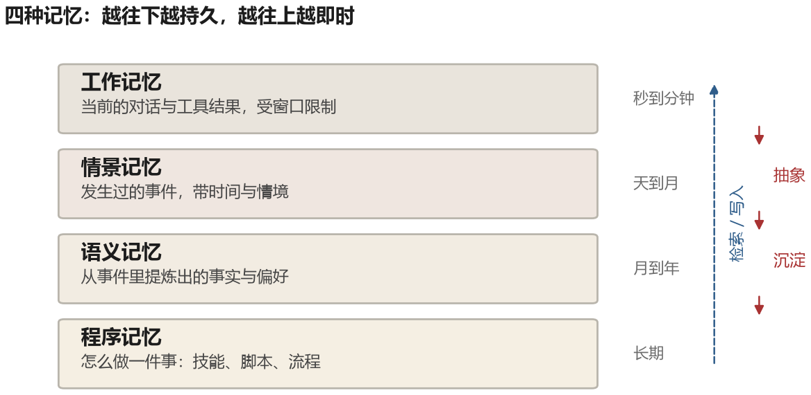
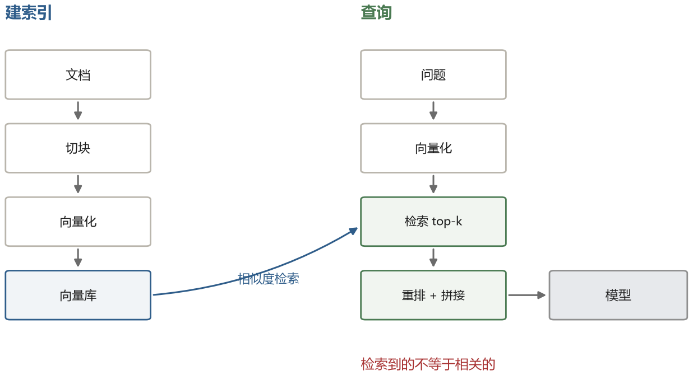
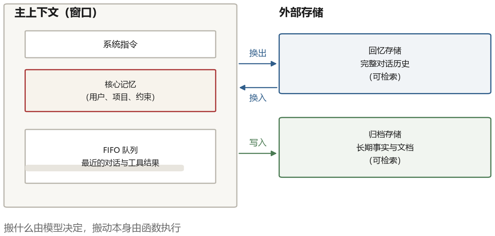
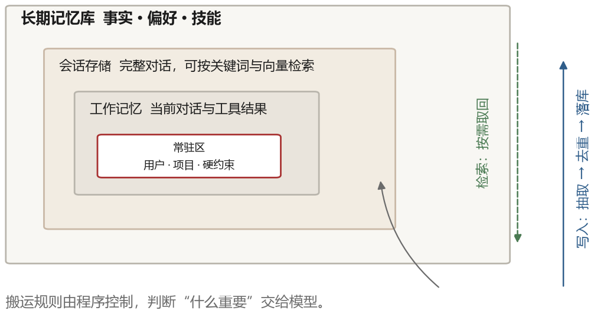

# 第 7 章 记忆：让 Agent 记住发生过什么

第二章说过，对一次无状态模型调用来说，对话记忆主要靠上下文窗口里的 token。模型参数里当然也有训练得到的知识，但那不等于“记得和你的对话”；窗口一关，若不借助外部存储，本次会话的轨迹就无法在下一次调用中自动出现。

一个真实的助手应该记得上周你让它改过哪个文件、记得你偏好什么样的代码风格、记得三个月前那次部署失败的教训。这些事情都放不进一次对话的上下文，就算放得进，也没必要每次都放。所以 agent 需要第二种记忆：存在模型之外、可以按需取回的记忆。

这一章先讲清楚“记忆”这个问题到底包含几件事，再看几条有代表性的技术路线，最后给出一个能落地的分层结构。

## 7.1 问题的三个面

把“记忆”这个词拆开，其实是三个不同的问题。

**容量问题**：上下文装不下所有历史。一个跑了三小时的任务，产生的对话可能有几十万字。要么压缩，要么丢掉，要么存到外面去。

**检索问题**：就算把历史都存下来了，怎么在需要的时候找到相关的那一段？人也有这个问题——你知道自己学过某个东西，但想不起来在哪看到的。

**持久问题**：会话结束之后，记忆要不要保留？保留多久？跨会话的记忆怎么保证不冲突、不过期、不泄露？

大多数关于 agent 记忆的讨论混在一起讲，结果什么都讲不清楚。分开看，会发现不同的技术路线其实在解决不同的问题。MemGPT 主要解决容量问题，RAG 主要解决检索问题，Mem0 这类产品主要解决持久化和管理问题。

## 7.2 分层的直觉

认知科学里有一组常被借用的区分：感觉记忆、工作记忆、长期记忆，长期记忆又分情景记忆（经历过的事）、语义记忆（事实和概念）、程序记忆（怎么做事）。

这套划分搬到 agent 上意外地合适。

**工作记忆**就是上下文窗口。它容量有限，内容随时被覆盖，但访问速度最快，是模型真正“看见”的东西。

**情景记忆**是发生过的事情的记录：某年某月某日，用户让我修一个 bug，我先查了日志，发现是缓存穿透。这类记忆的特点是带时间、带具体情境、按事件组织。

**语义记忆**是从具体事件里抽象出来的知识：这个项目的测试命令是 `make test`，用户不喜欢在代码里写行尾注释。这类记忆不带具体时间，是“事实”。

**程序记忆**是怎么做一件事的流程：部署要走哪几步、发布前要检查什么。对 agent 来说，这通常表现为可复用的技能、脚本或者提示模板。



CoALA 这篇论文（Cognitive Architectures for Language Agents）把这套结构形式化了，它把语言 agent 拆成工作记忆和长期记忆，长期记忆再分成情景、语义、程序三类，并指出每种记忆对应不同的读写操作。这个框架在 2023 年之后被大量引用，因为它给了一个共同语言，让不同系统之间的设计可以比较。

## 7.3 检索：RAG 及其边界

要讲记忆就绕不开 RAG。检索增强生成在 2020 年被提出时，目标不是给 agent 做记忆，而是给模型补充它参数里没有的知识。

### 索引与查询

它分两个阶段，离线建索引，在线查。

**建索引。** 先把文档切成块。每块 200 到 500 token、相邻块保留一定重叠，可以作为初始实验范围，而不是固定标准；代码、表格和合同需要不同的切法。然后用嵌入模型（embedding model）把每块编码成定长向量，存进向量库。向量库可用 HNSW、IVF 等近似最近邻索引，从大量候选中快速找出最相近的若干块；具体延迟取决于数据量、维度和部署环境。

**查询。** 用户的问题也用同一个嵌入模型编码成向量，在库里算相似度，取分数最高的 $k$ 块（$k$ 一般 3 到 20），拼成一段上下文，放在提示里让模型基于它作答。

$$\text{score}(q, d) = \cos\big(E(q),\, E(d)\big) = \frac{E(q)\cdot E(d)}{\lVert E(q)\rVert\,\lVert E(d)\rVert}$$

这种“问题和文档分别编码、只算向量相似度”的结构叫双塔（bi-encoder）。它的优点是文档向量可以离线算好，查询时只需编码问题，代价是问题和文档没有在编码阶段进行细粒度交互。因此，很多系统会在检索后加一个**重排器**（reranker）：把问题与每个候选块配对，送入一个交叉编码器逐对打分，再取前几名。它通常更慢，是否提升、提升多少要用自己的数据评估。



### 拿它当记忆用，会遇到的四个问题

这套流程简单有效，很快成了标配。但拿它当 agent 的记忆用，会遇到几个结构性问题。

**切块破坏了上下文。** 一个函数被切成三段，每段单独看都缺信息。检索到中间那段，模型不知道这个函数在哪个文件、被谁调用。缓解办法是给每块加上标题路径、文件名、前后块摘要这类“元信息”，或者用父子块结构：检索小块，返回大块。

**相似不等于相关。** 向量检索找的是语义相近的文本，但“相关”往往取决于任务。用户问“上次那个部署失败的问题修好了吗”，语义上最相近的可能是部署文档，而真正需要的是上周的故障记录。这种差距靠改嵌入模型解决不了，需要在检索时加入时间、来源、实体等结构化过滤条件。

**查询路径只负责读，不自动决定写什么。** RAG 建库当然有写入，但普通检索流程不会判断这次对话产生了哪些值得长期保留的新事实，也不会处理冲突和过期。Agent 记忆需要额外的写入策略：写什么、写到哪、和已有内容冲突怎么办、过期的怎么删。

**它没有“回忆”这个动作。** 人的记忆是有意识的搜索：先想起“大概是去年冬天”，再缩小到“和数据库有关”，最后定位到具体的事情。RAG 是一次性的相似度查询，没有多轮收敛的过程。有些系统开始做“迭代检索”：先查一次，看结果，根据结果改写查询再查，这实际上是把检索也变成了一个 agent 循环。

## 7.4 MemGPT：把模型当成操作系统

2023 年 10 月的 MemGPT 提出了一个很有想象力的类比：把 LLM 的上下文窗口当成内存，把外部存储当成磁盘，用操作系统的虚拟内存机制来管理。

### 三层内存

它的主上下文被切成固定的三段，位置和大小都是设计好的：

- **系统指令**：放在最前面，说明工具怎么用、当前时间、内存已经用了多少。
- **工作上下文**：一小块可读可写的“核心记忆”，存用户是谁、在做什么项目、有哪些硬约束。模型可以用 `core_memory_append` 往里加，用 `core_memory_replace` 改。
- **FIFO 队列**：最近的对话消息，按时间排，先进先出。

主上下文之外还有两个库：**回忆存储**保存完整的对话历史，可以按语义检索；**归档存储**保存任意文档和长期事实。两者都通过函数访问。

### 换页是怎么发生的

系统在每次请求前统计当前用了多少 token。教学上可以设两个阈值：超过软阈值（例如窗口的 70%）时提示模型整理记忆；接近硬上限时，程序必须淘汰或压缩最早的消息，并把原文保留到外部存储。具体阈值和搬运方式因实现而异，不能把 70% 当成 MemGPT 的固定规范。

模型的搬运动作也是函数调用：`archival_memory_insert` 写入、`archival_memory_search` 检索、`conversation_search` 回查早期对话。这些调用和普通工具调用没有区别，模型自己决定什么时候搬、搬哪一段。



### 函数链：为什么需要“心跳”

先看一次普通的工具调用是怎么走的，也就是第二章那个循环：

1. 用户发一句话，程序把它放进消息数组，请求模型；
2. 模型返回一个工具调用；
3. 程序执行工具，把结果追加进消息数组；
4. 程序再请求一次模型；
5. 模型这次返回一段给用户的话，没有工具调用；
6. 程序把这句话交给用户，循环结束，等待下一次用户输入。

问题出在第 6 步：这一轮对话的“驱动者”是用户。如果模型调工具不是为了回答用户，而是为了整理自己的记忆——把一段对话写进归档区、改一下核心记忆——那么它做完之后没有话要对用户说。按普通流程，程序只有两个选择：让它编一句“我整理好了”给用户看，很傻；或者停下来等用户，而用户可能几小时后才回来，这段时间内存整理就停在那里，后面的任务也接不上。

MemGPT 的做法是给工具返回值加一个标记 `request_heartbeat=true`。程序解析到这个标记，就不把控制权交回用户，而是立刻用工具的返回结果作为新的输入，再请求一次模型。用时间线写出来是这样（假设模型要把一段对话存进归档区）：

```text
t1  用户：我下周要去上海出差
    程序 → 模型（消息数组：system + 这句用户消息）

t2  模型 → 程序：调用 archival_memory_insert(text="用户下周去上海出差")
    程序执行写入

t3  程序 → 模型：{"result": "已保存", "request_heartbeat": true}
    注意：这里不是把结果给用户看，而是又发了一次模型

t4  模型 → 程序：记下了。需要我帮你看看那几天的天气吗？
    这条回复没有带 heartbeat 标记

t5  程序把这句话交给用户，循环结束
```

一次用户消息，触发了两次模型调用、一次工具执行。模型因此可以在“没人说话”的时候连续做几步内部操作，直到它自己决定停下来跟人说话。

有一点要说清楚：这个标记不是模型凭空发明的。系统提示里对它做了明确定义——“如果你调用了工具但还没完成任务，把 request_heartbeat 设为 true 继续；如果任务已经完成或需要用户回答，设为 false”。所以它本质上是**用函数参数表达控制流**：程序看参数决定要不要再转一圈，而不是让模型自己决定“我要不要再被调用一次”。这也解释了为什么这套机制可靠：判断标准是结构化的布尔值，不是模型的一句自然语言。

### 它证明了什么

关键在于，记忆管理同时使用了程序规则和模型判断：程序知道 token 是否接近上限，模型可以通过函数决定写入、检索或改写哪些语义内容。这在当时是一个有代表性的设计：把内存管理变成 agent 可以参与的操作，而不是只能靠人工预先整理。

这里还要区分两种“心跳”。上面的 `request_heartbeat` 表示“当前回合还没结束，请再次调用模型”，它是一个控制流标记，不是操作系统定时器。第十二章讲的常驻 agent 定时唤醒，则由调度器在某一时间触发任务；两者都能让 agent 继续做内部工作，但触发来源不同。

它的局限也很明显。让模型自己管理内存，意味着它会做出糟糕的决定：把重要的东西扔掉，把无关的东西反复搬来搬去。而且每次搬运都是一次额外的模型调用，成本不低。后来的系统更多采用“程序负责搬运、模型负责决定搬什么”的混合方式。

## 7.5 Mem0：抽取、整合、更新

Mem0 走的是另一条路：不做虚拟内存，做**记忆的抽取与整合**。它把“写记忆”拆成两个明确的阶段，每个阶段都是一次结构化的模型调用。

### 第一阶段：抽取

一段对话结束后，把最近若干条消息、会话摘要、以及几条已有记忆一起交给模型，让它输出一组“候选事实”。关键在提示里的约束：每条事实必须是**独立可理解的陈述句**，不能出现“他”“那个”这类指代；只保留跨会话仍然成立的信息，寒暄和临时状态丢掉。

```text
输入：用户：我把项目的包管理器换成 pnpm 了，npm 装依赖老是报 peer 冲突
     助手：好的，之后都用 pnpm。
输出：[{"fact": "该项目使用 pnpm 作为包管理器"},
      {"fact": "用户遇到过 npm 的 peer dependency 冲突"}]
```

### 第二阶段：更新

每条候选事实单独处理。先用它去检索最相近的若干条已有记忆（通常 5 到 10 条），把“新事实 + 相似旧记忆”一起交给模型，让它在四个动作里选一个：

```text
ADD     ：没有相似记忆，直接新增
UPDATE  ：已有记忆不完整或过时，改写那一条
DELETE  ：旧记忆与新事实矛盾，删掉
NOOP    ：已经有了，什么都不做
```

这个判断同样用函数调用（或 JSON）实现，输出里带目标记忆的 id 和改写后的文本。举个例子：旧记忆是“用户偏好 npm”，新事实是“项目改用 pnpm 了”，模型应该输出 UPDATE 而不是 ADD，否则两条互相矛盾的记忆会同时存在，以后检索到哪条全看运气。

这里的 pnpm 和 npm 都是 JavaScript 项目的依赖包管理工具；`peer dependency 冲突` 指相互依赖的软件包对版本要求不兼容。这个例子要保存的是项目当前使用哪个工具，而不是整段抱怨。

除了扁平的向量库，Mem0 还有一个图结构版本：抽取时同时识别实体和关系（用户—使用—pnpm），存成图，检索时可以沿着关系扩一跳。这对“这个项目的负责人还负责哪些项目”这类多跳问题有用。

论文在 LOCOMO 长对话记忆基准的相应设置中报告：Mem0 相比若干基线提高了准确率，并显著降低 token 消耗和延迟。这个结果支持“提炼后的记忆可能更高效”，但不保证在自己的数据上也有同样比例；抽取错误和检索漏召回都要单独评估。

这个思路的代价是抽取过程会丢信息。一句“用户说他下周三要去上海出差”被抽成“用户下周三去上海”，看起来没损失，但“出差”这个语境没了，下次判断要不要帮他订酒店时就少了一条线索。所以一些系统会同时保留原始片段和提炼后的事实，检索时两者都用。

## 7.6 记忆流与反思

更早的一个设计来自生成式智能体（Generative Agents）。这个工作造了二十多个住在小镇上的虚拟居民，每个居民有一个“记忆流”（memory stream）：所有的观察、对话、想法，都按时间顺序追加进去，每条带一个重要性评分（由模型自己打 1 到 10 分）。

检索的时候，用三个因子加权打分，再取总分最高的若干条放进上下文：

- **新近度**：按“距离现在多少小时”做指数衰减，衰减系数取 0.995。也就是说，每过 24 小时权重乘上 `0.995^24 ≈ 0.89`，一天掉一成，一周掉一半左右。
- **重要性**：写入时让模型给每条记忆打 1 到 10 分（“这件事有多值得记住”），检索时直接把这个分数归一化后加进去。
- **相关性**：当前情境和这条记忆的嵌入向量余弦相似度。

三个分数各自归一化，再按权重相加（论文里三项权重都取 1）。这个设计的好处是它同时照顾了“最近的”“重要的”“相关的”三件事：只看相关性会捞出很多陈年旧事，只看新近度会把关键约束挤掉。

这个设计里有个很有意思的步骤叫“反思”（reflection）。当累积的观察足够多时，系统会让模型回看最近的记忆，生成更高层的总结，比如“玛丽最近一直在准备情人节派对”。这些总结本身又作为新的记忆存进去，可以被再次检索。这就形成了一个抽象层级：从具体事件到概括认知。

这个机制解释了为什么“记忆”不等于“存档”。存档保留原始记录，面向模型的记忆还会提炼、重构和分层。生成式智能体由此提供了一种可实现的抽象机制：原始事件仍可回查，高层总结负责帮助后续检索和决策。

## 7.7 写入策略：什么值得记

所有记忆系统最终都要回答一个问题：什么值得记。

如果什么都记，记忆库很快变成一个垃圾场，检索质量下降，成本上升。如果只记“重要的”，判断标准又很难定。

实践中有几条经验。

**优先记可复用结论，同时保留过程原文。** “这个项目的超时配置已改为 300 秒，来源是某次提交”通常比“我们讨论了很久”更值得进长期记忆；但排错过程、决策理由和程序性经验也有价值，可留在轨迹或 Skill 中按需提炼，不能一概删除。

**记偏好和约束。** “这个项目不允许引入新的第三方依赖”这种约束，如果不在记忆里，agent 每次都会犯同样的错。这类记忆跨任务复用的价值很高，但也要注明适用于哪个项目和哪个用户，避免错误套用。

**记失败和教训。** 尤其是那些“下次遇到同样情况要小心”的模式。但教训必须具体、可执行，并最好能回指原始失败记录，否则一句“以后要更仔细”没有操作价值。

**带时间戳和来源。** 一条没有时间的事实，三个月后你不知道它还有没有效。一条没有来源的记忆，出错时你没法追溯。

**允许遗忘。** 不是所有记忆都要永久保留。给每条记忆一个衰减策略：任务相关的记忆在任务结束后归档，偏好类的长期保留，临时状态在几天后删除。遗忘不是缺陷，是维持信噪比的手段。

### 一条记忆的完整生命周期

“记忆”这个词太抽象，把它写成一条记录就清楚了。一条典型的记忆长这样：

```json
{
  "id": "mem_7f3a",
  "text": "该项目使用 pnpm 作为包管理器，禁止用 npm 安装依赖",
  "type": "preference",
  "source": "对话 2026-03-12，用户明确要求",
  "created_at": "2026-03-12T10:21:00",
  "last_used_at": "2026-04-02T09:03:00",
  "confidence": 0.9,
  "ttl_days": null
}
```

这些字段各有用途。`text` 是给模型读的独立陈述。`type` 帮助分库和过滤；偏好类是否每次注入要看任务和作用域，不能无限堆进上下文。`source` 用于追溯，`created_at` 记录创建时间，`last_used_at` 支持按使用情况排序。`confidence` 表示可信度，但模型自报的 0.9 也不是客观概率。`ttl_days` 是**存活时长**：临时状态可设几小时或几天，长期偏好可设 null；到期时刻要由 `created_at + ttl_days` 计算，或另存 `expires_at`。

它的生命周期是四步。**写入**：抽取记录，先查重再落库。**检索**：按当前任务、用户和项目作用域取出相关记录，并更新 `last_used_at`。**更新**：新事实与旧记录冲突时，修订旧记录并保留来源，而不是让两条矛盾记忆长期共存。**过期**：按创建时间和 `ttl_days` 判断到期，再删除、降权或重新确认；涉及权限和安全偏好的记录，不宜只因时间久就自动放宽。

这套字段看起来啰嗦，但每一样都对应一个真实的坑：没有 `source`，出错时无法归因；没有 `last_used_at`，常用的和不常用的混在一起；没有 `ttl_days`，三个月前的临时状态会被当成现在的事实。

## 7.8 一个能落地的分层

把上面的东西拼起来，一个实际可用的 agent 记忆大概长这样。



最内层是**常驻区**，几百到两千 token，放当前任务的硬约束：用户是谁、在做什么项目、有哪些不能碰的东西。这部分每次都进系统提示。

往外是**工作记忆**，就是当前的对话和工具结果，受上下文窗口限制。

再往外是**会话存储**，把完整对话按轮次存进数据库，支持按关键词和向量混合检索。这一层保证即使上下文被压缩，原始记录还在。

最外层是**长期记忆库**，存放从多次会话中提炼出来的事实、偏好、技能。写入要经过抽取和去重，读取要通过检索。

四个层次之间的搬运规则，最好由程序控制而不是模型控制。程序知道上下文用了多少 token，知道什么时候该压缩；模型只负责判断“这段内容重要吗”这种语义问题。把机械的部分交给代码，把判断的部分交给模型，这条原则在整本书里反复出现，因为它是所有可靠 agent 系统的共同特征。

最后要说一个容易被忽视的问题：记忆是攻击面。如果 agent 会把网页内容、邮件内容写进记忆库，那么一段精心构造的文本就能在记忆里种下一条“指令”，在未来的某次会话里被检索出来执行。这类攻击叫记忆投毒，第十六章会详细讲。设计记忆系统时，至少要区分“用户说的话”和“agent 从外部读到的东西”，后者不能当作可信指令。
