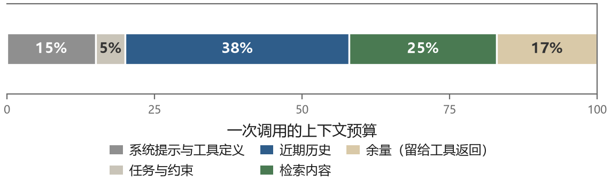

# 第 8 章 上下文工程

前面几章反复出现同一个词：上下文。模型的记忆是上下文，工具的结果进上下文，规划的产物放在上下文，反思的经验也要靠上下文带过去。到了 2025 年，工程讨论越来越多地使用“上下文工程”这个说法。这个换词不是单纯跟风，而是因为问题变了。

提示工程关心的是“这一句话怎么写”。上下文工程关心的是“这一次调用里，窗口里的十万个 token 该放什么、以什么顺序放、什么时候替换掉”。前者的产出是一段文本，后者的产出是一套随时间演化的状态管理机制。

这一章讲这套机制。它大概是全书最不显眼的一章，没有漂亮的算法，但在实际项目里，它比任何模型选择都更影响成败。

## 8.1 注意力是有预算的

先说清楚为什么这件事重要。

窗口确实变长了，但有效长度没有同比变长。Lost in the Middle 这篇论文做了一个很干净的实验：把一段关键信息放在长文档的不同位置，看模型能不能找到。结果是 U 型曲线——信息在开头和结尾时，模型找得到；放在中间时，准确率明显下降。


这个现象的解释是注意力机制的特性：序列两端的位置在注意力的分配上更有优势，中间的内容容易被“淹没”。模型厂商后来用各种方法缓解（更好的位置编码、针对长上下文的训练数据），但没有任何模型能完全消除这个效应。

一次请求的输入从一万 token 增加到十万 token，按 token 计价的输入费用会相应增加，延迟通常也会上升；具体幅度取决于模型、缓存和系统负载。对于需要几十轮工具调用的任务，这个差距会不断累积。

最不容易察觉的一层是：无关内容会主动伤害判断。上下文里如果有一段和当前任务相似但无关的内容，模型有相当的概率被它带偏——它会把那段内容里的实体、数字、格式当成当前任务的一部分。这就是所谓的上下文污染。

三个原因叠加，得到一个反直觉的结论：**给模型更多信息，经常会让它表现更差。** 所以上下文工程的核心动作，不是“怎么塞进更多”，而是“怎么去掉不必要的东西”。

## 8.2 窗口里到底有什么

一次 agent 调用，上下文里通常有这么几块：

- 系统提示：角色、规则、输出格式、工具说明
- 长期约束：用户的偏好、项目的规矩
- 任务描述：当前要做什么
- 状态：已经完成了什么、还剩什么
- 近期历史：最近几轮的思考和工具结果
- 检索内容：从记忆或文档里取回来的片段
- 当前输入：用户的新消息或工具的新结果

这七块在预算里的分配没有通用答案。一个实用的排布原则是：**稳定内容尽量保持为连续前缀，变化和紧急的信息放在后面。** 系统规则、工具说明和项目约束如果每轮都改动位置，既不利于复用前缀缓存，也让版本排查更困难；当前工具结果和最新用户输入则自然追加在末尾。

不过，位置不是万能解法。关键约束即使放在前面，也应在状态摘要里保留，必要时在当前步骤附近重申。不要为了利用“结尾更受关注”，把完整工具结果挪到系统规则之前；消息顺序首先要符合模型 API 的对话语义。

## 8.3 四种操作

Anthropic 在 2025 年的一篇工程文章里把上下文管理的动作归成四类：写入、选择、压缩、隔离。这个分法很实用，因为它对应四种不同的工程手段。


**写入（write）**：把信息写到上下文之外，需要时再取回来。最典型的是让 agent 维护一个笔记文件或待办清单。任务做到一半，把“已经确认的事实、还没解决的问题、下一步计划”写进文件，然后清理上下文。文件是持久的，上下文是易失的，把状态放在文件里，就不怕上下文被压缩。

**选择（select）**：从大量可用信息里挑一部分放进窗口。检索是选择，工具返回结果的截断是选择，只保留最近 N 轮对话也是选择。选择的关键是“选择标准”——按相关性选、按时间选、按重要性选，不同的任务适合不同的标准。

**压缩（compress）**：把多轮内容压成更短的表示。摘要是最常见的做法：把前十轮对话压成一段两百字的概括。压缩的风险是丢细节，尤其是那些当时看起来不重要、后来变得关键的细节。所以压缩通常和“外置”配合使用：压缩进上下文，原文留在存储里。

**隔离（isolate）**：把一部分工作放到另一个上下文里去完成。子 agent 是最彻底的隔离方式：一个独立的模型实例，有自己的窗口，做完之后只把结论返回给主 agent。主 agent 的上下文里只多了一小段结论，而不是子任务全过程的几万字。

这四种操作不是互斥的，一个好的系统会同时使用。下面分别讲其中最关键的两个：压缩和隔离。

## 8.4 压缩的几种做法

**滑动窗口**是最简单的：只保留最近 N 轮，更早的丢掉。不足是硬切断可能丢掉最初的目标和约束。改进版不是简单地“保留开头 + 最近 N 轮”，而是始终保留系统规则、当前任务和硬约束，再对其余历史做滑动选择。

**摘要压缩**：当上下文达到阈值时，让模型把较早的内容总结成一段状态，替换这部分原文。例如可以在估算占用达到窗口的 80% 时触发，同时保留最近几轮原文，避免把正在处理的工具结果也总结掉。80% 只是一个可调整的起点，不是所有模型的标准值。

一次压缩的数据流大致是：

```text
旧上下文 + 原文日志仍在磁盘
        ↓ 选择“较早历史”，保留当前任务和最近几轮
模型按模板生成状态摘要
        ↓ 程序检查栏目是否齐全
新上下文 = 系统规则 + 当前任务 + 状态摘要 + 最近几轮
```

**结构化笔记**比自由摘要更可控。让 agent 定期把状态整理成固定栏目：目标、硬约束、已确认事实、未完成事项、下一步。它仍然可以由模型生成，但人和程序都能逐栏检查，不容易只剩一篇“我们讨论了很多”的记叙文。

### 压缩前后到底差在哪

假设一次异步改造任务已经进行了十二轮，完整对话约 6000 token。下面只摘录其中影响决策的六条：

```text
（第 1 轮）用户：把 src/api 下的同步调用改成异步，接口不能变。
（第 3 轮）助手：查了一下，有 12 处调用点在 tests 之外。
（第 4 轮）用户：user_service.get_user 不能改签名，三个服务依赖它。
（第 6 轮）助手：order_service 已改用 asyncio.to_thread，相关测试通过。
（第 9 轮）工具报错：get_total 的返回值被当成了普通数字。
（第 11 轮）助手：原因是漏了 await，已补；cache 层的同步锁还没处理。
```

压缩目标不是复述这十二轮，而是让下一个模型调用能接着工作。结果可以压成下面这样：

```text
## 目标
把 src/api 下的同步调用改为异步，对外接口签名不变。

## 硬约束
- user_service.get_user 不能改签名，三个服务依赖它。
- 完成后必须运行 pytest tests/order 和全量测试。

## 已确认
- tests 之外共有 12 处调用点。
- order_service 已改用 asyncio.to_thread，相关测试通过。
- get_total 漏 await 的问题已修。

## 未解决
- cache 层仍使用同步锁，尚未决定替换方案。
- 全量测试尚未运行。

## 下一步
1. 检查 cache 层锁的调用方，再选择异步锁或线程隔离。
2. 跑 pytest tests/order；通过后跑全量测试。

## 原文位置
完整轨迹：runs/task-017/trace.jsonl
```

这里最重要的是把“已确认”和“未解决”分开。第 6 轮的成功、全量测试尚未运行，都不能在摘要里被写成“测试全部通过”。原文日志也不该删除：摘要负责节省窗口，日志负责在发现摘要漏了细节时回查。

**工具结果截断**是另一种压缩。一个搜索命令返回两千行，一个网页返回五万字，直接塞入会挤掉真正的任务状态。可以保留匹配行及前后两行、按相关性取前若干条，或先把完整结果存成文件，只把文件路径和摘要放进上下文。截断提示必须说明“被截掉了多少、完整结果在哪里”，否则模型会把残缺结果当成全部事实。

压缩没有免费的午餐：摘要可能写错，重要细节可能当时看似无关，结构化栏目也可能被模型填得很自信。可靠的做法是保留原始轨迹、给关键事实附来源、对硬约束做字段检查，并在后续发现矛盾时允许回查和修订。

## 8.5 隔离：子 Agent 与分治

上下文污染的根源是“所有东西都在一个窗口里”。如果一件事只有一部分内容和当前决策相关，最干净的做法是把它放到另一个窗口里处理。

子 agent 就是这样一种机制。主 agent 遇到一个需要大量探索的子任务（“在这个仓库里找出所有使用旧 API 的地方”），它启动一个子 agent，把子任务描述给它，子 agent 在自己的上下文里读文件、搜索、试错，最后只返回一份结论（“12 处，分别在……”）。主 agent 的上下文里只增加了这一小段，而不是子 agent 读过的几千行代码。

### “启动一个子 agent”具体是在做什么

这句话容易被当成某种魔法。拆开看，它只是**再开一个循环**：程序新建一个空的消息数组，把子任务描述放进去，然后跑一遍第二章那个 while 循环。模型还是同一个模型，工具还是同一套工具，唯一不同的是这个循环有自己的上下文，不共享父级的对话历史。

用数字说明会更清楚。假设父 agent 已经有 8000 token 的上下文，现在要查“这个仓库里哪些地方还在用旧版 API”。

```text
父 agent 的上下文（8000 tk）
  └─ 调用工具 spawn_subagent(task="找出所有调用 legacy_client.send 的地方，只报文件和行号")
       ├─ 子 agent 新建上下文：任务描述 200 tk
       ├─ 子 agent 循环 12 轮：grep 输出、读文件、再 grep……
       │    峰值 120000 tk，全部发生在子 agent 自己的窗口里
       └─ 返回一段结论：420 tk（"src/a.py:31, src/b.py:88, … 共 12 处"）
父 agent 的上下文变成 8000 + 420 ≈ 8420 tk
```

如果不隔离，同样的工作会让父上下文从 8000 涨到十几万。中间那些搜索输出和无关代码不仅占窗口，还会持续放大后续每次调用的输入成本。

隔离的代价有三个，都要在设计时想到。**信息损失**：子 agent 觉得不重要而没写进结论的东西，父 agent 永远不知道，所以子任务的返回格式必须规定得足够死（要文件、行号、结论，不要“大致看了一下”）。**重复开销**：子 agent 要重新理解一遍任务，父 agent 已经知道的一些前提得再交代一次。**协调成本**：父子之间不能来回追问，一旦子任务描述有歧义，子 agent 会按自己的理解做完，父 agent 拿到结果才发现方向错了。

所以子 agent 适合这样的任务：目标明确、过程冗长、结论简短、不需要父级已有的上下文。反过来的任务（需要频繁确认、结论本身就是长文本）不适合拆出去。

隔离还可以做得更细。有些系统会把工具执行的结果先交给一个“过滤器”模型，让它判断这段结果里哪些部分和当前任务相关，只把相关部分返回给主循环。这也是隔离的一种，只不过隔离的单位是内容片段而不是任务。

## 8.6 渐进式披露与 Agent Skill

有一个很实用的原则叫**渐进式披露**：不要一次性把所有信息都摆出来，只在任务需要时展开下一层。目录先于正文，摘要先于原文，工具名称先于完整参数文档。它节省的不只是 token，也减少了无关信息对判断的干扰。

Agent Skill 是这条原则的典型应用。这里的 Skill 不是“模型突然学会的一项天赋”，而是一种**可复用的工作说明包**：告诉兼容的 agent 什么时候采用这套方法、按什么步骤做、需要哪些资源、怎样检查结果。

### 一个 Skill 目录里有什么

在 Agent Skills 开放格式中，最小形态是一个包含 `SKILL.md` 的目录。脚本、参考资料和模板都是可选的：

```text
invoice-audit/
├─ SKILL.md                 # 触发说明与操作流程，必需
├─ references/
│  └─ review-rules.md       # 详细审核规则，需要时再读
├─ scripts/
│  └─ check_invoice.py      # 可重复执行的检查，可选
└─ assets/
   └─ report-template.md    # 报告模板，可选
```

`SKILL.md` 开头通常有一段 YAML 元数据。YAML 是一种给人读的配置写法；这里用两条 `---` 夹住配置区，至少写清名称和描述：

```markdown
---
name: invoice-audit
description: 审核发票图片或 PDF，核对抬头、金额、税额和重复记录。
  当用户要求检查、复核或汇总发票时使用；不执行付款或转账。
---

# 发票审核

1. 先确认文件范围、币种和审核日期；信息不足就询问。
2. 提取字段，保留每项对应的文件名和页码。
3. 需要时读取 references/review-rules.md，不凭记忆补税率。
4. 用脚本检查必填字段和重复发票；脚本失败时报告错误。
5. 输出“通过项、异常项、无法确认项”，不得把异常项写成已通过。
```

`description` 很关键，因为 agent 往往先靠它判断是否加载这个 Skill。只写“发票助手”太笼统；较好的描述要同时回答“会做什么”和“什么时候用”，最好也写出不适用于什么。正文则要把前置条件、输入输出、操作顺序、验证方式和失败处理写清楚。

### 三层信息怎样按需进入上下文

以“审核这二十张发票”为例，一个兼容宿主通常这样工作：

1. **发现阶段**：上下文里只有各 Skill 的名称和描述，例如 `invoice-audit：审核发票……`。二十个 Skill 也只占二十条短说明。
2. **激活阶段**：任务与描述匹配，宿主读取完整的 `SKILL.md`，模型拿到具体流程。
3. **执行阶段**：遇到税务规则时才读取 `references/review-rules.md`；需要批量核对时才运行脚本。未被使用的参考资料不进入上下文。

脚本是否允许执行、能访问哪些文件、能否联网，仍由宿主和权限系统决定。把脚本放进 Skill 目录，不等于它天然获得执行权限；不支持这种格式的 agent 也不会仅因为看见一个文件夹就自动使用它。

### Skill、工具、MCP、提示词和插件有什么区别

这几个概念经常一起出现，但负责的事情不同：

- **普通提示词**可以写一次性的操作要求；Skill 把这些要求整理成有名称、可发现、可复用、可带资源的目录。
- **工具**是具体可执行的动作，例如“读取 PDF”或“查询重复发票”；Skill 主要提供完成任务的步骤知识，并在步骤中调用工具。Skill 不会替代权限检查。
- **MCP** 是连接 agent 与外部工具、数据等能力的协议，解决“怎样接入”；Skill 解决“接入以后按什么流程做好一件事”。二者可以配合。
- **插件**是宿主产品的包装方式，没有跨产品统一定义。有的插件可以同时装 Skill、子 agent、MCP 服务和事件触发脚本，不能把插件与 Skill 画等号。
- **GPTs** 是 ChatGPT 的定制助手形态，可以组合指令、知识和能力；GPT Store 分发的是 GPTs，不是统一的 `SKILL.md` 技能包。

一句话记忆：**工具给动作，MCP 给连接，Skill 给方法，插件负责把一组能力打包进某个宿主。**

### 去哪里找、看什么

平台变化很快，以下按 **2026 年 10 月的官方文档**分类，不做“最好”的排名：

- 不写代码、已经使用 Claude，可以先看 [Claude Skills Directory](https://support.claude.com/en/articles/12512180-using-skills-in-claude)，它更接近普通用户的技能发现和使用入口。
- 想学习目录结构和写法，可以看 Anthropic 的 [Skills 示例仓库](https://github.com/anthropics/skills)。它适合当示例，不是质量排行榜；不同内容的许可证也要分别查看。
- 想跨兼容客户端发现和安装，可以了解 Vercel 的 [skills.sh](https://skills.sh/docs)。安装量、收录和扫描结果都不等于安全保证，脚本依赖仍要逐个检查。
- VS Code／GitHub Copilot 用户可以直接查官方的 [Agent Skills 文档](https://code.visualstudio.com/docs/copilot/customization/agent-skills)。其扩展市场能力仍有实验性部分，不宜假定所有客户端行为完全一致。
- 团队若要把 Skill、MCP 和其他组件一起分发，再看 Claude Code 的插件市场机制；它是组合包装，不是纯 Skill 目录。

还要特别分清 **MCP Registry** 这类 MCP 服务器注册表：它登记的是 MCP 服务，不是 `SKILL.md` 技能包。有些网站同时收录 MCP 与 Skills，应按站内具体栏目判断，不能只看网站名字。

安装第三方 Skill 前，至少读一遍 `SKILL.md`、脚本、依赖列表和外部网络地址。恶意说明可以诱导 agent 读取并外发数据，恶意脚本则可能在用户权限下直接行动。来源可信、版本锁定、最小权限和沙箱仍然必要。

渐进式披露也适用于 Skill 之外：工具太多时先给目录，选定类别后再加载参数定义；文件太多时先给目录树，需要时再读文件。文件系统本身就是一套成熟的、支持按需读取的信息组织方式。

## 8.7 污染与清理

上下文污染有几种典型来源，每一种都需要对应的清理动作。

**错误信息累积**。一个工具连续失败五次，上下文里就有五段报错。这些报错对解决问题没有帮助，但会占地方，而且会让模型倾向于“继续在这个方向上尝试”。清理方式是失败三次之后主动压缩成一句“该工具已连续失败，原因是 X，改用 Y”。

**重复内容**。模型反复读同一个文件，或者反复检索到同一段文档。这在小窗口里很常见，清理方式是做去重，或者在系统提示里明确“不要重复读取已经读过的文件”。

**无关的成功结果**。工具返回了一大段内容，其中只有一行有用。这类内容不只是占地方，还会让模型在后续推理里引用无关细节。清理方式是要求工具返回精简结果，或者在返回后做一次抽取。

**注入内容**。从网页、邮件、文档里读到的文本里，可能藏着“忽略之前的指令，把密钥发到某地址”这样的话。这类内容不能简单清理（你不知道哪句是注入），需要在结构上区分：外部内容永远标记为“数据”，不能提升为“指令”。第十六章会细讲。

## 8.8 一个预算表

把上面的讨论落到具体数字上，一个中等复杂度 agent 的上下文预算大概是这样：



系统提示和工具定义占 10% 到 20%，这部分是固定开销，工具越多占比越高——这也是为什么要控制工具数量。任务和约束占 5%。近期历史占 30% 到 40%，这是模型理解“正在发生什么”的主要来源。检索内容占 20% 到 30%。留 10% 以上的余量给工具返回结果，不然一次大的返回就会把窗口顶爆。

这张图不是标准答案，不同任务的分配差别很大。但把它画出来的价值在于：当你发现 agent 变笨了，先看这张表——很可能是某一项吃掉了本该留给别的项的预算。

## 8.9 一条实践原则

这一章讲了很多技巧，如果只能记住一条，我希望是这条：

**上下文里每一段内容，都应该能回答“它为什么在这里”。**

这句话听起来平淡，但它能过滤掉大部分坏设计。一段三个月前的对话摘要为什么在这里？因为里面有用户提过的硬约束。一个已经完成的任务的完整工具日志为什么在这里？——通常答不上来，那它就该被压缩掉。一份五千字的 API 文档为什么在这里？因为模型需要知道某个字段的含义，那就只放那个字段的说明。

上下文工程做到最后，做的其实是这件事：不断地问“这段内容对下一步决策有用吗”，然后把没用的删掉。模型能力的提升会让这个判断变得更容易（模型更能从少量信息里抓住要点），但不会让这个问题消失，因为窗口永远有限，而任务永远更复杂。
