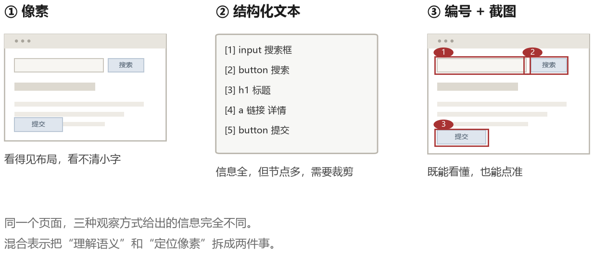
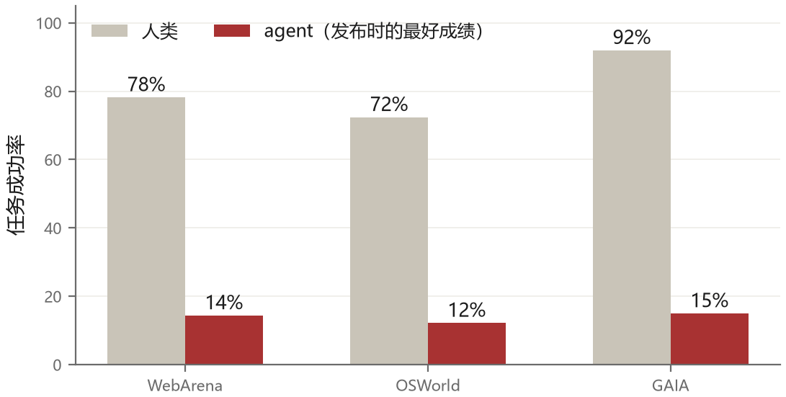

# 第 10 章 操作界面：浏览器与计算机

第九章的 agent 活在一个有文件系统、有命令行、有测试的世界里。那个世界是为程序员造的，一切都可以用文本精确表达。但大部分真实软件不是这样：报销系统、CRM、政府网站、医院的信息系统、公司内部的旧后台——它们只有一个网页，或者一个窗口，一串按钮。

要让 agent 处理这些任务，它必须学会像人一样：看屏幕，移动鼠标，点，输入，滚动，等页面加载。

这条路比代码那条难走得多，因为界面的信息量巨大、状态空间连续、反馈延迟且噪声大。但它的价值也大得多，因为它通向的是“替代人在电脑前做的重复劳动”这件事本身。

## 10.1 界面的三种表示

一个网页或一个桌面应用，对 agent 来说可以有三层表示。

**像素**。一张截图，模型看得见布局、颜色、文字、图标。这是最接近人的表示，也是最通用的——任何界面都有像素。短板是分辨率有限，小字看不清；而且从像素到“该点哪里”的映射需要模型具备空间定位能力，这个能力目前还不算强。

**结构化文本**。网页有**文档对象模型**（DOM，浏览器把 HTML 元素组织成的树），桌面应用常有无障碍树（accessibility tree，向辅助技术暴露控件语义的结构）。它们包含元素类型、文字、位置和层级，模型可以读到“一个按钮，文字是‘提交’”。麻烦在于树可能有几千个节点，需要裁剪；桌面应用的无障碍支持也参差不齐。

**混合表示**。把结构化文本里的可交互元素标上编号，同时给一张截图，在截图对应位置画出编号。模型看到“元素 12 是搜索框”，也能参照它在哪里。这个技巧叫 set-of-marks（给元素集合加标记），目标是同时帮助“看懂”和“点准”。



实践中常见的是混合表示：截图提供全局布局，编号文本提供精确引用。纯像素方案更通用，不需要页面结构，但对视觉定位能力要求更高；具体成功率要按模型和界面测试。

## 10.2 动作空间

动作通常有这么几种：点击（坐标或元素编号）、输入文字、按键（回车、Tab、组合键）、滚动、拖拽、切换标签页、等待。

看起来简单，难点在细节。

**点击哪里**。如果按元素编号点，需要把编号映射回真实 DOM 节点；如果按坐标点，需要考虑缩放、滚动位置和 iframe（嵌在当前页面里的另一个页面区域）。点击偏移可能让 agent 落到旁边按钮上，所以动作后还要检查实际目标。

**输入到哪里**。输入前要先聚焦。有些输入框点击后才会出现，有些点击后会失去焦点。稳妥的做法是“点击、等 100 毫秒、确认焦点、再输入”。

**等待多久**。这是最折磨人的部分。页面加载可能 100 毫秒，也可能 10 秒。固定等待太慢，不等待就点空。好的做法是等待某个条件成立（某个元素出现、某个网络请求完成），而不是等固定时间。

**怎么知道动作生效了**。点了一个按钮，页面可能变了，也可能弹了一个错误提示，也可能什么都没发生。agent 需要比较动作前后的状态，判断结果。

## 10.3 定位是最大的技术难点

把“点击提交按钮”这个意图落到具体的坐标上，是整个流程里最容易出错的一步。

早期方案是让模型直接输出坐标。这种方法在简单页面上可以工作，在复杂页面上对小目标和精细位置的定位更困难，因为视觉定位要求细粒度空间理解。命中率受模型、截图分辨率、元素大小和评测方式影响，不宜用一个固定百分比概括所有模型。

set-of-marks 缓解了这个问题：模型只需要输出“点击 12 号”，而 12 号元素的坐标由程序提供。这把视觉定位问题转化成了“在文本列表里选一个”，回到了语言模型擅长的领域。

但 set-of-marks 也有麻烦。一个页面上的可交互元素可能有几百个，全部标注会让截图变得混乱，文本列表也会很长。需要筛选：只标注视口内可见的、只标注看起来可交互的、按任务相关性排序。筛选规则本身又会引入错误——漏标了一个关键的链接，agent 就找不到入口。

### 元素表长什么样

set-of-marks 的做法是：程序先把页面上可交互的元素找出来，编上号，再把“编号 + 元素信息”和一张标了号的截图一起给模型。元素表是一串 JSON：

```json
[
  {"id": 1, "role": "textbox", "name": "搜索", "bbox": [120, 86, 430, 112]},
  {"id": 2, "role": "button",  "name": "搜索", "bbox": [440, 86, 500, 112]},
  {"id": 3, "role": "link",    "name": "高级搜索", "bbox": [120, 120, 190, 136]},
  {"id": 4, "role": "combobox","name": "排序：综合", "bbox": [700, 200, 820, 224]}
]
```

模型不再输出坐标，而是输出一个编号：

```json
{"action": "click", "target": 2, "reason": "先提交搜索"}
```

程序拿到编号，回表里查 `bbox`，算出中心点 (470, 99)，再换算成真实屏幕坐标去点击。这一步很关键：**模型只做“选哪个”，坐标由程序算**。这把细粒度视觉定位的一部分转成了程序可查表的计算，但程序仍可能标错框或映射错节点。

`bbox` 是“bounding box”，即元素的矩形范围，用左上角和右下角两个点表示。换算时要先弄清坐标系：它可能相对视口、完整文档或缩放后的截图，取决于采集工具。截图缩放和页面滚动都要纳入换算，并处理 iframe 的偏移。两处算错，表现就是“点偏了”，而模型只看到页面没变化，可能继续无效重试。

## 10.4 基准测试给出的冷水

这一节要泼点冷水，因为 GUI agent 的实际能力和宣传的差距比较大。

**WebArena** 造了几个仿真网站（购物、论坛、代码托管、企业后台），任务是“把购物车里的商品换成另一个尺码”这种真实操作。论文报告，GPT-4 驱动的 agent 成功率是 14.41%，而人类是 78.24%。

**Mind2Web** 用真实网站的离线快照测试泛化能力，结论是：在训练过的网站上表现还行，换到没见过的网站成功率大幅下降。这说明当时的模型学到的更多是“这类网站的常见布局”，而不是“如何操作任意界面”。

**OSWorld** 把战场搬到完整的操作系统：真实的 Ubuntu 桌面，真实的应用（LibreOffice、Chrome、VS Code），任务是“把这份表格里的数据做成图表并插入文档”。发布时最好的模型成功率是 12.24%，人类是 72.36%。



这些数字说明一件事：GUI agent 在 2024 年还处在很早期的阶段。它能演示，不能托付。

2025 年之后情况有改善。模型厂商开始专门训练“计算机使用”能力，把截图理解、坐标定位、多步操作都放进训练目标；同时 harness 层面也成熟了很多（截图压缩、动作重试、状态校验）。在一些受限的场景里（固定的几个内部系统、流程明确的任务），成功率已经可以到可用水平。但离“随便给我个网站你都能操作”还很远。

## 10.5 工程上的六个细节

如果你要做一个 GUI agent，下面这些经验能省很多时间。

**第一，让截图中的关键文字可读。** 模型的视觉输入分辨率有限，一个 1920×1080 的截图缩放后，小字可能难辨认。可以从 1280×800 的浏览器窗口和适当的页面缩放开始做实验，而不是把这套尺寸当成所有网站的固定答案。

**第二，DOM 要裁剪，但不能裁掉语义。** 把无信息的多层容器压平，优先保留可交互元素、文字、必要的层级和位置。裁剪能显著减少文本量，但要检查关键按钮是否被误删。

**第三，动作要小，副作用操作要幂等。** 原子性指一个动作尽量不可拆成难以恢复的半截状态；GUI 点击本身未必能做到真正原子，因此要在业务层确认结果。幂等指同一请求重复执行不会产生额外副作用。“点击提交”超时重试可能提交两次，需要请求编号去重，或在提交后查询是否已经生成记录。

**第四，每一步都要验证。** 动作执行后，比较前后状态：URL 变了吗？目标元素出现了吗？有没有错误提示？如果没有变化，说明动作没生效，不要盲目进入下一步。这一条能挽救大量轨迹。

**第五，准备退路。** 弹窗、cookie 提示、登录过期、验证码，这些意外会打断流程。agent 需要能识别“这不是我要的页面”，并且有对应的处理策略（关弹窗、重新登录、报告给人）。

**第六，记录轨迹。** GUI 任务的调试几乎完全依赖回放：看每一步的截图，才知道它为什么点错。没有轨迹记录，调试就是猜。

## 10.6 混合策略：能用 API 就别点界面

一个实用的判断是：**GUI 操作是最后手段，不是首选。**

如果目标系统有公开 API，优先用 API；如果有经过授权的数据导出或数据库接口，也通常比模拟点击稳定。直接分析网页并构造 HTTP 请求看似更快，却要处理登录态、隐藏字段、权限、服务条款和页面变更，不能默认它是可靠捷径。只有这些路都不适合时，才动用视觉和鼠标。

这个原则在产品设计上有个名字：渐进式降级。先用最可靠、最便宜的方式，失败了再换更通用、更昂贵的方式。一个成熟的 agent 会同时具备这三层能力，并且知道什么时候切换。

## 10.7 这条路的终点

GUI agent 的长期目标是“给它一台电脑，它能完成更多真实桌面任务”。模型原生计算机使用能力、操作系统无障碍接口和结构化操作端点都在进步，但离任意软件上可靠工作仍有距离。

但即使技术到位，还有一层问题不会自动解决：**责任**。让 agent 代替你在银行页面点“确认转账”，和在代码仓库里改一行注释，风险等级完全不同。所以这个方向的进展，最终不只取决于模型能不能点准，还取决于权限、审计、回滚这一整套机制能不能跟上。这是下一章和第十六章的内容。
