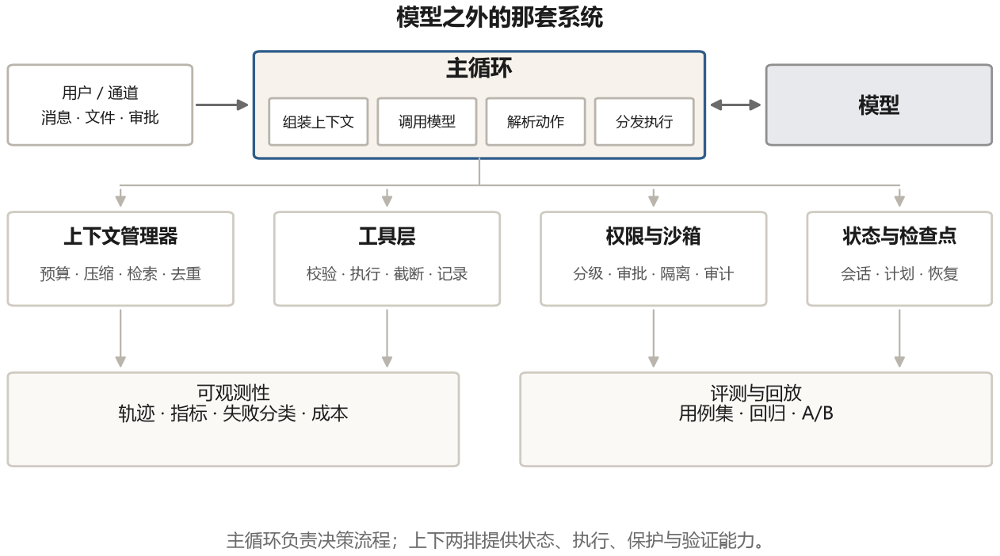
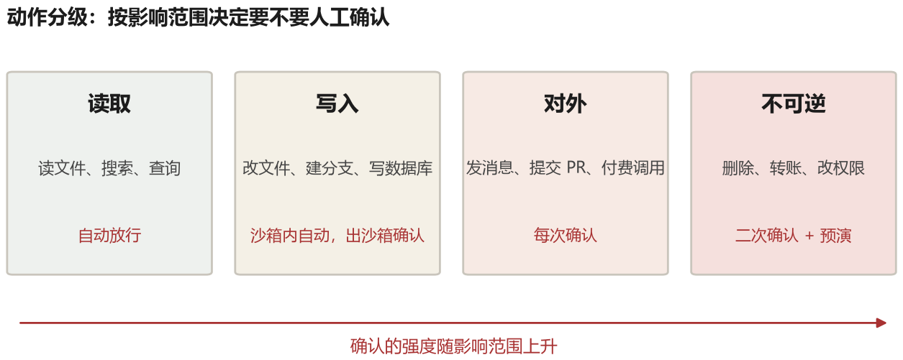

# 第 11 章 Harness：模型外面那层壳

2025 年之后，harness 这个词在 Agent 工程讨论中越来越常见。harness 原意是马具；在 agent 语境里，它指模型之外的一整套运行支撑系统：循环、工具执行、上下文管理、权限、沙箱、日志和错误处理。

为什么这个词重要？因为同一个模型接入不同的运行系统，基准成绩、成本和失败类型可能明显不同。模型厂商公布成绩时使用的工具、提示和循环，与第三方简单实现可能并不一样。只有固定模型和任务，逐项替换 harness 组件，才能判断差异来自哪里。

这一章把 harness 拆开，看它到底由哪些部分组成，每一部分解决什么问题，以及为什么它值得被当成一门正经的工程来做。

## 11.1 一个思想实验

设想两个团队用同一个模型做同一件事：修 GitHub issue。

团队 A 的做法：把 issue 描述和仓库打包，让模型输出一段 patch，应用，跑测试。失败就重来一次，把测试报错贴回去。

团队 B 的做法：给模型一套命令（打开文件、搜索、按行编辑），每次编辑后做语法检查，提示里带着仓库的目录结构和常用命令，上下文超过阈值时把早期内容摘要，跑测试失败时只把失败的那几个用例和对应的代码片段给它，连续三次相同失败就提示它换思路。

在这个思想实验里，B 更有机会获得清晰反馈并避免重复失败，但“两三倍”不是预先可断言的结果。差别不在某句魔法提示，而在**模型每一步能看到什么、能做什么、做完之后得到什么反馈**。这三件事合起来就是 harness，实际收益要用同一批任务测量。

所以 harness 的定义可以更精确一点：它是那个把“文本生成”变成“闭环控制”的系统。模型是控制器，工具是执行器，环境是被控对象，harness 是它们之间的接线、传感器、限幅器和保护电路。

## 11.2 主循环



图 11-1 是一个比较完整的 harness 结构。从中间往两边看。

中间是**主循环**。它做四件事：组装上下文、调用模型、解析输出、分发动作。听起来和第二章那个最小循环一样，但工程化之后每件事都有很多细节。

**组装上下文**：不是简单拼接，而是要按预算分配（第八章）、要做去重、要做格式规范化、要处理多模态内容（截图、文件附件）。这一层通常是整个系统里代码最复杂的部分。

**调用模型**：要处理流式输出（用户要能看到进度）、超时、限流、重试、以及模型服务端的各种异常（内容过滤、上下文超限、工具调用格式错误）。还要记录 token 消耗，用于计费和预算控制。

**解析输出**：结构化工具调用比文本解析可靠得多，但仍然要处理“模型想调一个不存在的工具”、“参数类型不对”、“一次返回了五个调用但其中两个冲突”这些情况。

**分发动作**：单个动作直接执行；多个动作要判断能否并行；有依赖的要排序；危险动作要过权限层。

主循环还有一个常被忽略的职责：**中断处理**。用户随时可能按下停止，或者插一句话改变需求。harness 要能在动作执行到一半时安全地停下来，保留状态，接受新指令。这在流式交互的产品里是必须的，做不好会让用户觉得“这东西不听使唤”。

### 主循环写成代码是什么样

前面讲的四件事（组装上下文、调用模型、解析动作、分发执行），落到代码上大概是这样。省略了错误处理的细节，但骨架是完整的：

```python
def run(task, budget=2.0, max_steps=40):
    ctx = Context(budget_usd=budget)          # 管理消息、token 预算、压缩
    ctx.add_system(SYSTEM_PROMPT)
    ctx.add_user(task)
    state = {"step": 0, "failures": []}

    while state["step"] < max_steps:
        state["step"] += 1

        if ctx.over_budget():                  # 预算兜底
            return "预算用完，未完成"

        ctx.compact_if_needed()                # 超过阈值就先压缩
        reply = llm(ctx.messages(), tools=TOOLS)   # ① 调模型（含超时、重试）

        ctx.add_assistant(reply.text)
        kind, payload = parse(reply)           # ② 解析

        if kind == "final":
            checkpoint(state, ctx); return payload

        if kind == "error":
            ctx.add_user(f"格式错误：{payload}，请重试")
            continue

        for call in payload["calls"]:          # ③ 分发（可能并行）
            if not permitted(call):            # 权限层
                ctx.add_tool_result(call.id, "没有权限执行这个操作")
                continue
            try:
                out = execute(call, timeout=TOOL_TIMEOUT[call.name])
            except TimeoutError:
                out = "执行超时，已终止"
            except Exception as e:
                out = f"工具报错：{e}"
            ctx.add_tool_result(call.id, truncate(out, 2000))   # ④ 写回

        checkpoint(state, ctx)                 # 每步落盘，崩溃可恢复

    return "达到步数上限，未完成"
```

对着这段代码看，前面讲的那些“工程细节”就有了位置：`ctx.compact_if_needed()` 是第八章的上下文管理；`permitted(call)` 是这一章第五节的权限；`truncate(out, 2000)` 是工具层的整形；`checkpoint` 是第四节的恢复；`over_budget()` 是成本控制。一个能跑长任务的 harness，就是把这些看起来琐碎的检查塞进一个循环里。

## 11.3 工具层

工具层是模型和世界之间的唯一通道，它的质量直接决定 agent 的能力上限。

### 一次调用要经过八道关

模型输出的只是一句“我要调用 read_file，参数是 notes.md”。从这句话到真正读到文件，中间要经过八个环节。用一个具体例子走一遍：模型请求读取 `/work/notes.md`。

```text
① 找到工具      在注册表里查名字。查不到就直接回“没有这个工具”，不抛异常
② 校验参数      对照 schema 检查类型和必填项；只接受无歧义的规范化，否则返回错误
③ 规范化        path 里有没有 ../ 想跳出工作目录？统一成绝对路径再检查一次
④ 权限判定      这个会话允许读文件吗？属于低风险还是需要用户确认？
⑤ 执行          交给实际函数，带超时。超时要连同子进程一起杀掉
⑥ 整形          结果 8000 字？截到 2000 字，并注明“已截断，还有 6000 字”
⑦ 计量          记下耗时、token 数、是否失败，累加进本次任务预算
⑧ 写回          包成一条 tool 消息追加到上下文，等下一轮模型调用
```

八道关里任何一道出错，都必须是“可读的错误”，而不是一个异常堆栈。因为下一步读这段文字的是模型，它要靠这段文字决定怎么改。

### 每一步容易出什么问题

第 ② 步最常见：数字给成字符串、布尔值给成 `"true"`，或者数组变成逗号分隔文本。可以在**含义无歧义**时做规范化，例如把 `"3"` 转成整数 3；不能把任意非空字符串都当成 true，也不能悄悄截断数组。无法确定时，返回“哪个字段、期望什么、实际收到什么”，让模型修正。

第 ③ 步是安全线。`../../etc/passwd` 这种路径必须挡掉；符号链接指向工作目录外面也要挡掉。只做字符串前缀检查是不够的，要先把路径解析成绝对路径（`realpath`）再比较。

第 ④ 步是产品体验的分界线。同样是读文件，读 `/work` 里的和读 `~/.ssh` 里的，风险完全不同；同样是调用 git，`status` 和 `push` 也不是一个量级。分级的依据是“影响范围”，不是“工具名字”。

第 ⑤ 步的超时要按工具类型设。搜索接口 10 秒，编译 5 分钟，都不是一个数能概括的。超时之后要确保子进程被真正杀掉，不然会积累僵尸进程。

第 ⑥ 步要有明确的截断策略和截断提示。如果输出被截断，必须告诉模型“后面还有内容”，否则它会以为看到的就是全部。常见的做法是保留头尾、中间省略，或者在截断时提示“用更精确的参数重试”。

第 ⑦ ⑧ 步看似琐碎，但在调试时价值最高。一条完整的工具调用记录应该包含：谁发起的、参数是什么、执行了多久、返回了什么、有没有被截断、有没有报错。有了这些，才能回答“它为什么这么做”。

## 11.4 状态与恢复

一个跑三小时的 agent，中途很可能遇到网络、模型服务、进程或用户中断等问题。

没有状态持久化的 agent，遇到这些只能从头再来。有状态持久化的 agent，可以从最后一个检查点继续。

需要持久化的东西包括：对话历史、工具调用记录、当前计划、工作目录的快照或版本标识，以及外部系统标识（比如已经创建的工单号）。最后这类标识尤其重要，否则恢复后可能重复创建对象。

检查点的粒度是个权衡。每一步都存，开销大但恢复精确；每十步存一次，开销小但可能丢掉一段工作。实践中通常按“重要动作”存：写完一个文件、提交一次修改、完成一个子任务。

还有一类恢复更难：**外部世界的状态已经变了，但 agent 不知道**。比如它正在等一个异步任务完成，恢复之后那个任务早就结束了；或者它修改了一个文件，恢复之后文件被别人改过。这类问题没有通用解法，只能在设计时尽量避免长时间挂起，并且在做修改前检查前置条件。

## 11.5 权限

这是 harness 里最容易被低估、出事最严重的部分。

一个 agent 能做的事，等于它所有工具能力的并集。如果它有 shell，它就能删库；如果它有浏览器并且带着登录态，它就能以你的身份发消息；如果它有云平台凭据，它就能开机器花钱。

权限设计的第一条原则是**最小权限**：默认不给，按任务授予，范围尽可能窄。文件系统只开放需要的目录，API 只给必要的权限范围（scope），网络只放行必要域名。工作目录本身不是安全边界，还要做路径解析和操作系统级隔离。

第二条原则是**分级审批**。把所有动作按风险分级，低风险的自动执行，中风险的事后可见，高风险的执行前确认。



图 11-2 是一个常见的四级划分，但级别不能只看动作名字。读取公开文档通常低风险，读取私钥或完整邮箱同样是“读”，却可能高风险。低风险只读操作可自动放行；沙箱内、可回滚的写入可自动或按需确认；发消息、提交 PR、调用付费接口等对外副作用通常执行前确认；删除数据、转账、改权限等不可逆操作需要更严格策略，必要时由另一名授权者复核。

**预演**（dry-run）是“只计算将要发生什么，不真正执行”，例如显示将删除的三个文件或将支付的金额。审批界面要把主体、资源、关键参数、数据去向和风险写清楚，不能只问一句“允许这个工具吗”。预演本身也必须足够可信，否则只是另一种形式上的确认。

第三条原则是**可审计**。每个动作都要有记录：谁批准的、什么时候、参数是什么。出事之后能追溯，这既是安全需要，也是调试需要。

第四条原则是**默认拒绝未知**。模型可能会发明一个不存在的工具名，或者传入一个没见过的参数。这些都应该被拒绝并返回明确错误，而不是“尽力而为”地执行。

## 11.6 可观测性

调试一个 agent，和调试一个普通程序完全不同。普通程序的 bug 可以复现，agent 的行为带随机性，同一个输入两次运行可能走完全不同的路径。所以你需要的是“事后能看清发生了什么”，而不是“能下断点”。

一套基本的可观测性包括：

**轨迹（trace）**。每一步的完整记录：输入给模型的上下文（或者它的摘要和哈希）、模型输出、解析出的动作、动作结果、耗时和 token 数。轨迹要能导出、回放和对比；其中可能含用户数据和密钥，保存前还要脱敏并设置访问权限。

**指标（metrics）**。任务成功率、平均步数、平均 token 消耗、工具调用失败率、重试率、人工介入率。这些指标随时间的变化，比单次运行的结果更能说明系统在变好还是变坏。

**失败分类**。把失败按原因归类：模型判断错、工具报错、格式错误、超时、权限拒绝、达到预算上限。不同原因的修法完全不同，混在一起看只会得出“模型不行”这种没用的结论。

**成本归因**。按任务、按用户、按工具统计花费。有些 agent 的账单会突然飙升，通常是因为某个任务陷入了循环，或者某个工具的返回特别大。

## 11.7 harness 是可以被评测的

这一章最想强调的一点是：**harness 的每一处设计，都应该能被数据检验。**

举几个可以做的实验。

改一条系统提示的措辞，跑同一批任务，看成功率和失败类型变化。这是 harness 的 A/B 对比：A 是原版本，B 是只改一个变量的新版本。样本量和重复次数要足以区分真实变化与随机波动。

改工具返回的截断长度，从 2000 token 改到 5000 token，看成功率怎么变。通常存在一个最优点，太短丢信息，太长稀释注意力。

改上下文压缩的触发阈值，看长任务的成功率。压得太早丢细节，压得太晚爆窗口。

改重试策略，从“失败就重试”改成“失败先分析再重试”，看重复失败率。

这些实验的前提是你有一个**可重复的评测集**，以及一套能跑的自动化。第十五章会讲怎么造评测集，这里只说结论：没有评测的 harness 调优，就是在凭感觉改代码。

## 11.8 一个具体实验：上下文是不是越多越好

不要先断言“局部上下文一定更好”，把它做成一个可重复的比较实验。任务是修复长文件中的一个小 bug，使用同一个模型、同一批任务和相同工具。

- **版本 A**：每次编辑前，把整个文件放进上下文。
- **版本 B**：先给文件结构摘要（函数名和行号），再给改动位置前后各 30 行；模型需要时可以主动请求更多内容。

两版都记录任务成功率、输入 token、延迟、误改行数和额外读取次数。可能出现的结果不是单一的：长文件、局部修改中，B 可能减少干扰和成本；如果 bug 涉及相距很远的多个函数，A 或“B 主动扩展读取”可能更可靠。局部窗口太小，也会丢掉必要定义和调用关系。

因此，更好的设计通常不是永远少给，而是**先给结构，再给相关局部，并保留可追踪的扩展入口**。程序要记录模型读过哪些区间，避免它在不知道全文结构时误称“整个文件都没有问题”。

这个实验要检验的不是“信息越少越好”，而是“哪些信息对下一步有用，缺失的信息能否按需取回”。这正是第八章上下文工程和本章 Harness 的交界。

## 11.9 harness 与模型的共同演化

最后要说一个趋势。

2023 年，harness 需要替模型做很多事：教它格式、帮它拆解任务、纠正它的错误、给它补上它不会的能力。那时候的 harness 更像一个“扶着孩子走路”的支架。

随着模型规划和工具使用能力增强，harness 的重心也在变化：少一些替模型规定每一步怎么想的技巧，多一些安全环境、可靠状态、真实反馈和错误兜底。不同模型能力差异很大，不能假设所有模型都已经会自主规划和检查。

这个转移有个直接后果：**harness 里那些“聪明”的技巧会过时，而那些“结实”的机制会留下来。** 精心设计的提示模板可能下个模型版本就不需要了，但沙箱、检查点、权限、审计这些东西，换多少代模型都得有。

所以如果你要投入时间做 harness，优先做那些和模型能力无关的部分。
