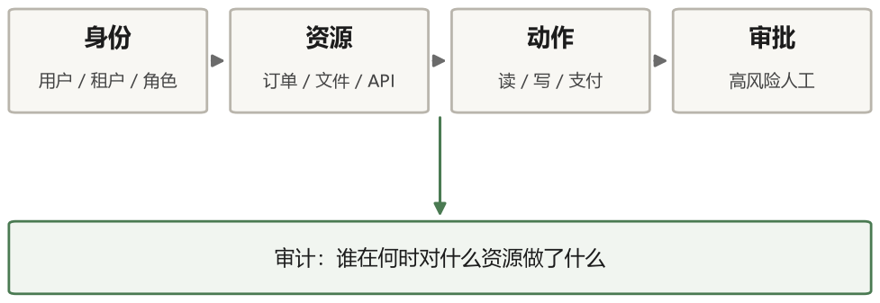

# 第 4 章 权限、身份与沙箱

## 4.1 权限不是提示词

系统提示里写“不要访问其他客户的数据”，不是权限控制，只是行为建议。真正的权限控制要求：即使模型被诱导、被注入或直接忽略提示，程序仍然拒绝越权动作。

权限至少包含三部分：

- **身份**：这次动作代表谁；
- **资源**：能操作哪些文件、表、API、目录；
- **动作**：能读、写、删除、发送、支付，还是只能查询。

## 4.2 身份传播

一个 Agent 可能同时代表：

- 终端用户；
- 一个服务账号；
- 一个租户；
- 一个后台任务。

这些身份不能混在一起。用户让 Agent 查订单，Agent 不应该用管理员账号绕过用户权限；定时任务也不应该继承某个员工的全部权限。

请求上下文应携带明确的身份范围：

```json
{
  "tenant_id": "t-42",
  "user_id": "u-108",
  "roles": ["support"],
  "scopes": ["orders:read", "refunds:submit"],
  "task_id": "task-017"
}
```

工具执行时使用这个上下文，而不是让模型在参数里自由填写 `tenant_id`。

## 4.3 最小权限

默认拒绝，按任务授予：

- 只读任务不授予写权限；
- 只处理一个订单，不授予全表查询；
- 只访问指定目录，不挂载整个磁盘；
- 只访问必要域名，不开放任意网络；
- 凭据使用短时 token 或按任务 scope，不把长期密钥放进提示。

任务结束后回收临时权限。不要让一次授权永久留在环境中。



## 4.4 沙箱的边界

代码执行、浏览器操作和命令行需要隔离。一个“限定工作目录 + 命令白名单”的实现只能降低部分风险，不能自动成为安全沙箱；路径穿越、子进程、网络访问和系统调用仍可能绕过。

一个更完整的执行环境要考虑：

| 资源 | 控制 |
| --- | --- |
| 文件系统 | 只挂载工作目录，禁止访问宿主敏感路径 |
| 网络 | 默认关闭，按域名/端口放行 |
| 进程 | CPU、内存、时间、子进程限制 |
| 凭据 | 只注入当前任务需要的短时凭据 |
| 输出 | 限制大小，敏感信息脱敏 |

## 4.5 审批

高风险动作不应只靠“模型觉得自己可以”。审批界面要展示：

- 谁在请求；
- 要操作什么资源；
- 关键参数和金额；
- 数据会发往哪里；
- 是否可撤销；
- 请求的有效期。

预演（dry-run）可以先展示“将发生什么”，但不真正执行。对不可逆操作，审批还要确认执行后的补偿方案。

## 4.6 读也可能高风险

读取公开文档通常低风险；读取私钥、完整客户资料、内部财务表，同样是“读”，却可能造成泄露。权限分级不能只看动作名称，还要看数据敏感度和数据去向。

一个只读 Agent 仍然可能把敏感内容粘进回答、写进日志或发送到外部 URL。只读权限必须和可读范围、输出过滤、网络出口一起设计。

## 4.7 失败模式

**在提示词里做权限。** 注入内容可以诱导模型忽略规则。

**共用服务账号。** 所有用户共享一个高权限账号，审计时无法知道是谁做的。

**权限检查在生成后。** 文档已经进入上下文，模型可能已经复述。

**审批只问“允许吗”。** 没有资源、参数、金额和数据去向，用户无法做出有意义的判断。

**沙箱只限目录。** 没有网络和进程隔离，仍可能逃逸或外传数据。

## 4.8 本章的结论

权限是运行时属性，不是模型性格。身份要传播，资源要最小化，动作要分级，沙箱要限制文件、网络和进程，高风险动作要有人类可理解的审批。

模型被误导并不可怕，前提是它即使被误导，也拿不到不该拿的权限、读不到不该读的数据、做不了不可逆的动作。

## 4.9 一个审批记录

```json
{
  "approval_id": "apr-2291",
  "task_id": "task-017",
  "requested_by": "agent:task-017",
  "approver": "u-201",
  "action": "submit_refund",
  "resource": "order:A1023",
  "amount": 199.00,
  "currency": "CNY",
  "expires_at": "2026-11-17T12:00:00Z",
  "decision": "approved",
  "reason": "符合促销年付条款"
}
```

审批要有有效期和精确资源范围。批准“订单 A1023 的 199 元退款”不等于批准该用户之后的所有退款；审批不能变成一张无限期通行证。

## 4.10 凭据回收

任务结束、失败或取消时，回收临时凭据和沙箱。检查后台进程、临时文件和网络连接是否清理。长期凭据应放在受控密钥服务中，通过短时 token 换取，不进入提示、日志或检查点。
