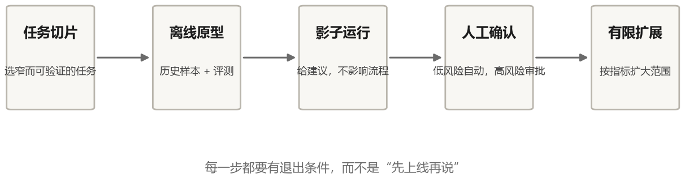

# 第 1 章 企业项目方法

## 1.1 先定义工作，不先选模型

企业项目最容易犯的错误，是从“我们用一个 Agent 吧”开始。正确的起点是当前工作流：

- 谁发起请求？
- 现在需要查哪些系统、问哪些人、填哪些表？
- 哪一步最耗时，哪一步最容易错？
- 最终结果交给谁，谁承担责任？
- 失败时业务会损失什么？

只有把现状画出来，才能判断 Agent 应该接手哪一段。一个“自动回答所有问题”的目标通常无法验收；“把客服的一线查询从 6 分钟降到 2 分钟，并把需要人工判断的比例控制在 20% 以下”才是可执行目标。

## 1.2 需求访谈的六个问题

1. 这件事现在怎样做？请演示一次真实流程。
2. 哪些输入是必须的，缺少时应该追问谁？
3. 哪些动作只是建议，哪些会改变外部系统？
4. 结果错了，最坏会发生什么？
5. 什么情况下必须停下来找人？
6. 上线后看哪三个数字判断是否有效？

访谈要拿到真实样本，而不是只听概括。一个客服主管说“经常查退款”，实际可能是查政策、查订单、查支付渠道三类不同任务，权限和工具完全不同。

## 1.3 数据清单

每个数据源至少记录：

```text
名称、所有者、类型（文档/数据库/API）
更新频率、版本字段、删除策略
敏感级别、租户/角色字段
是否有测试数据、数据量、质量抽检
```

不要等项目开始后才问“这份文档能不能给模型看”。权限和数据边界是需求的一部分。

## 1.4 权限矩阵

| 角色 | 可看订单 | 可看合同 | 可提交退款 | 可审批 |
| --- | --- | --- | --- | --- |
| 客服 | 自己负责的客户 | 否 | 小额 | 否 |
| 财务 | 全部 | 财务条款 | 是 | 小额 |
| 法务 | 否 | 全部 | 否 | 合同例外 |
| 管理员 | 是 | 是 | 是 | 是 |

Agent 的权限不能超过发起人的权限；后台任务使用独立服务身份，不能借用某个管理员账号。

## 1.5 里程碑

一个相对稳妥的交付路径：

1. **任务切片**：选一个高频、边界清楚、可验证的子任务；
2. **离线原型**：用历史样本跑通，不接生产写权限；
3. **影子运行**：在真实请求旁边给出建议，不影响业务；
4. **人工确认**：Agent 执行，人确认；
5. **有限自动**：低风险动作自动，高风险仍审批；
6. **扩展**：按评测结果增加任务类型。

每一步都要有退出条件。影子运行解决率不达标，不应该直接进入自动执行。



## 1.6 验收指标

指标分三层：

- 业务：处理时长、一次解决率、退款准确率、人工转接率；
- 任务：完成率、工具成功率、平均步数、失败分类；
- 技术：延迟、token、成本、权限拒绝、错误率。

指标必须有基线。没有“现在是多少”，就无法判断上线后是否真的改善。

## 1.7 本章的结论

企业 Agent 项目的起点是工作流和责任，不是模型选型。需求、数据、权限、验收和退出条件要在开发前写清楚；先做窄而可验证的任务，再扩展自主性。

## 1.8 项目路线与风险登记

```text
第 1—2 周：访谈、样本、权限矩阵
第 3—5 周：离线原型、评测集
第 6—8 周：影子运行
第 9—10 周：人工确认和小流量
第 11 周起：按指标决定是否扩大
```

风险登记至少包括：数据无法授权、正确率不足、工具无幂等、成本高于人工、业务无人验收、供应商锁定。每项风险要有负责人、触发条件和应对动作。

## 1.9 不该自动化的部分

涉及法律责任、不可逆财务动作、无授权数据、无法解释的高风险判断，应该保留人工决定。Agent 可以准备材料、检查规则和给出建议，但不能用“模型判断”替代责任主体。
